# Hito — Flujo Agéntico de RFPs: Aprobación y Cierre (Parte 3 de 3)

Antes de empezar: Lee tu [company-BRIEFING.md](https://github.com/4GeeksAcademy/ai-engineering-syllabus/tree/main/content/contexts/09-agentic-workflows) antes de escribir cualquier línea de código — allí están quién aprueba cada departamento (y cualquier aprobador extra que tu empresa exija), las reglas de arbitraje ante conflictos y el formato del documento final. No inventes una escalera jerárquica multi-nivel salvo que tu BRIEFING lo diga (p. ej. umbral de CEO); en la mayoría de empresas el sign-off es el responsable nombrado de cada departamento activo.

## 🎯 Tu reto
📌 Estás construyendo sobre tu copia del [monorepo](https://github.com/4GeeksAcademy/ai-engineering-company-project-monorepo) de la empresa seleccionada al inicio del curso — no en un repositorio nuevo.

En la Parte 2 cada departamento ya genera y autoevalúa su sección de la propuesta económica dentro del mismo ticket abierto en la Parte 1. Falta lo más delicado: que un humano de cada departamento dé el visto bueno antes de que el documento final salga hacia el cliente.

### Ticket — Aprobación humana y cierre del documento
**Contexto:** Ya generamos y autoevaluamos cada sección de la propuesta, pero nadie va a firmar una propuesta económica sin que un humano de cada departamento le dé el visto bueno. Esta es la última pieza del flujo que empezamos en la Parte 1 — y tiene que sentirse como una sola experiencia, no como tres proyectos pegados con cinta.

**Qué necesito que construyas:**
1. Antes de dar por aprobada la sección de un departamento, el flujo debe pasar por un punto de aprobación humana real — un human-in-the-loop, no solo un evaluador automático más.
2. El flujo debe detenerse justo antes de esa acción irreversible, guardar el estado con un checkpointer, y poder reanudarse exactamente donde quedó cuando llegue la aprobación — no reiniciar desde cero.
3. Esa pausa debe afectar solo la rama del departamento que está esperando aprobación; los demás departamentos que ya tengan su sección lista deben poder seguir avanzando en paralelo, no bloquearse entre sí.
4. Define un límite de iteraciones y un nodo de arbitraje explícito para los desacuerdos entre departamentos. Conéctalo a los triggers de conflicto y al árbitro fijo de tu BRIEFING (reglas o un humano nombrado — no un LLM “votando” entre agentes).
5. Cuando todos los departamentos den su sign-off, el documento final debe generarse solo, consolidando las secciones aprobadas.
6. Quiero poder ver, para cualquier ejecución, qué agente hizo qué y en qué orden, porque cuando algo salga mal en producción no vamos a tener tiempo de adivinar.

Cuando termines, corre el flujo completo de principio a fin — desde que se sube la RFP en la Parte 1 hasta que se genera el documento final aquí — y revisa que se sienta como un solo proceso: sin saltos de estado raros, sin mensajes que no coincidan entre partes, sin pasos que se rompan en la transición de una parte a otra.

**Acceptance criteria:** Una RFP puede recorrer las tres partes de punta a punta, pausarse para aprobación humana por departamento sin bloquear a los demás, y terminar en un documento final generado automáticamente, con trazabilidad completa de cada paso.
— *Tu tech lead*

---

## 📚 Conocimiento complementario: cuándo interrumpir y cuándo poner un guardrail
No todo control debe pausar el flujo para un humano. Los guardrails (validaciones automáticas de esquema, tipo o negocio) deben resolver solos los casos claros; reserva las interrupciones (interrupt) para decisiones que de verdad requieren juicio humano, como aprobar una propuesta económica antes de enviarla a un cliente. Y cuando interrumpas, hazlo de forma acotada: la interrupción debe pausar únicamente la rama del grafo que depende de esa aprobación (la sección de ese departamento y lo que dependa de ella), no el flujo completo — un departamento esperando el visto bueno de su gerente no debería frenar a los demás que ya están listos para avanzar.

### Estados del ticket para esta parte (misma fila — nombres del BRIEFING):
El ciclo completo está en el BRIEFING; aquí solo necesitas:

| Estado | Rol | Cuándo |
| :--- | :--- | :--- |
| `en_evaluación` / `needs_human_review` | Entrada Parte 2 | El ticket llega con borradores + EvaluationResult (incl. secciones al tope) |
| `esperando_aprobación` | Parte 3 escribe | Pausa humana mientras alguna aprobación de departamento esté pendiente |
| `terminado` | Parte 3 escribe | Documento final guardado y accesible |

*No inventes estados huérfanos; conserva valores previos de Parte 1/2 en la misma fila cuando no estés en transición.*

---

## 🗺️ Referencia visual: tickets de aprobación y síntesis del documento final
Cuando los tickets de asignación por departamento de la Parte 2 están totalmente aprobados, un ultimate document synthesizer compila el documento final acordado y lo entrega a Ventas — las ramas por departamento aprueban de forma independiente y luego convergen:

```mermaid
flowchart LR
    %% Entrada Estructurada
    subgraph Input ["Entrada"]
        WS["DEFINED WORKSTREAM<br/>STRUCTURE & META-INFO"]
    end

    %% Orquestador de Asignación
    AO["ASSIGNMENT ORCHESTRATOR<br/><i>(Orchestrator)</i>"]
    WS --> AO

    %% Departamentos y Tareas Asignadas
    subgraph Departments ["Departamentos y Tareas"]
        direction TB

        subgraph DeptSales ["DEPARTMENT: SALES"]
            direction TB
            S1["☑ Value Proposition Definition"]
            S2["☑ Pricing & Commercial Terms"]
            S3["☑ Client Relationship Strategy"]
            S4["☑ Comms & Sales"]
        end

        subgraph DeptLegal ["DEPARTMENT: LEGAL & COMPLIANCE"]
            direction TB
            L1["☑ Terms & Conditions Review"]
            L2["☑ Regulatory Alignment"]
            L3["☐ Contract Generation"]
            L4["☐ ..."]
        end

        subgraph DeptOps ["DEPARTMENT: OPERATIONS & DELIVERY"]
            direction TB
            O1["☑ Resource Allocation"]
            O2["☑ Timeline & SLA Definition"]
            O3["☐ Timeline Allocation"]
            O4["☐ Contract Operations"]
            O5["☐ Solution Design Validation"]
        end
    end

    AO --> DeptSales
    AO --> DeptLegal
    AO --> DeptOps

    %% Tickets de Asignación y Aprobación Humana
    subgraph ApprovalTickets ["Department-specific assignment and approval tickets"]
        direction TB

        subgraph TicketSales ["SALES ASSIGNMENT TICKET: For Approval"]
            direction TB
            TS_Dept["Department: Sales"]
            TS_Content["Assigned Content: [Brief summary of tasks]"]
            TS_Status["APPROVAL STATUS:<br/><b>[X] Approved</b>  [ ] Rejected"]
        end

        subgraph TicketLegal ["LEGAL & COMPLIANCE ASSIGNMENT TICKET: For Approval"]
            direction TB
            TL_Dept["Department: Legal"]
            TL_Content["Assigned Content: [Brief tasks]"]
            TL_Status["APPROVAL STATUS:<br/><b>[X] Approved</b>  [ ] Rejected"]
        end

        subgraph TicketOps ["OPERATIONS & DELIVERY ASSIGNMENT TICKET: For Approval"]
            direction TB
            TO_Dept["Department: Operations & Delivery"]
            TO_Content["Assigned Content: [Brief summary of tasks]"]
            TO_Status["APPROVAL STATUS:<br/><b>[X] Approved</b>  [ ] Rejected"]
        end
    end

    DeptSales --> TicketSales
    DeptLegal --> TicketLegal
    DeptOps --> TicketOps

    %% Sintetizador Final
    UDS["ULTIMATE DOCUMENT SYNTHESIZER<br/><i>(Final Synthesizer)</i><br/><small>Once all department assignment tickets<br/>are fully approved [X], the Ultimate<br/>Document Synthesizer compiles<br/>the final agreed-upon document</small>"]

    TicketSales --> UDS
    TicketLegal --> UDS
    TicketOps --> UDS

    %% Documento Final Acordado
    DOC["FINAL AGREED-UPON<br/>DOCUMENT<br/><i>(Propuesta Económica Final)</i>"]
    UDS --> DOC

    %% Destinatario Final
    RECIPIENT["SALES TEAM<br/><i>(Recipient)</i>"]
    DOC --> RECIPIENT
```

---

> 🔀 **PR aprobado → haz merge a `main`.** Si no, la funcionalidad no se despliega y tu siguiente rama parte de código desactualizado, lo que acaba en conflictos de merge.

---

## 🌱 Cómo Empezar el Proyecto

Continúa sobre tu rama del Hito en el fork del monorepo de tu empresa, a partir de donde entregaste la Parte 2. Si todavía no tienes tu fork, créalo desde el monorepo base.

1. Crea la rama `feature/rfp-approval-completion` a partir de tu rama de la Parte 2.
2. Configura el checkpointer que corresponda a tu entorno (SQLite o Postgres — evita el checkpointer en memoria salvo en desarrollo local).
3. Instala cualquier dependencia nueva con `uv add`.
4. Revisa tu `company-BRIEFING.md` para conocer los aprobadores por departamento, los triggers de conflicto / árbitro fijo, y el formato del documento final.

---

## 💻 Lo Que Debes Hacer

### Aprobación humana por departamento
- [ ] Implementa un punto de interrupción (`interrupt`) antes de dar por aprobada la sección de cada departamento.
- [ ] La interrupción debe pausar únicamente la rama del grafo correspondiente a ese departamento, sin bloquear el avance de los departamentos que ya están listos.
- [ ] Persiste el estado del flujo con un checkpointer antes de cada interrupción, para que la ejecución sea reanudable.
- [ ] Implementa el `resume` como un punto de entrada explícito del grafo — no como un reinicio del flujo completo.
- [ ] Valida la respuesta humana al reanudar (aprobar, rechazar o solicitar cambios) antes de dejarla entrar de nuevo al grafo.
- [ ] Extiende la interfaz de ticket construida en la Parte 1 (`uis/backoffice`) para que cada departamento pueda registrar su aprobación o rechazo.

### Guardrails y control de flujo
- [ ] Define un límite máximo de iteraciones en cualquier ciclo restante entre departamentos.
- [ ] Implementa un nodo de arbitraje explícito que dispare ante los triggers de conflicto de tu BRIEFING y resuelva con el árbitro fijo allí (humano nombrado o regla determinista — no freestyle de LLM entre agentes).
- [ ] Registra en el estado, para cada ejecución de nodo, el agente, el input, el output y el timestamp (trazabilidad).

### Identidad del checkpointer
- [ ] Haz namespacing del `thread_id` de cada ejecución del grafo por `ticket_id` (y por departamento si checkpointeas ramas por separado), p. ej. `rfp-{ticket_id}` o `rfp-{ticket_id}:{department}` — tickets concurrentes no deben compartir checkpoint.

### Cierre del documento
- [ ] Cuando todos los departamentos dan su aprobación, genera el documento final consolidando las secciones aprobadas.
- [ ] Mientras alguna aprobación de departamento esté pendiente, pon el ticket en `esperando_aprobación`; cuando el documento final esté guardado, ponlo en `terminado` y déjalo accesible.

### Revisión de extremo a extremo
- [ ] Corre al menos una RFP de prueba a través de las tres partes completas (recepción → generación → aprobación y cierre) y confirma que los estados del ticket, los mensajes y los datos se mantengan consistentes de principio a fin.
- [ ] Entrega una ruta E2E reproducible: fixture + script o test de integración que ejecute la Parte 3 con aprobaciones simuladas (`resume` programático / equivalente) — la revisión no debe depender solo de clicks irreproducibles en la UI.
- [ ] Corrige cualquier salto, mensaje inconsistente o dato que se pierda en la transición entre partes.

> ⚠️ **IMPORTANTE:** Los aprobadores por departamento, los triggers/árbitro de arbitraje y el formato del documento final deben coincidir con tu `company-BRIEFING.md`. Una implementación genérica que ignore el contexto no será aceptada.

### Pruebas
- [ ] Incluye pruebas unitarias en `tests/pipelines/` que cubran: interrupción y reanudación exitosa, límite de iteraciones alcanzado, y arbitraje ante desacuerdo.
- [ ] Incluye un test (o aserción sobre el trace) que apruebe el departamento B mientras el departamento A sigue interrumpido — demuestra ramas paralelas, no paralelismo fingido en serie.
- [ ] Incluye un test de integración / E2E o script con fixtures y resumes humanos simulados en el camino de la Parte 3 (idealmente Partes 1→3 con estado sembrado).

---

## 🧭 Preguntas de Diseño
- **¿Qué pasa si un departamento rechaza su sección después de la interrupción?** ¿El flujo vuelve al generador de la Parte 2 o requiere una nueva ejecución?
- **¿Qué información mínima necesita ver un humano en el punto de aprobación para decidir con confianza, sin tener que releer todo el documento?**
- **¿Cómo detectas los triggers de conflicto del BRIEFING en estado estructurado (no solo texto libre), para que el nodo de arbitraje sea real y no decorativo?**

---

## ✅ Lo Que Evaluaremos
- [ ] El flujo se pausa correctamente antes de la aprobación de cada departamento y persiste su estado.
- [ ] La pausa afecta solo la rama del departamento correspondiente — los demás pueden seguir sin bloquearse (probado con test/trace: aprobar B mientras A sigue interrumpido).
- [ ] La ejecución se reanuda exactamente desde el punto de interrupción, sin reiniciar el flujo completo.
- [ ] El `thread_id` está namespaced por ticket (y departamento si aplica); ejecuciones concurrentes no comparten checkpoint.
- [ ] Existe un límite de iteraciones aplicado y verificable en el código, no solo mencionado.
- [ ] El nodo de arbitraje dispara ante los triggers de conflicto del BRIEFING y resuelve con el árbitro fijo del BRIEFING (no freestyle de LLM).
- [ ] Cada ejecución de nodo queda registrada con agente, input, output y timestamp.
- [ ] El documento final se genera automáticamente solo cuando todos los departamentos han dado su aprobación.
- [ ] El ticket usa `esperando_aprobación` mientras el HITL esté pendiente y `terminado` cuando el documento final sea accesible.
- [ ] Existe una ruta E2E/fixture reproducible (script o test de integración con aprobaciones simuladas), no solo una demo manual en UI.
- [ ] Una RFP de prueba puede recorrerse de principio a fin (Parte 1 a Parte 3) sin saltos de estado ni inconsistencias visibles entre partes.
- [ ] Existen pruebas unitarias para la interrupción/reanudación, el límite de iteraciones, el arbitraje y la aprobación en paralelo bajo interrupt.

---

## 📦 Cómo Entregar
Esta es la Parte 3 de 3 del Hito. Entrégala con su propio Pull Request.

1. Haz commit y push de tu rama `feature/rfp-approval-completion`.
2. Abre un Pull Request describiendo qué implementaste y cómo probarlo.
3. Incluye en la descripción del PR un ejemplo completo: RFP de entrada, aprobación simulada por cada departamento, y el documento final generado — y enlaza el script/test de integración reproducible que ejecuta esas aprobaciones simuladas.
4. Solicita revisión a tu tech lead.

