# Hito — Flujo Agéntico de RFPs: Generación de Respuestas (Parte 2 de 3)

Antes de empezar: Lee tu [company-BRIEFING.md](https://github.com/4GeeksAcademy/ai-engineering-syllabus/tree/main/content/contexts/09-agentic-workflows) antes de escribir cualquier línea de código — allí están los lineamientos concretos contra los que deben validar tus agentes evaluadores.

## 🎯 Tu reto
📌 Estás construyendo sobre tu copia del [monorepo](https://github.com/4GeeksAcademy/ai-engineering-company-project-monorepo) de la empresa seleccionada al inicio del curso — no en un repositorio nuevo.

En la Parte 1 ya tienes un flujo que clasifica cada RFP y abre un ticket por cada una, dejándole claro a Ventas qué le toca a cada departamento. Ahora Ventas quiere ir un paso más allá: que ese análisis se convierta directamente en un primer borrador de la propuesta económica, revisado automáticamente antes de que un humano lo vea.

### Ticket — Generación y evaluación de respuestas a RFP
**Contexto:** La Parte 1 nos dice qué hay que responder en cada RFP, pero armar el borrador de la propuesta económica sigue siendo manual y lento. Necesito que el sistema genere un primer borrador por departamento y que ese borrador se autoevalúe antes de llegar a un humano.

**Qué necesito que construyas:**
1. Un agente generador por departamento que reciba los metadatos y el resumen producidos en la Parte 1, y redacte la sección correspondiente de la propuesta económica.
2. Varios agentes evaluadores corriendo en paralelo sobre cada sección generada: legibilidad (de nuevo, `py-readability-metrics` te sirve para esto), pertinencia respecto a lo que pide la RFP, y cumplimiento de nuestros lineamientos de empresa.
3. Si una sección falla la evaluación, que vuelva al generador correspondiente con feedback concreto sobre qué corregir — no que se quede atascada ni que se descarte el ticket completo.
4. Un límite de iteraciones para ese ciclo generador-evaluador, para que no se repita indefinidamente si un generador no logra pasar la evaluación. Si una sección agota ese límite sin pasar, conserva el último borrador y su resultado de evaluación, márcala `needs_human_review`, e inclúyela igual en el handoff a la Parte 3 — nunca descartes el ticket completo.
5. **Opcional:** si ya tienes montada la base de conocimiento semántica de la empresa, dale acceso al generador — que redacte con nuestras políticas y tono reales en lugar de improvisarlos ayuda mucho a que pase la evaluación de cumplimiento a la primera. No es indispensable para esta parte, pero si la tienes disponible, úsala.

**Acceptance criteria:** El handoff hacia la Parte 3 debe incluir, por cada departamento, tanto el contenido generado como un resultado de evaluación estructurado (ver schema abajo). Las secciones que agotaron el límite de iteraciones van con `needs_human_review` — no se eliminan.
— *Tu tech lead*

---

## 📚 Conocimiento complementario: cumplimiento de lineamientos
Cuando el ticket pide que un evaluador revise "cumplimiento de lineamientos de la empresa", no se refiere a un juicio de estilo libre: tu `company-BRIEFING.md` incluye una lista concreta de reglas (tono, datos que no pueden faltar, cifras que deben aparecer) contra la cual el evaluador debe verificar el contenido generado — no una opinión subjetiva del agente. Si tu empresa ya tiene una base de conocimiento semántica, es un buen lugar para que el generador busque políticas, precios de referencia o lenguaje de marca reales antes de redactar — reduce las veces que el evaluador rebota la sección por inventar algo que no coincide con lo que la empresa realmente dice. Esto es una mejora sugerida, no un requisito de esta parte.

### Estados del ticket para esta parte (misma fila que la Parte 1 — nombres del BRIEFING):
El ciclo completo está en el BRIEFING; aquí solo necesitas:

| Estado | Rol | Cuándo |
| :--- | :--- | :--- |
| `analisis_completo` | Entrada Parte 1 | Arranca aquí vía handoff de enrutamiento — no reescribas este estado |
| `generando_borrador` | Parte 2 escribe | Generadores escribiendo secciones |
| `en_evaluación` | Parte 2 escribe | Evaluadores en paralelo / ciclo generador-evaluador |
| `needs_human_review` | Parte 2 escribe | Límite de iteraciones agotado; último borrador + EvaluationResult pasan a Parte 3 |

*No inventes estados de Parte 3 (`esperando_aprobación`, `terminado`) en esta parte.*

---

## 🗺️ Referencia visual: mapeo departamental y finalización del entregable
Este tramo del flujo toma la estructura de workstreams definida en la Parte 1, mapea tareas a departamentos vía un assignment orchestrator, ejecuta generación por departamento en paralelo, y un synthesizer consolida las salidas en tickets de asignación por departamento listos para evaluación / aprobación:

```mermaid
flowchart LR
    %% Entradas
    subgraph Input ["Entrada Estructurada"]
        WS["DEFINED WORKSTREAM<br/>STRUCTURE & META-INFO"]
    end

    %% Orquestador de Asignación
    AO["ASSIGNMENT ORCHESTRATOR<br/><i>(Orchestrator)</i>"]
    WS --> AO

    %% Departamentos en Paralelo
    subgraph Departments ["Departamentos"]
        direction TB
        
        subgraph DeptSales ["DEPARTMENT: SALES"]
            direction TB
            S1["- Value Proposition Definition"]
            S2["- Pricing & Commercial Terms"]
            S3["- Client Relationship Strategy"]
            S4["- Comms & Sales"]
        end

        subgraph DeptLegal ["DEPARTMENT: LEGAL & COMPLIANCE"]
            direction TB
            L1["- Terms & Conditions Review"]
            L2["- Regulatory Alignment"]
            L3["- Contract Generation"]
        end

        subgraph DeptOps ["DEPARTMENT: OPERATIONS & DELIVERY"]
            direction TB
            O1["- Resource Allocation"]
            O2["- Timeline & SLA Definition"]
            O3["- Solution Design Validation"]
            O4["- Contract Operations"]
        end
    end

    AO --> DeptSales
    AO --> DeptLegal
    AO --> DeptOps

    %% Sintetizador Final
    FDS["FINAL DELIVERABLE<br/>SYNTHESIS<br/><i>(Synthesizer)</i>"]

    DeptSales --> FDS
    DeptLegal --> FDS
    DeptOps --> FDS

    %% Tickets de Asignación y Aprobación
    subgraph Deliverables ["Department-specific assignment and approval tickets"]
        direction TB
        
        subgraph TicketSales ["SALES ASSIGNMENT TICKET: For Approval"]
            direction TB
            TS_Dept["Department: Sales"]
            TS_Content["Assigned Content: Brief summary of tasks"]
            TS_Status["APPROVAL STATUS: [ ] Approved [ ] Rejected"]
        end

        subgraph TicketLegal ["LEGAL & COMPLIANCE ASSIGNMENT TICKET: For Approval"]
            direction TB
            TL_Dept["Department: Legal"]
            TL_Content["Assigned Content: Brief summary of tasks"]
            TL_Status["APPROVAL STATUS: [ ] Approved [ ] Rejected"]
        end

        subgraph TicketOps ["OPERATIONS & DELIVERY ASSIGNMENT TICKET: For Approval"]
            direction TB
            TO_Dept["Department: Operations & Delivery"]
            TO_Content["Assigned Content: Brief summary of tasks"]
            TO_Status["APPROVAL STATUS: [ ] Approved [ ] Rejected"]
        end
    end

    FDS --> TicketSales
    FDS --> TicketLegal
    FDS --> TicketOps
```



---

## 🔀 Flujo Git y Próximos Pasos
- **PR aprobado → haz merge a main.** Si no, la funcionalidad no se despliega y tu siguiente rama parte de código desactualizado, lo que acaba en conflictos de merge.

## 🌱 Cómo Empezar el Proyecto
1. **Rama de trabajo:** Continúa sobre la misma rama de trabajo del Hito en tu fork del monorepo (o crea `feature/rfp-response-generation` a partir de la rama donde entregaste la Parte 1). Si aún no tienes tu fork, créalo desde el [monorepo base](https://github.com/4GeeksAcademy/ai-engineering-company-project-monorepo).
2. **Reutilización:** Parte del flujo de clasificación y enrutamiento que construiste en la Parte 1 — no lo reescribas desde cero.
3. **Consumo de handoff:** Consume el handoff de enrutamiento de la Parte 1 — la Parte 2 debe arrancar desde tickets que la Parte 1 marcó listos (estado `analisis_completo` más el flag de cola / campo DB / contrato de handoff que definiste). Entrada = `ticket_id` + payload del synthesizer (`key_aspects` / estructura de workstreams). No vuelvas a parsear el PDF ni inventes un resumen paralelo que ignore ese contrato.
4. **Dependencias:** Instala cualquier dependencia nueva con `uv add`.
5. **Lineamientos de negocio:** Revisa nuevamente tu `company-BRIEFING.md`: allí están los lineamientos concretos contra los que deben validar tus agentes evaluadores.

---

## 💻 Lo Que Debes Hacer

### Consumir el enrutamiento de la Parte 1
- [ ] La entrada de la Parte 2 lee el handoff de enrutamiento de la Parte 1 (`ticket_id` + payload del synthesizer / `key_aspects`, vía el flag de cola, campo DB o contrato documentado de la Parte 1) — los generadores no deben re-ingerir el PDF crudo como input principal.

### Generación por departamento
- [ ] Implementa un agente generador por departamento que reciba el resumen relevante producido en la Parte 1 (desde ese handoff).
- [ ] El agente generador debe producir contenido específico para la sección de propuesta económica de su departamento.

> **💡 Opcional:** Si tu empresa ya tiene una base de conocimiento semántica, puedes darle acceso al generador para que redacte con políticas y lenguaje de marca reales. No es un requisito de esta parte ni se evalúa como tal — es una mejora que puede reducir cuántas veces una sección rebota en la evaluación.

### Evaluación en paralelo
- [ ] Implementa múltiples agentes evaluadores que corran en paralelo sobre cada sección generada.
- [ ] Al menos un evaluador debe revisar legibilidad (se sugiere `py-readability-metrics`).
- [ ] Al menos un evaluador debe revisar pertinencia (que el contenido responda lo que pide la RFP).
- [ ] Al menos un evaluador debe revisar cumplimiento de los lineamientos definidos en tu `company-BRIEFING.md`.
- [ ] Persiste la evaluación de cada sección como un `EvaluationResult` estructurado (los nombres de campo pueden variar un poco; la forma debe ser equivalente):

```yaml
EvaluationResult:
  section_id / department_id
  readability: { pass, score, details }
  relevance: { pass, missing_aspects[] }
  compliance: { pass, rule_ids[], violations[] }
  overall_pass: bool
  feedback_for_generator: string # concreto y accionable
```

### Ciclo generador-evaluador
- [ ] Si una sección falla la evaluación, el flujo debe devolverla al agente generador correspondiente junto con el `feedback_for_generator` del `EvaluationResult`.
- [ ] Define y aplica un límite de iteraciones para evitar que el ciclo generador-evaluador se repita indefinidamente.
- [ ] Cuando se agota el límite sin pasar: conserva el último borrador + su `EvaluationResult`, marca la sección (y el ticket si aplica) como `needs_human_review`, e inclúyela igual en el handoff a la Parte 3 — no descartes el ticket.

### Estado del ticket
- [ ] Actualiza el ticket creado en la Parte 1 (desde `analisis_completo`) para reflejar el progreso de la generación y evaluación (`generando_borrador`, `en_evaluación`, `needs_human_review`). Persiste borradores y `evaluation_results` en PostgreSQL. Sigue sin crear un API nuevo: extiende el backend existente y el pipeline bajo `data/pipelines/`.

> ⚠️ **IMPORTANTE:** Los lineamientos de la empresa contra los que evalúas el contenido generado, y el formato esperado de cada sección, deben coincidir con lo especificado en tu `company-BRIEFING.md`. Una implementación genérica que ignore el contexto no será aceptada.

### Pruebas
- [ ] Incluye pruebas unitarias en `tests/pipelines/` para al menos un agente generador y un agente evaluador, incluyendo un caso donde la evaluación falla.
- [ ] Añade un caso de fallo de compliance anclado a una regla de tu `company-BRIEFING.md` (p. ej. un borrador que promete algo que los lineamientos prohíben → `compliance.pass == false`). Mantenlo pequeño: un fixture, una aserción de fallo — no hace falta el ciclo completo para este caso.

---

## 🧭 Preguntas de Diseño
- **¿Qué información del estado necesita realmente cada agente evaluador?** ¿Le estás pasando solo la sección que debe revisar o el documento completo?
- **¿Cómo evitas que dos evaluadores en paralelo entren en conflicto al escribir su resultado en el estado compartido?**
- **Cuando una sección llega a `needs_human_review` tras agotar iteraciones, ¿cómo se lo muestras a Ventas para que sepa qué borrador es provisional?**
- **¿El feedback que recibe el generador tras un fallo es lo suficientemente específico como para corregir el problema real, o es genérico?**

---

## ✅ Lo Que Evaluaremos
- [ ] Cada departamento tiene su propio agente generador, claramente separado de los demás.
- [ ] La Parte 2 consume el handoff de enrutamiento de la Parte 1 (`ticket_id` + payload synthesizer / `key_aspects`) — no re-parsea el PDF como input principal del generador.
- [ ] Los evaluadores corren en paralelo y no bloquean la ejecución de otros departamentos entre sí.
- [ ] El sistema aplica correctamente el ciclo generador-evaluador, incluyendo el límite de iteraciones y el handoff `needs_human_review` al agotarlo.
- [ ] El ticket refleja con precisión el progreso de generación y evaluación en tiempo real.
- [ ] La salida de evaluación sigue la forma `EvaluationResult` (legibilidad / pertinencia / compliance estructurados — no texto libre sin estructura).
- [ ] Los borradores y `evaluation_results` se persisten en PostgreSQL; sigue habiendo un solo API backend bajo `services/` (sin un segundo servicio HTTP).
- [ ] Existen pruebas unitarias que cubren éxito, un fallo genérico de evaluación, y un fallo de compliance anclado al BRIEFING.
- [ ] La implementación usa los lineamientos y formatos definidos en el `company-BRIEFING.md` de tu empresa.

---

## 📦 Cómo Entregar
Esta es la Parte 2 de 3 del Hito. Entrégala con su propio Pull Request — no esperes a tener la Parte 3 lista.

1. Haz commit y push de tu rama `feature/rfp-response-generation`.
2. Abre un Pull Request describiendo qué implementaste y cómo probarlo.
3. Incluye en la descripción del PR un ejemplo de sección generada: uno que pase evaluación y uno que falle.
4. Solicita revisión a tu tech lead.


