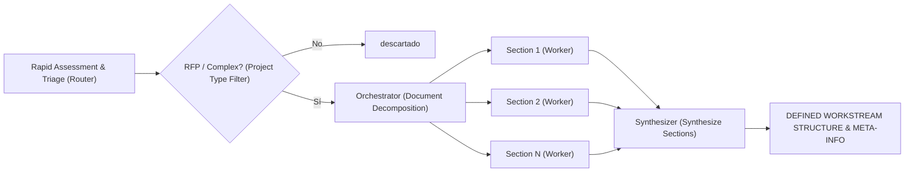

# Hito — Flujo Agéntico de RFPs: Recepción y Enrutamiento (Parte 1 de 3)

Antes de empezar: Lee tu [company-BRIEFING.md](https://github.com/4GeeksAcademy/ai-engineering-syllabus/tree/main/content/contexts/09-agentic-workflows) antes de escribir cualquier línea de código — allí se definen los departamentos, el formato de las RFPs, las reglas de persistencia y los lineamientos específicos de tu empresa para esta parte del hito.

---

## 🎯 Tu reto

📌 Estás construyendo sobre tu copia del [monorepo](https://github.com/4GeeksAcademy/ai-engineering-company-project-monorepo) de la empresa seleccionada al inicio del curso — no en un repositorio nuevo.

Ya construiste un agente capaz de usar herramientas, recordar contexto entre interacciones y orquestarse de forma segura a través de un servidor MCP. Ahora tu empresa necesita que varios agentes trabajen juntos para resolver un problema real de negocio.

El equipo de Ventas recibe cada semana decenas de RFPs (Request for Proposal) en PDF de clientes que piden una propuesta económica, y le está costando cumplir los plazos porque cada solicitud requiere involucrar a varios departamentos distintos — y nadie tiene claro, al leer el documento, a quién hay que pedirle qué. Tu tech lead te asigna el siguiente ticket: construir el primer tramo de un flujo agéntico que reciba estas RFPs, determine si realmente lo son, y reparta el trabajo entre los agentes correctos.

---

## Ticket — Flujo agéntico de recepción y enrutamiento de RFPs

**Contexto:** Ventas está perdiendo plazos porque nadie sabe, al recibir una RFP, qué departamentos debe involucrar ni qué necesita cada uno. Necesitamos automatizar ese primer análisis antes de tocar la generación de la propuesta en sí (eso viene en la siguiente parte).

**Qué necesito que construyas:**
- Una interfaz en modo ticket donde el equipo suba la RFP (siempre PDF) y vea el estado en tiempo real. La subida pasa por el backend existente de la empresa — sin un API nuevo. Guarda el PDF bajo `data/raw/` como parte del proceso de recepción.
- Persiste el ticket, los metadatos de la RFP y los aspectos clave por departamento en PostgreSQL (Supabase) — el mismo stack de DB que ya usas para inventario — no TinyDB ni archivos JSON como fuente de verdad.
- El pipeline LangGraph (o equivalente) vive en `data/pipelines/` (p. ej. `data/pipelines/rfp_intake/`). Los routers en `services/` solo disparan y consultan; no poseen el grafo. Helpers CLI sueltos van en `scripts/`.
- Las RFPs en PDF pesan mucho en tokens. Conviértelas a Markdown apenas entran — MarkItDown (o un paso PDF→Markdown equivalente documentado) — antes de que cualquier agente las lea.
- Un agente clasificador que decida si el documento es una RFP legítima; si no lo es, detén el flujo y deja el ticket en `descartado`.
- Para cada RFP válida, extrae metadatos y métricas de legibilidad (`py-readability-metrics` sirve) para anticipar el costo de procesamiento.
- Reparte el análisis por departamento con `orchestrator-worker-synthesizer` — no un solo agente. Usa un grafo dedicado `rfp_intake`; no enganches nodos RFP al grafo CX / knowledge-agent.

**Acceptance criteria:** Ventas debe poder mirar el resultado de una RFP procesada y saber, sin leer el documento original, qué le toca a cada departamento y a quién pedírselo.

*— Tu tech lead*

---

## 📚 Conocimiento complementario: PDFs, legibilidad, tickets e ingesta async

Las RFPs reales llegan como PDF. Convertirlas a Markdown antes del LLM reduce costo de tokens y ruido. Usa `py-readability-metrics` sobre el Markdown para estimar costo de procesamiento (Flesch-Kincaid, Gunning Fog, etc.), no como nota literaria.

Modo ticket significa que cada subida es una fila con ciclo de vida que la UI puede consultar. El mismo ticket continúa en partes posteriores — el vocabulario completo vive en el BRIEFING. Esta parte solo usa:

| Estado | Cuándo |
| :--- | :--- |
| `analizando` | Subida aceptada; conversión + agentes en curso |
| `descartado` | El clasificador rechazó el documento |
| `analisis_completo` | El synthesizer terminó; Ventas puede leer los aspectos clave por departamento |

PDF→Markdown + clasificador + workers en paralelo pueden tardar minutos. El `POST` de subida no debe ejecutar el pipeline completo en sync: crea el ticket (`analizando`), guarda el PDF en `data/raw/`, responde rápido (p. ej. `202` + `ticket_id`), corre el pipeline en background, y deja que la UI haga poll del `GET` de estado.

---

## 🗺️ Referencia visual: análisis inicial y aislamiento de workstreams

Esta parte del flujo empieza con un triage rápido (¿es una RFP / lo bastante compleja?), luego un orquestador descompone el documento principal en workstreams paralelos (secciones / departamentos), los workers los procesan de forma independiente, y un synthesizer consolida todo en una estructura de workstreams definida con meta-información.

> [!IMPORTANT]
> 🔀 **PR aprobado → haz merge a `main`.** Si no, la funcionalidad no se despliega y tu siguiente rama parte de código desactualizado, lo que acaba en conflictos de merge.

---

## 🌱 Cómo Empezar el Proyecto

- Sigue trabajando sobre la copia (fork) del monorepo de tu empresa que vienes usando desde el Hito. Si por algún motivo todavía no tienes tu fork, créalo ahora desde el [monorepo base](https://github.com/4GeeksAcademy/ai-engineering-company-project-monorepo).
- Crea una rama nueva a partir de tu rama principal: `feature/rfp-intake`.
- Instala las dependencias nuevas que necesites con `uv add` (por ejemplo, `uv add markitdown` y `uv add py-readability-metrics`) — nunca con `pip install` ni `pipenv`.
- Extiende `uis/backoffice` para la UI de subida — no crees una app frontend nueva.
- Añade rutas HTTP en el backend existente bajo `services/` (mismo proceso / mismo API). Implementa el pipeline de agentes en `data/pipelines/` (p. ej. `data/pipelines/rfp_intake/`). Pon runners CLI sueltos en `scripts/` si hace falta.
- Lee tu `company-BRIEFING.md` antes de definir departamentos, esquema o RFPs de prueba. Usa los PDF de muestra en `rfp-requests/<empresa>/` de la carpeta BRIEFING — súbelos por la UI para verificar el flujo.

---

## 💻 Lo Que Debes Hacer

### Layout del monorepo (no negociable)
- [ ] **Sin API nuevo** — extiende el backend existente en `services/`; los routers llaman a `data/pipelines/`
- [ ] Implementa el grafo/pipeline de recepción RFP bajo `data/pipelines/` (`rfp_intake` dedicado, no mezclado con el grafo CX)
- [ ] Scripts standalone (reproceso manual, smoke runs) viven en `scripts/`, no como segundo HTTP API
- [ ] Persiste **Ticket**, **metadatos RFP** y **DepartmentSection.key_aspects** en **PostgreSQL (Supabase)** vía SQLModel (o tu capa DB existente) — TinyDB no es aceptable para estos datos

### Interfaz de recepción (modo ticket)
- [ ] Implementa en `uis/backoffice` una interfaz donde se puedan subir RFPs en PDF y se cree un ticket por cada una
- [ ] Al subir, guarda el PDF bajo `data/raw/` (artefacto runtime del proceso) y deja el ticket en `analizando`
- [ ] El endpoint de subida responde rápido; el pipeline corre en async; la UI consulta/refresca estado (`analizando` → `analisis_completo` o `descartado`)

### Ingesta y conversión del documento
- [ ] Convierte cada RFP de PDF a Markdown **antes** de que cualquier agente la lea (obligatorio: MarkItDown o equivalente documentado)
- [ ] Extrae metadatos del documento convertido (campos que pide tu BRIEFING)
- [ ] Calcula métricas de legibilidad que anticipen el costo de procesamiento (se sugiere `py-readability-metrics`)
- [ ] Guarda metadatos y métricas en PostgreSQL junto al ticket

### Agente clasificador
- [ ] Implementa un primer agente que lea el Markdown convertido y determine si es una RFP válida
- [ ] Si no lo es, detén el flujo y deja el ticket en `descartado` (no falles en silencio)

### Orquestación por departamento
- [ ] Implementa `orchestrator-worker-synthesizer`: el orquestador descompone en subtareas por departamento
- [ ] Cada worker recibe **metadatos + extractos relevantes a su departamento** (sin inventar volúmenes/cifras que no estén en la RFP); guarda `key_aspects` por departamento en PostgreSQL
- [ ] El synthesizer consolida un resumen para Ventas (qué pedir a quién)
- [ ] En éxito, deja el ticket en `analisis_completo` con handoff claro hacia la Parte 2

### Enrutamiento
- [ ] Implementa el enrutamiento del documento clasificado hacia el resto del flujo agéntico (flag en cola, campo en DB o contrato de handoff documentado — sin segundo API). El handoff **debe** llevar `ticket_id` + payload del synthesizer (`key_aspects` / estructura de workstreams) para que la Parte 2 arranque sin re-parsear el PDF.

> ⚠️ **IMPORTANTE:** Los nombres de los departamentos, el formato de las RFPs y los criterios de clasificación deben coincidir con lo que se especifica en tu `company-BRIEFING.md`. Una implementación genérica que ignore el contexto no será aceptada.

### Pruebas
- [ ] Incluye pruebas unitarias en `tests/pipelines/` para el agente clasificador y para al menos un agente worker
- [ ] Verifica contra los PDF de muestra del BRIEFING (formal aceptar, informal aceptar, inválido rechazar) subiéndolos por la UI

---

## 🧭 Preguntas de Diseño

- ¿Qué pasa si una RFP menciona un departamento que no existe en tu `company-BRIEFING.md`? ¿Cómo lo maneja tu clasificador/orquestador?
- ¿Qué necesita realmente cada worker del estado compartido? ¿Le pasas el documento completo o solo lo relevante — y qué haces si falta una cifra requerida?
- ¿Cómo decides que un documento "no es una RFP"? ¿Qué pasa con un falso negativo?
- ¿Qué pasa si dos workers devuelven información contradictoria sobre la misma sección?
- ¿Dónde corre el trabajo async (background task, worker process, Prefect) — y cómo el ticket sigue siendo verdad si el job falla a mitad de pipeline?

---

## ✅ Lo Que Evaluaremos

- [ ] Solo el mismo backend API; código de pipeline bajo `data/pipelines/`; sin segundo servicio HTTP
- [ ] Ticket, metadatos RFP y aspectos clave persistidos en PostgreSQL (Supabase)
- [ ] Los PDF subidos caen en `data/raw/` como parte de la recepción; la UI dispara la subida
- [ ] El estado del ticket refleja la realidad: `analizando` → `analisis_completo` o `descartado` (Parte 1); no `esperando_aprobación`
- [ ] La subida es async (respuesta rápida + pipeline en background + estado consultable)
- [ ] El clasificador rechaza no-RFPs sin detener otros tickets
- [ ] Metadatos y métricas de legibilidad almacenados por documento procesado
- [ ] Orchestrator-worker-synthesizer como agentes separados en un grafo `rfp_intake` dedicado
- [ ] El handoff de enrutamiento lleva `ticket_id` + payload synthesizer / `key_aspects` para la Parte 2 (flag de cola, campo DB o contrato documentado)
- [ ] El resultado final lista aspectos clave + contactos por departamento — verificable contra los PDF de muestra del BRIEFING
- [ ] Pruebas unitarias del clasificador y al menos un worker
- [ ] La implementación usa los departamentos y el formato de RFP del `company-BRIEFING.md` de tu empresa

---

## 📦 Cómo Entregar

Esta es la **Parte 1 de 3** del Hito. Entrégala con su propio Pull Request contra tu rama principal — no esperes a tener las partes 2 y 3 listas.

1. Haz commit y push de tu rama `feature/rfp-intake`
2. Abre un Pull Request describiendo qué implementaste y cómo probarlo
3. Incluye en la descripción del PR un ejemplo de RFP de prueba (de `rfp-requests/` del BRIEFING) y el resultado que produce tu flujo
4. Solicita revisión a tu tech lead
