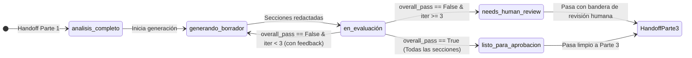

# Implementation Plan: Hito 9 (Parte 2 de 3) — Generación y Evaluación de Respuestas a RFPs

**Nivel de Complejidad:** Nivel 4 (Sistema Cognitivo / Agéntico y Estado Persistente)  
**Rama de Trabajo:** `feature/rfp-response-generation`  
**Documentos de Referencia:** `.github/STRATEGY.md`, `docs/nexova-rfp-BRIEFING.md`  

---

## 1. 📐 PACK 1: ARCHITECT (Ideación y Decisión Técnica)

### 1.1 Árbol de Pensamiento (Tree of Thoughts - ToT)
Se evaluaron tres ramas arquitecturales para el ciclo generador-evaluador:

- **Rama A (Secuencial monolítica en un único LLM call):** El generador redacta y acto seguido se autoevalúa en la misma llamada.
  - *Ventajas:* Implementación rápida.
  - *Riesgos:* Sesgo de auto-aprobación del LLM (*sycophancy*), imposibilidad de correr evaluadores especializados en paralelo y mezcla de contextos. **Descartada.**
- **Rama B (Multi-agente pesado con subagentes independientes en subprocesos):** Un proceso o subagente autónomo por cada evaluación y departamento.
  - *Ventajas:* Aislamiento extremo.
  - *Riesgos:* Sobrecarga innecesaria de latencia y llamadas IPC; fragilidad en la orquestación y mayor costo en CI/CD. **Descartada.**
- **Rama C (Grafo LangGraph con Workers generadores paralelos y Evaluadores concurrentes aislados - Elegida):**
  - Un subgrafo o nodo por departamento activo (`seleccion`, `capacitacion`, `soporte`).
  - Tres evaluadores puros y concurrentes por departamento: **Legibilidad** (determinista con `py-readability-metrics`), **Pertinencia** (cobertura semántica de `key_aspects`), y **Cumplimiento** (matriz estricta de reglas de `company-BRIEFING.md`).
  - Un nodo condensador que consolida el `EvaluationResult` estructurado y controla el bucle de feedback con límite de iteraciones (`max_iterations = 3`), pasando a `needs_human_review` si no aprueba.

---

### 1.2 Análisis de los 3 Expertos

#### 1. UX / Product Specialist
- El ticket no debe morir nunca en un error opaco. Si una sección falla las evaluaciones tras agotar el límite, debe conservarse el último borrador junto con el desglose del fallo, marcando el ticket y la sección como `needs_human_review`.
- En el Backoffice, el comercial de Ventas debe distinguir a simple vista las secciones aprobadas (badge verde) de aquellas provisionales que requieren intervención humana (badge ámbar con detalle del fallo).

#### 2. Dev Lead / Software Architect
- **Contrato inmutable:** Se consume el handoff de la Parte 1 (`ticket_id`, metadatos, departamentos activos, `key_aspects` y `open_questions`). Prohibido re-parsear el PDF original.
- **Concurrencia limpia:** Los evaluadores corren como funciones puras en paralelo mediante `ThreadPoolExecutor` dentro del nodo evaluador de cada departamento, devolviendo un objeto agregado `EvaluationResult` para evitar colisiones en el estado compartido.
- **RAG Semántico Opcional:** El generador consulta la colección `nexova_knowledge` en Qdrant (si está disponible) para obtener tono institucional y políticas de reposición/SLAs antes de redactar.

#### 3. Security & Compliance Specialist
- **Restricciones estrictas de Nexova (`docs/nexova-rfp-BRIEFING.md §5`):**
  1. `RULE-WARRANTY`: Garantía de satisfacción estándar a 90 días obligatoria.
  2. `RULE-CURRENCY`: Sede en España → EUR; Sede en Miami/EE. UU. → USD (según `client_hq`).
  3. `RULE-TTC-MIN`: Búsqueda ejecutiva (Selección) no puede prometer cierre en < 15 días hábiles.
  4. `RULE-SUPPORT-SLA`: Soporte outsourced debe explicitar SLA de respuesta de 24 horas.
  5. `RULE-ANONYMIZATION`: Prohibido citar nombres de clientes reales sin anonimizar ("cliente del sector retail").
- **Protección API:** Todo endpoint nuevo o extendido mantiene `Depends(get_current_user)`.

---

### 1.3 Threat Modeling (OWASP Top 10 for LLMs) & FMEA

| Amenaza / FMEA | Modo de Fallo | Severidad | Mitigación Técnica |
| :--- | :--- | :--- | :--- |
| **Bucle Infinito de Reintentos** | Generador no logra pasar evaluación y genera bucle infinito | Alta | Límite estricto de iteraciones (`iteration_count >= 3`). Al alcanzarse, transiciona forzosamente a `needs_human_review`. |
| **Alucinación de Moneda / Slips** | Generador cotiza en USD para España o en EUR para Miami | Alta | Evaluador de Compliance valida `currency` vs `client_hq` mediante verificación programática determinista. |
| **Colisión de Estado Concurrente** | Dos evaluadores sobreescriben la misma clave en el estado | Media | Evaluadores devuelven diccionarios aislados; el nodo consolida en `EvaluationResult` antes de escribir en el estado de LangGraph. |
| **Pérdida de Borradores en DB** | Se descarta el borrador fallido dejando al comercial sin texto base | Media | La tabla `rfp_department_sections` persiste `draft_content` e `evaluation_results` en cada iteración. |

---

## 2. 📝 PACK 2: PLANNER (Estructuración del Plan de Implementación)

### 2.1 Contratos de Datos y Schemas Pydantic (`data/pipelines/rfp_intake/schemas.py`)

```python
class ReadabilityEvaluation(BaseModel):
    passed: bool
    flesch_reading_ease: float
    flesch_kincaid_grade: float
    feedback: Optional[str] = None

class RelevanceEvaluation(BaseModel):
    passed: bool
    covered_aspects: List[str]
    missing_aspects: List[str]
    feedback: Optional[str] = None

class ComplianceEvaluation(BaseModel):
    passed: bool
    rule_ids_checked: List[str]
    violations: List[str]
    feedback: Optional[str] = None

class EvaluationResult(BaseModel):
    department_id: str
    readability: ReadabilityEvaluation
    relevance: RelevanceEvaluation
    compliance: ComplianceEvaluation
    overall_pass: bool
    feedback_for_generator: str
    iteration: int
```

### 2.2 Máquina de Estados e Invariantes



**Invariantes del Sistema:**
1. Ninguna sección re-analiza el archivo PDF original.
2. Cada departamento activo tiene un borrador independiente generado por su respectivo especialista.
3. Si un departamento requiere 2 iteraciones y otro 1, no se bloquean mutuamente.
4. El feedback devuelto al generador es específico, citando las reglas o aspectos que fallaron.

---

## 3. 💻 PACK 3: CODER (Desarrollo y Verificación Fáctica)

### Componentes a Desarrollar:
1. **Schemas (`data/pipelines/rfp_intake/schemas.py`):**
   - Incorporar `EvaluationResult`, `ReadabilityEvaluation`, `RelevanceEvaluation`, `ComplianceEvaluation` y `SectionDraftPayload`.
2. **Nodos de Generación y Evaluación (`data/pipelines/rfp_intake/nodes.py`):**
   - `generate_department_section(metadata, task, feedback, iteration)`: Genera el borrador con políticas de Nexova (consultando RAG semántico si está disponible).
   - `evaluate_readability(text)`: Evaluación de legibilidad usando `py-readability-metrics`.
   - `evaluate_relevance(text, task_aspects)`: Evaluación de pertinencia respecto a los aspectos clave solicitados.
   - `evaluate_compliance(text, metadata, dept_id)`: Evaluación rigurosa contra las 5 reglas de `company-BRIEFING.md §5`.
   - `evaluate_section_parallel(...)`: Ejecuta los 3 evaluadores en paralelo y sintetiza `EvaluationResult`.
3. **Ampliación del Grafo LangGraph (`data/pipelines/rfp_intake/graph.py`):**
   - Integrar el ciclo condicional generador ⇄ evaluador con guardián de iteraciones (`max_iterations = 3`).
   - Actualización de estados del ticket en PostgreSQL: `generando_borrador` → `en_evaluación` → `needs_human_review` (o `listo_para_aprobacion`).
4. **Endpoints FastAPI (`services/api/routes/rfps.py`):**
   - Exponer endpoints para disparar o consultar la generación de propuestas de un ticket ya clasificado.
5. **Backoffice UI (`uis/backoffice/src/app/rfps/page.tsx`):**
   - Visualización del borrador generado (`draft_content`), estado de evaluación (`overall_pass`), desglose de compliance y botón para disparar la generación si el ticket está en `analisis_completo`.

---

## 4. 🛡️ PACK 4: AUDITOR (Testing, Red Teaming y Protocolo Git)

### 4.1 Suite de Pruebas Automatizadas (`tests/pipelines/test_rfp_generation.py`)
- **Test 1: Generación exitosa y evaluación limpia:** Borrador completo que cumple con garantía de 90 días, moneda correcta, TTC ≥ 15 días y SLA de 24h (`overall_pass == True`).
- **Test 2: Fallo de compliance por moneda incorrecta:** Sede en Madrid cotizada en USD → detecta violación `RULE-CURRENCY`.
- **Test 3: Fallo de compliance por TTC menor a 15 días:** Búsqueda ejecutiva prometida en 10 días → detecta violación `RULE-TTC-MIN`.
- **Test 4: Fallo de compliance por omisión de SLA 24h:** Sección de soporte que omite SLA → detecta violación `RULE-SUPPORT-SLA`.
- **Test 5: Ciclo de reintentos con feedback:** El generador recibe el feedback de fallo y en la siguiente iteración autocorrige el texto.
- **Test 6: Agotamiento de iteraciones y transición a `needs_human_review`:** Se fuerza fallo persistente; el ticket y la sección terminan en `needs_human_review` sin descartar el ticket.

---

## 🗺️ Mapa de Trabajo por Fases (Roadmap)

### Fase 1: Schemas y Modelos de Datos
- [ ] 1.1 Definir schemas Pydantic de evaluación en `data/pipelines/rfp_intake/schemas.py` (`ReadabilityEvaluation`, `RelevanceEvaluation`, `ComplianceEvaluation`, `EvaluationResult`).
- [ ] 1.2 Verificar compatibilidad con los campos existentes de `RFPDepartmentSection` en `services/api/models.py`.

### Fase 2: Agentes Generadores y Evaluadores Paralelos
- [ ] 2.1 Implementar agentes generadores por departamento en `data/pipelines/rfp_intake/nodes.py` con prompt institucional de Nexova.
- [ ] 2.2 Implementar evaluador de legibilidad determinista (`py-readability-metrics`).
- [ ] 2.3 Implementar evaluador de pertinencia (cobertura de `key_aspects`).
- [ ] 2.4 Implementar evaluador de compliance anclado a las 5 reglas de `docs/nexova-rfp-BRIEFING.md §5`.
- [ ] 2.5 Orquestar la evaluación paralela y consolidación en `EvaluationResult`.

### Fase 3: Grafo LangGraph con Ciclo Generador-Evaluador y Límite de Iteraciones
- [ ] 3.1 Añadir nodos y aristas condicionales en `data/pipelines/rfp_intake/graph.py`.
- [ ] 3.2 Implementar lógica de bucle con inyección de feedback y límite de reintentos (máx 3).
- [ ] 3.3 Gestionar transiciones de estado: `generando_borrador` → `en_evaluación` → `needs_human_review` (o aprobado).
- [ ] 3.4 Persistir borradores y resultados de evaluación en PostgreSQL/SQLModel.

### Fase 4: Endpoints FastAPI y Soporte Backoffice
- [ ] 4.1 Extender `services/api/routes/rfps.py` con endpoint para disparar generación sobre tickets en `analisis_completo`.
- [ ] 4.2 Actualizar servicio frontend `uis/backoffice/src/services/rfps.ts` y componentes en `uis/backoffice/src/app/rfps/page.tsx` para visualizar borradores, badges de compliance y avisos de `needs_human_review`.
- [ ] 4.3 Ejecutar verificación de tipos TypeScript (`cd uis/backoffice && npx tsc --noEmit`).

### Fase 5: Suite de Tests Automatizados y Auditoría
- [ ] 5.1 Crear `tests/pipelines/test_rfp_generation.py` con tests unitarios e integrados deterministas.
- [ ] 5.2 Validar casos de éxito, fallo de legibilidad, fallo de pertinencia y fallos de compliance (`RULE-CURRENCY`, `RULE-TTC-MIN`, `RULE-SUPPORT-SLA`).
- [ ] 5.3 Validar caso de límite agotado (`needs_human_review`).
- [ ] 5.4 Ejecución completa de la suite con `uv run python -m pytest tests/pipelines/ -v`.

---

## ⚙️ Métodos Aplicados (Code Refinement Suite)
- **Tree of Thoughts (ToT):** Exploración y selección de la arquitectura desacoplada de evaluadores puros concurrentes frente a modelos monolíticos o procesos pesados.
- **Análisis de 3 Expertos:** Perspectivas cruzadas de UX (claridad de `needs_human_review`), Arquitectura (aislamiento y consumo de handoff inmutable) y Seguridad/Compliance (matriz determinista de lineamientos de Nexova).
- **Threat Modeling & FMEA:** Identificación y mitigación preventiva del riesgo de bucle infinito mediante contador de iteraciones estricto y salvaguarda de persistencia.
- **Eval-Driven Development (EDD):** Diseño guiado por pruebas unitarias ancladas a las reglas del briefing antes de cerrar el código productivo.
