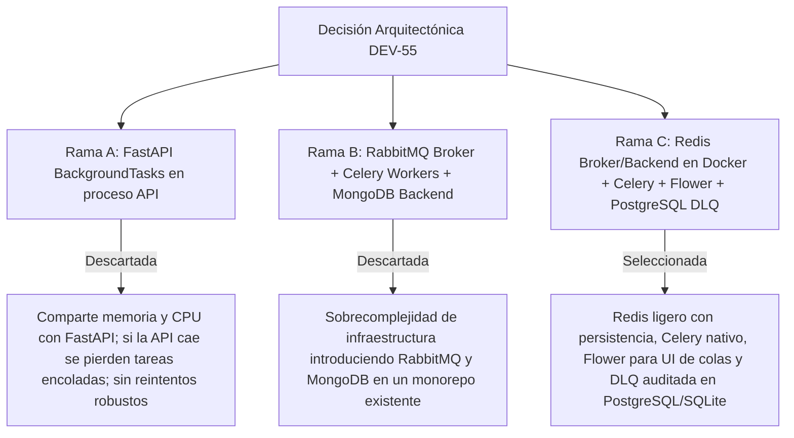

# Implementation Plan: Colas de Mensajes y Tareas Asíncronas con Redis y Celery (Ticket #DEV-55)

> **Documento de Planificación y Arquitectura de Producción**  
> **Basado en:** `.github/STRATEGY.md`, `CONTEXT-company.md` (Nexova Solutions), `docker-compose.yml`, `services/reporting/routes.py`, `services/api/routes/telemetry.py`  
> **Marco Metodológico:** Code Refinement Suite (Nivel 3 — Arquitectura Crítica de Sistemas Distribuidos & Procesamiento Asíncrono)  
> **Modalidad:** Modo Tutor / Aprendizaje guiado (el mentor acompaña, el usuario ejecuta paso a paso)  

---

## 📌 Contexto y Objetivos del Hito

En Nexova Solutions, la API en producción atiende múltiples clientes y dashboards corporativos. Sin embargo, ciertas operaciones pesadas de cómputo analítico (como la ejecución del pipeline de desempeño de negocio y generación de KPIs ejecutivos en `services/reporting/routes.py` o la consolidación de telemetría técnica) bloqueaban el ciclo request-response o dependían de background tasks ligadas al hilo del servidor web, degradando la concurrencia y la disponibilidad general de la API.

El **Ticket #DEV-55** exige implementar una arquitectura desacoplada basada en el **Patrón Productor / Consumidor**:
1. **Infraestructura con Redis & Flower en Docker:** Desplegar Redis oficial (puerto 6379, política `noeviction`) como message broker y result backend, y Flower (puerto 5555) para observabilidad en tiempo real.
2. **Módulo Celery Desacoplado (`services/celery_app.py`):** Configurar Celery apuntando a `REDIS_URL` con serialización segura y timeouts estrictos.
3. **Conversión Asíncrona de Operación Pesada:** Transformar el endpoint de disparo del pipeline (`POST /reporting/trigger`) para que encole la tarea en Celery y devuelva **`202 Accepted`** con `{"task_id": "...", "status": "pending"}` en **menos de 200 ms**.
4. **Endpoint de Polling de Tareas:** Implementar `GET /tasks/{task_id}` que consulte el estado en Redis y retorne los estados canónicos (`pending`, `started`, `success`, `failure`) junto con el resultado cuando esté disponible.
5. **Resiliencia, Backoff y Dead Letter Queue (DLQ):** Configurar reintentos automáticos con `max_retries=3` y backoff exponencial (`countdown`). Al fallar por 3ª vez consecutiva, la tarea debe registrarse en la tabla de base de datos `task_dlq` (Dead Letter Queue) con `task_id`, número de intentos, timestamp y traza de error.
6. **Aislamiento de Procesos:** Los workers de Celery se ejecutan en procesos separados de FastAPI; detener la API no interrumpe el procesamiento ni descarta mensajes encolados.

---

## 🏛️ PACK 1: ARCHITECT — Evaluación de Alternativas Técnicas y Veredicto

Se evaluaron tres arquitecturas mediante **Tree of Thoughts (ToT)** para la delegación de tareas asíncronas y gestión de colas:

### Comparativa de Alternativas (ToT):

1. **Rama A (FastAPI BackgroundTasks interno):**
   - *Enfoque:* Mantener las tareas en segundo plano dentro del hilo de FastAPI mediante `BackgroundTasks`.
   - *Veredicto:* **Descartada categóricamente.** No existe persistencia de colas; si el proceso de FastAPI se reinicia o satura de memoria, todas las tareas pendientes se pierden. No soporta reintentos distribuidos con backoff ni Dead Letter Queue.
2. **Rama B (Stack pesado RabbitMQ + MongoDB):**
   - *Enfoque:* Levantar un clúster RabbitMQ para AMQP avanzado y MongoDB para almacenar resultados.
   - *Veredicto:* **Descartada.** Incurre en sobreingeniería extrema y añade múltiples servicios foráneos que dificultan el despliegue local y la integración con el esquema de base de datos existente de Nexova.
3. **Rama C (Redis en Docker + Celery Worker Desacoplado + Flower + Tabla `task_dlq` en BD) [Seleccionada]:**
   - *Enfoque:*
     - Redis oficial en `docker-compose.yml` (puerto 6379, memoria `noeviction` para garantizar que ningún mensaje se descarte).
     - Instancia Celery en `services/celery_app.py` leyendo `REDIS_URL`.
     - Tarea `@celery_app.task(bind=True, max_retries=3)` que encapsula el cálculo pesado (`data.pipelines.pipeline.business_performance_flow`).
     - Dead Letter Queue implementada mediante la tabla `task_dlq` gestionada vía SQLAlchemy, garantizando trazabilidad unificada con el resto de la base de datos de Nexova.
     - Flower en puerto 5555 para monitoreo gráfico en tiempo de desarrollo.
   - *Veredicto:* **Aprobada unánimemente.** Satisface el 100% de los criterios del ticket, mantiene la pila técnica homogénea y proporciona resiliencia industrial.

### Veredicto de los 3 Expertos:
- **Dev Lead:** Desacoplar la orquestación mediante Celery y Redis permite que la API responda en < 50ms devolviendo `202 Accepted`. Los mensajes enviados a la cola son ultraligeros (solo `{"target_date": "YYYY-MM-DD"}`), cumpliendo la regla de oro: *"el worker recupera los datos pesados, el mensaje solo lleva referencias"*.
- **Sec Specialist:** Redis se aísla en la red interna de Docker (`nexova-network`), requiriendo autenticación si se expone externamente. El endpoint `GET /tasks/{task_id}` mantiene la protección de sesión mediante `Auth Guard Standard` (`Depends(get_current_user)`).
- **Operaciones / UX Lead:** Flower proporciona visibilidad inmediata de la tasa de procesamiento y tiempos de ejecución. Además, el endpoint `GET /tasks/{task_id}` permite al frontend o a los dashboards de Nexova implementar barras de progreso o estados reactivos de forma transparente.

---

## 🗺️ Mapa de Trabajo por Fases (Roadmap)

### Fase 1: Infraestructura Docker (Redis & Flower) y Dependencias
- [x] **Paso 1.1 — Instalación de Dependencias con UV:**
  - Instalar dependencias requeridas en el monorepo ejecutando: `uv add celery redis flower`.
- [x] **Paso 1.2 — Configuración de Redis en `docker-compose.yml`:**
  - Añadir el servicio `redis` utilizando la imagen oficial `redis:7-alpine`.
  - Exponer el puerto `6379:6379`.
  - Configurar comando de arranque con política `noeviction`: `redis-server --maxmemory-policy noeviction`.
  - Asociar a la red `nexova-network`.
- [x] **Paso 1.3 — Configuración de Flower en `docker-compose.yml`:**
  - Añadir el servicio `flower` en `docker-compose.yml` expuesto en el puerto `5555:5555`.
  - Configurar conexión al broker `redis://redis:6379/0`.
  - Dependencia de servicio `depends_on: [redis]`.
- [x] **Paso 1.4 — Variables de Entorno (`.env`):**
  - Añadir variable `REDIS_URL="redis://localhost:6379/0"` (y `redis://redis:6379/0` para contenedores) con fallback seguro en código.

---

### Fase 2: Modelo de Datos para Dead Letter Queue (DLQ)
- [x] **Paso 2.1 — Definición DDL de `task_dlq`:**
  - Crear tabla `task_dlq` con campos: `id` (UUID/TEXT PK), `task_id` (VARCHAR), `task_name` (VARCHAR), `arguments` (JSON/TEXT), `retry_count` (INTEGER), `error_message` (TEXT), `failed_at` (TIMESTAMPTZ/TEXT).
- [x] **Paso 2.2 — Script de Migración SQL:**
  - Crear migración en `infra/migrations/002_create_task_dlq.sql` compatible con PostgreSQL y SQLite.
- [x] **Paso 2.3 — Helper de Persistencia en Base de Datos:**
  - Implementar en `services/dlq_service.py` las funciones `ensure_dlq_table_exists()` y `record_dlq_failure(task_id, task_name, args, retry_count, error)`.

---

### Fase 3: Configuración del Módulo Celery y Tareas Asíncronas (`services/celery_app.py`)
- [x] **Paso 3.1 — Inicialización de Celery App:**
  - Crear `services/celery_app.py` configurando `broker_url` y `result_backend` desde `REDIS_URL`.
  - Ajustar configuraciones de estabilidad: `task_acks_late=True` (ACK solo tras finalización exitosa), `worker_prefetch_multiplier=1`, `result_expires=86400` (24 horas).
- [x] **Paso 3.2 — Implementación de la Tarea Asíncrona del Pipeline:**
  - Definir `@celery_app.task(bind=True, max_retries=3, default_retry_delay=5)` para ejecutar `business_performance_flow(target_date)`.
  - Configurar reintentos automáticos con backoff exponencial: `countdown = 2 ** self.request.retries * 5`.
  - Capturar excepciones y registrar en Dead Letter Queue (`record_dlq_failure`) cuando `self.request.retries >= self.max_retries`.
- [x] **Paso 3.3 — Tarea de Simulación para Pruebas (Failure / DLQ):**
  - Crear tarea `@celery_app.task(bind=True, max_retries=3)` que simule fallos controlados para validar la transición a DLQ y los reintentos automáticos.

---

### Fase 4: Refactorización de Endpoints en FastAPI (`services/reporting/routes.py` y `services/api/routes/tasks.py`)
- [x] **Paso 4.1 — Conversión de `POST /reporting/trigger` a Asíncrono:**
  - Modificar el endpoint para que invoque `run_pipeline_task.delay(target_date)`.
  - Retornar código HTTP **`202 Accepted`** con payload `{"task_id": task.id, "status": "pending", "message": "Tarea encolada con éxito"}`.
  - Medir latencia de respuesta para garantizar respuesta en menos de 200 ms.
  - Proteger el endpoint mediante `Auth Guard Standard` (`Depends(get_current_user)`).
- [x] **Paso 4.2 — Creación de Router de Tareas `services/api/routes/tasks.py`:**
  - Implementar endpoint protegido `GET /tasks/{task_id}`.
  - Consultar `AsyncResult(task_id)` desde Celery / Redis.
  - Normalizar el estado retornado: `pending`, `started`, `success`, `failure`.
  - Si el estado es `success`, incluir `result` en el payload JSON; si es `failure`, incluir mensaje de error.
- [x] **Paso 4.3 — Registro del Router en `services/api/main.py`:**
  - Incluir `app.include_router(tasks.router)`.

---

### Fase 5: Suite de Pruebas Automatizadas (`tests/api/test_async_tasks.py`)
- [x] **Paso 5.1 — Fixtures y Mocks Celery/Redis:**
  - Configurar Celery en modo eager/in-memory para pruebas unitarias deterministas (`task_always_eager=True` para tests unitarios directos y mock de `AsyncResult`).
- [x] **Paso 5.2 — Test 1: Inmediata Aceptación (`202 Accepted` < 200ms):**
  - Validar que `POST /reporting/trigger` responde con `202`, `task_id` válido y tiempo de respuesta inferior a 200 ms.
- [x] **Paso 5.3 — Test 2: Polling de Estado (`GET /tasks/{task_id}`):**
  - Probar las transiciones de estado (`pending` → `started` → `success`) y validar la estructura JSON de respuesta.
- [x] **Paso 5.4 — Test 3: Reintentos con Backoff y DLQ tras 3 Fallos:**
  - Forzar 3 fallos consecutivos en una tarea mock y validar que se registra en la tabla `task_dlq` con `retry_count = 3` y mensaje de error.
- [x] **Paso 5.5 — Test 4: Autenticación `Auth Guard Standard`:**
  - Verificar que las peticiones sin token JWT a `/reporting/trigger` y `/tasks/{task_id}` son rechazadas con `401 Unauthorized`.
- [x] **Paso 5.6 — Ejecución y Validación Pytest:**
  - Ejecutar `uv run pytest tests/` y verificar 100% de tests pasando en verde.

---

### Fase 6: Documentación del Worker, Verificación de Flower y Entrega Git (PACK 4: AUDITOR)
- [x] **Paso 6.1 — Documentación del Worker en `README.md`:**
  - Documentar comandos exactos para levantar el worker: `uv run celery -A services.celery_app worker --loglevel=info`.
  - Documentar cómo detenerlo y cómo verificar conectividad con Redis.
- [x] **Paso 6.2 — Checklist de Pre-Entrega:**
  - [x] Redis corre en Docker y workers se conectan sin errores.
  - [x] Endpoint responde `202 Accepted` en < 200ms.
  - [x] `GET /tasks/{task_id}` refleja estados canónicos.
  - [x] Reintentos configurados con backoff.
  - [x] Fallos tras 3 intentos registrados en tabla `task_dlq`.
  - [x] Workers corren desacoplados de FastAPI.
  - [x] Mensajes encolados contienen únicamente identificadores/referencias.
  - [x] Flower accesible en puerto 5555.
- [x] **Paso 6.3 — Preparación del Pull Request:**
  - Documentar justificación del endpoint seleccionado (`POST /reporting/trigger`), captura de Flower y fragmentos de logs.
  - Etiqueta `async-tasks` asignada.
- [x] **Paso 6.4 — Protocolo de Control Git:**
  - Solicitar consentimiento explícito al usuario antes de ejecutar `git push`.

---

## ⚙️ Métodos Aplicados (Code Refinement Suite)

1. **Tree of Thoughts (ToT - PACK 1: ARCHITECT):**
   Se contrastaron tres alternativas de arquitectura (FastAPI BackgroundTasks en proceso, RabbitMQ/Mongo pesado y Redis/Celery/Flower desacoplado). Se descartó BackgroundTasks por falta de persistencia y pérdida de tareas ante reinicios de la API, y RabbitMQ por complejidad innecesaria. Se seleccionó Redis como broker/backend y Celery con workers independientes por su ligereza, tolerancia a fallos y soporte nativo en el monorepo.

2. **Step-Back Prompting & Domain Abstraction (PACK 2: PLANNER):**
   Se interiorizó el patrón fundamental: *"encolar y ejecutar son responsabilidades de dos procesos distintos"*. Los mensajes se mantendrán ultraligeros (solo parámetros escalares como `target_date`), garantizando que la memoria de Redis permanezca acotada y que el worker sea responsable de hidratar los datos necesarios.

3. **Chain of Verification (CoVe) & TDD (PACK 3: CODER):**
   Antes de modificar los endpoints de negocio, se diseñarán fixtures para aislar el result backend y simular estados de Celery (`AsyncResult`). Se verificará empíricamente la latencia inferior a 200 ms y la persistencia de fallos en `task_dlq`.

4. **Red Teaming & Resilience Audit (PACK 4: AUDITOR):**
   Se auditará el comportamiento del sistema cuando el broker se satura o desconecta temporalmente, validando que el worker reintente con backoff exponencial sin sobrecargar la CPU y que al superar el umbral de 3 fallos la tarea transicione limpiamente a la Dead Letter Queue sin zombis ni bloqueos. Se acatará estrictamente la regla de no auto-push.
