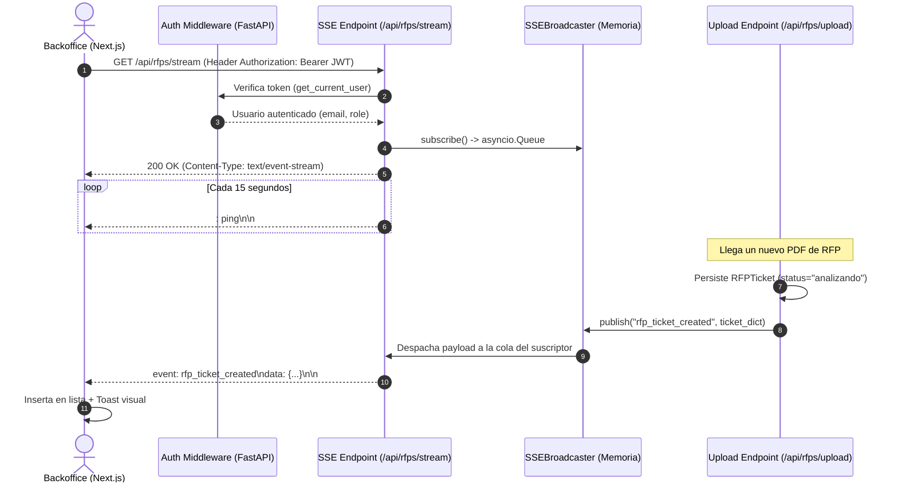

# Implementation Plan: Sistemas en Tiempo Real — Notificaciones SSE (Parte 1 de 2)

**Nivel de Complejidad:** Nivel 3 (Arquitectura / Módulo Crítico — Streaming en tiempo real con Auth Guard y resiliencia)  
**Rama de Trabajo:** `feature/sse-notifications`  
**Documentos de Referencia:** `.github/STRATEGY.md`, `docs/nexova-rfp-BRIEFING.md`, `AGENTS.md`  

---

## 1. 📐 PACK 1: ARCHITECT (Ideación y Decisión Técnica)

### 1.1 Árbol de Pensamiento (Tree of Thoughts - ToT)
Se evaluaron tres ramas arquitecturales para resolver la notificación en tiempo real de nuevos tickets de RFP:

- **Rama A (Polling corto frecuente desde el frontend con `setInterval` cada 2-3s):**
  - *Ventajas:* Implementación rápida en el frontend sin cambios profundos en el backend.
  - *Riesgos:* Sobrecarga masiva de la base de datos y de FastAPI con peticiones HTTP repetitivas (99% de ellas sin cambios). Viola explícitamente el requerimiento de `STRATEGY.md` ("reemplazar el refresco manual con un flujo que empuje la notificación al frontend"). **Descartada.**
- **Rama B (WebSockets bidireccionales con protocolo `ws://` / `wss://`):**
  - *Ventajas:* Comunicación dúplex de bajísima latencia.
  - *Riesgos:* Sobreingeniería para un requerimiento donde el tráfico es exclusivamente unidireccional (servidor a cliente). Los navegadores no soportan el envío nativo de cabeceras HTTP personalizadas (como `Authorization: Bearer <token>`) en el handshake estándar de `WebSocket` sin hacks en query params (vulnerable a fuga de tokens en logs). Complica proxies y balanceadores. **Descartada.**
- **Rama C (Server-Sent Events con `fetch` + `ReadableStream` y Broadcaster en memoria - Elegida):**
  - *Ventajas:*
    1. Basado en HTTP/1.1 y HTTP/2 estándar (`text/event-stream`), compatible con proxies y cortafuegos.
    2. Al consumirse en el frontend con `fetch` y `ReadableStreamDefaultReader` (en lugar de `EventSource` vanilla), permite adjuntar limpiamente la cabecera `Authorization: Bearer <JWT>`, cumpliendo el Auth Guard Standard.
    3. Conexiones ligeras y no bloqueantes en FastAPI mediante generadores asíncronos (`asyncio.Queue`).
    4. Soporte de reconexión con backoff progresivo y frames de keep-alive (`: ping\n\n`) para evitar cierres prematuros por inactividad.

---

### 1.2 Análisis del Panel de 3 Expertos

#### 1. UX / Product Specialist
- **Feedback inmediato y no invasivo:** Cuando entra una nueva RFP, la pantalla del dashboard no debe parpadear ni forzar un refresco total. El nuevo ticket debe insertarse en la parte superior de la tabla de tickets con un badge visual temporal ("Nuevo" / "Recién llegado") y un toast informativo con el nombre del cliente y el estado inicial (`analizando`).
- **Transparencia en el estado de red:** Se incorporará en el encabezado del panel un indicador discreto de conexión en tiempo real:
  - 🟢 *En vivo* (conectado y escuchando stream).
  - 🟡 *Reconectando (intento N)...* (en período de backoff tras corte de red).
  - 🔴 *Desconectado* (si se agotan los reintentos o el usuario no está autenticado).

#### 2. Dev Lead / Software Architect
- **Desacoplamiento mediante Broadcaster (`services/api/sse_manager.py`):**
  - El router de subida de tickets (`services/api/routes/rfps.py`) no debe saber nada sobre sockets HTTP o clientes web conectados. Simplemente invoca `await rfp_broadcaster.publish("rfp_ticket_created", payload)`.
  - El broadcaster mantiene un set de colas `asyncio.Queue(maxsize=100)`. Si un suscriptor es lento y satura la cola, se descarta el mensaje más antiguo o se purga la conexión para evitar fugas de memoria (*leak*).
- **Consumo con Stream Reader en Frontend (`uis/backoffice/src/hooks/useRFPNotifications.ts`):**
  - Encapsular la conexión en un hook limpio que devuelva `{ isConnected, reconnectingAttempt, lastEvent }`.
  - Uso riguroso de `AbortController` para cancelar y cerrar el stream en el evento `cleanup` de `useEffect` (evitando conexiones fantasma al cambiar de ruta).

#### 3. Security & Compliance Specialist (Auth Guard Standard)
- **Protección obligatoria del endpoint:** `GET /api/rfps/stream` debe exigir `current_user: dict = Depends(get_current_user)`. Clientes no autenticados reciben inmediatamente `401 Unauthorized`.
- **Cero exposición en URLs:** Prohibido aceptar tokens en la query string (`?token=...`). El JWT viaja exclusivamente en el header `Authorization: Bearer <token>`.
- **Invariante de IA:** Esta entrega no ejecuta ni invoca ningún agente o modelo generativo. Es una capa pura de transporte reactivo.

---

### 1.3 Threat Modeling (OWASP API Security) & FMEA

| Amenaza / Modo de Fallo | Riesgo / Impacto | Severidad | Mitigación Técnica |
| :--- | :--- | :--- | :--- |
| **Acceso no autorizado al stream** | Un atacante escucha en vivo las RFPs confidenciales de clientes. | Crítica | Auth Guard estricto con `Depends(get_current_user)` validando firma y expiración del JWT en el handshake del stream. |
| **Cierre prematuro de conexión por proxies** | Proxies intermedios o Next.js cortan la conexión tras 30s de silencio. | Alta | Tarea periódica de keep-alive en FastAPI emitiendo comentarios SSE (`: ping\n\n`) cada 15 segundos. |
| **Pérdida de eventos durante caída de red** | Una RFP llega mientras el cliente comercial sufre un microcorte de red. | Alta | Política de recuperación: al reconectar exitosamente, el cliente ejecuta un refetch ligero de la lista de tickets y deduplica por `ticket_id`. |
| **Duplicación de tickets en la UI tras reconexión** | El mismo ticket aparece repetido dos veces en la tabla. | Media | Invariante en React: fusión de estado usando `Map<string, RFPTicket>` indexado por `ticket_id`. |
| **Fuga de memoria por clientes desconectados bruscamente** | Clientes que cierran la pestaña dejan colas huérfanas en el backend. | Alta | Captura de `asyncio.CancelledError` y bloque `finally` en el endpoint SSE para desuscribir y limpiar la cola del cliente. |

---

## 2. 📝 PACK 2: PLANNER (Estructuración del Plan de Implementación)

### 2.1 Contratos de Datos y Schemas

#### Formato Wire del Protocolo SSE
El stream responderá con `Content-Type: text/event-stream`, `Cache-Control: no-cache`, `Connection: keep-alive` y `X-Accel-Buffering: no`.

**Frame de Keep-Alive:**
```http
: ping

```

**Frame de Evento (Creación de Ticket de RFP):**
```http
event: rfp_ticket_created
data: {"ticket_id": "7f8b9c2a-...", "rfp_id": "RFP-...", "filename": "nexova-request-1.pdf", "status": "analizando", "client_name": null, "created_at": "2026-11-20T15:00:00Z"}

```

#### Payload del Evento en Python (`services/api/schemas.py`)
```python
class RFPTicketCreatedEvent(BaseModel):
    ticket_id: str
    rfp_id: str
    filename: str
    status: str = "analizando"
    client_name: Optional[str] = None
    created_at: str
```

---

### 2.2 Diagrama de Secuencia y Máquina de Estados



---

### 2.3 Respuestas Arquitectónicas a las Preguntas de Diseño (STRATEGY.md)

1. **¿Si 2 personas del equipo comercial abren el dashboard al mismo tiempo vs 50 personas a la vez?**
   - *Respuesta:* Cada conexión SSE cliente establece su propio canal HTTP y su propia cola asíncrona ligera (`asyncio.Queue`) gestionada por el `SSEBroadcaster`. No abren conexiones independientes a la base de datos ni ejecutan consultas periódicas. Para 50 usuarios, el costo de CPU y memoria en una instancia asíncrona de Uvicorn/FastAPI es prácticamente insignificante (~10-20 KB de memoria total).
   - Si la aplicación creciera a cientos de comerciales distribuidos en un cluster de múltiples workers/contenedores Uvicorn, la capa intermedia en memoria se reemplazaría por un backend de pub/sub distribuido (Redis Pub/Sub o NATS), permitiendo que cualquier worker que reciba la subida publique el evento y todos los workers con clientes conectados lo propaguen a sus respectivos sockets.
2. **¿Qué estrategia de recuperación se eligió para tickets registrados durante una desconexión y cómo se evitan duplicados?**
   - *Respuesta:* Se eligió la estrategia **"Refetch al Reconectar + Deduplicación por Clave Primaria"**. Cuando el hook de React detecta que la conexión se restableció con éxito tras un corte, dispara inmediatamente `rfpService.listTickets()` para recuperar cualquier ticket creado durante el período de desconexión.
   - En el frontend, el estado de tickets se consolida mediante una función de combinación indexada por `ticket_id` (usando un diccionario o `Map`), de forma que si un evento ya había llegado o llega durante la sincronización, jamás se duplica en la interfaz de usuario.
3. **¿Por qué SSE es la herramienta correcta para este caso y no WebSockets? ¿En qué momento dejaría de serlo?**
   - *Respuesta:* Las notificaciones de nuevas RFPs son un flujo estrictamente **unidireccional** (servidor hacia los dashboards de los comerciales). SSE es nativo de la capa HTTP, opera sobre HTTP/1.1 y HTTP/2 multiplexado, atraviesa sin problemas proxies corporativos y cortafuegos, y permite autenticación limpia enviando cabeceras `Authorization: Bearer <token>` mediante la API `fetch` del navegador. WebSockets añade complejidad innecesaria de handshake, protocolo de enmarcado dúplex y dificultad para pasar headers de autenticación estándar.
   - *Cuándo dejaría de serlo:* SSE dejaría de ser la herramienta correcta si el flujo requiriese bidireccionalidad intensiva y de baja latencia en el mismo canal (por ejemplo, edición colaborativa concurrente del alcance de la propuesta entre Marcos y Javier, cursores compartidos, o un chat interactivo de feedback en tiempo real).

---

## 3. 💻 PACK 3: CODER (Desarrollo y Verificación Fáctica)

### Componentes a Desarrollar:

1. **Gestor de Eventos SSE (`services/api/sse_manager.py`):**
   - Clase `SSEBroadcaster` con soporte `subscribe()`, `unsubscribe()`, y `publish(event_name, data)`.
   - Limpieza automática de colas saturadas o cerradas.
2. **Endpoint SSE en FastAPI (`services/api/routes/rfps.py`):**
   - `GET /api/rfps/stream`: Protegido con `Depends(get_current_user)`.
   - Generador asíncrono con `request: Request`, comprobación periódica `await request.is_disconnected()` y `asyncio.wait_for(queue.get(), timeout=15.0)` para emitir latidos keep-alive (`: ping\n\n`) cada 15s y limpiar la cola en `finally`.
   - Modificación de `POST /api/rfps/upload` para publicar el evento `rfp_ticket_created` en cuanto el ticket se guarda en la base de datos con estado `"analizando"`.
3. **Hook de Notificaciones en Frontend (`uis/backoffice/src/hooks/useRFPNotifications.ts`):**
   - Implementación de lector de stream con `window.fetch` + `response.body.getReader()`.
   - Búfer acumulativo de texto (`buffer += decoder.decode(chunk, { stream: true })`) procesando únicamente frames completos delimitados por `\n\n` (evita errores por fragmentación TCP).
   - Inyección de cabecera `Authorization: Bearer ${token}` extraída de `localStorage`.
   - Algoritmo de reconexión con backoff exponencial (`1000ms * 2^attempt`, máx. `30000ms`, más *jitter* aleatorio).
   - Disparo de callback de recuperación al reconectar.
4. **Integración en UI Dashboard (`uis/backoffice/src/app/rfps/page.tsx`):**
   - Indicador de estado de conexión SSE en la cabecera del panel.
   - Inserción reactiva de nuevos tickets y toast de notificación al recibir `rfp_ticket_created`.
   - Deduplicación estricta de tickets por `ticket_id`.
5. **Suite de Pruebas Automatizadas (`tests/api/test_rfp_sse.py`):**
   - Test 1: Verificar rechazo `401 Unauthorized` si no hay JWT.
   - Test 2: Verificar cabeceras `text/event-stream` y keep-alive `: ping\n\n`.
   - Test 3: Verificar emisión y formato del evento `rfp_ticket_created` al subir un archivo o invocar el broadcaster.

---

## 4. 🛡️ PACK 4: AUDITOR (Testing, Concurrencia y Protocolo Git)

### 4.1 Verificaciones Automatizadas
- Ejecución de tests unitarios y de integración con `pytest`:
  `uv run pytest tests/api/test_rfp_sse.py -v`
- Comprobación de no regresión en tests existentes:
  `uv run pytest tests/pipelines/ -v`
- Verificación de tipos y lint en el frontend:
  `cd uis/backoffice && npm run build` (o `npx tsc --noEmit`)

### 4.2 Protocolo de Control Git
- ⚠️ **Regla Inviolable:** NUNCA realizar `git push` automático.
- Al completar la verificación del plan y código, solicitar consentimiento explícito al usuario.

---

## 🗺️ Mapa de Trabajo por Fases (Roadmap)

### Fase 1: Arquitectura de Streaming en Backend (`services/`)
- [ ] 1.1 Crear el gestor de eventos en memoria `services/api/sse_manager.py` (`SSEBroadcaster`).
- [ ] 1.2 Implementar el endpoint `GET /api/rfps/stream` en `services/api/routes/rfps.py` con Auth Guard (`Depends(get_current_user)`).
- [ ] 1.3 Incorporar generador de eventos con frames de keep-alive (`: ping\n\n`) cada 15 segundos y manejo de desconexión.
- [ ] 1.4 Integrar la publicación de `rfp_ticket_created` en `POST /api/rfps/upload` al registrar el ticket.

### Fase 2: Suite de Pruebas Automatizadas del Stream (`tests/`)
- [ ] 2.1 Crear `tests/api/test_rfp_sse.py` usando `httpx.AsyncClient`.
- [ ] 2.2 Probar rechazo sin autenticación (`401 Unauthorized`).
- [ ] 2.3 Probar recepción del formato wire de SSE (`event: rfp_ticket_created` y payload estructurado con campos del briefing).
- [ ] 2.4 Ejecutar suite con `uv run pytest tests/api/test_rfp_sse.py -v`.

### Fase 3: Cliente Frontend con Tolerancia a Fallos (`uis/backoffice/`)
- [ ] 3.1 Implementar el hook `useRFPNotifications` en `uis/backoffice/src/hooks/useRFPNotifications.ts` con `fetch` y `ReadableStreamDefaultReader`.
- [ ] 3.2 Implementar reconexión con backoff exponencial progresivo y cancelación por `AbortController`.
- [ ] 3.3 Implementar estrategia de recuperación con refetch al reconectar y deduplicación por `ticket_id`.
- [ ] 3.4 Conectar el hook en `uis/backoffice/src/app/rfps/page.tsx` con indicador visual de estado y actualización en tiempo real de la lista.
- [ ] 3.5 Validar compilación TypeScript en frontend (`cd uis/backoffice && npx tsc --noEmit`).

### Fase 4: Auditoría de Seguridad y Verificación Pre-Push
- [ ] 4.1 Auditar que no exista ninguna llamada a LLMs ni agentes en la solución de esta parte.
- [ ] 4.2 Ejecutar pruebas de regresión globales del backend (`uv run pytest`).
- [ ] 4.3 Solicitar confirmación explícita para control de versiones Git.

---

## ⚙️ Métodos Aplicados (Code Refinement Suite)

1. **Tree of Thoughts (ToT):** Evaluación comparativa formal entre Polling, WebSockets y SSE, ponderando seguridad de tokens, costo computacional y adecuación funcional.
2. **Panel de 3 Expertos (UX, Dev, Sec):** Integración armónica de requerimientos de interfaz amigable (estados de conexión y toasts), arquitectura limpia (patrón pub/sub desacoplado con colas asíncronas) y cumplimiento estricto del Auth Guard Standard.
3. **Threat Modeling & FMEA:** Identificación proactiva de riesgos críticos: fugas de memoria por clientes desconectados, cortes silenciosos por proxies y desincronización de eventos durante caídas de red.
4. **Chain of Verification (CoVe):** Contrastación exhaustiva contra los modelos reales de `RFPTicket` y las funciones existentes en `rfps.py` y `rfps.ts`.
5. **Test-Driven Refinement (TDD):** Planificación de pruebas específicas para validar el wire protocol de SSE antes de dar por cerrada la fase de backend.
