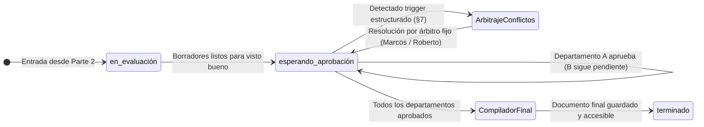

# Implementation Plan: Hito 9 (Parte 3 de 3) — Aprobación Humana, Arbitraje y Cierre de RFPs

**Nivel de Complejidad:** Nivel 4 (Sistema Cognitivo / Agéntico y Estado Persistente - Human-in-the-Loop)  
**Rama de Trabajo:** `feature/rfp-approval-completion`  
**Documentos de Referencia:** `.github/STRATEGY.md`, `docs/nexova-rfp-BRIEFING.md`  

---

## 1. 📐 PACK 1: ARCHITECT (Ideación y Decisión Técnica)

### 1.1 Árbol de Pensamiento (Tree of Thoughts - ToT)
Se evaluaron tres ramas arquitecturales para la interacción humana y el arbitraje:

- **Rama A (Polling síncrono con `time.sleep` en el worker):** El flujo se queda esperando en un bucle activo a que un campo de la base de datos cambie a "approved".
  - *Ventajas:* Ninguna en producción.
  - *Riesgos:* Bloqueo de hilos de servidor, consumo destructivo de memoria, timeouts de proxies HTTP e imposibilidad de reiniciar el proceso sin perder la sesión. **Descartada.**
- **Rama B (Aprobación global monolítica):** Un único interruptor general que pausa todo el grafo hasta que todos los directores aprueben a la vez.
  - *Ventajas:* Grafo lineal simple.
  - *Riesgos:* Viola la regla de oro: un departamento esperando sign-off bloquea el avance y revisión de los demás departamentos listos. **Descartada.**
- **Rama C (Ramas paralelas con Checkpointer persistente namespaced y punto de entrada `resume` - Elegida):**
  - Cada departamento tiene su estado de aprobación independiente (`department_approvals[dept_id]`).
  - Uso de checkpointer persistente (`SqliteSaver` o Postgres) con `thread_id = "rfp-{ticket_id}"`.
  - El grafo se interrumpe (`interrupt`) en el nodo de sign-off del departamento específico y se reanuda limpiamente vía `resume` sin reiniciar las partes previas.
  - Nodo de arbitraje determinista conectado a los 3 triggers de conflicto de `docs/nexova-rfp-BRIEFING.md §7` (árbitros fijos: Marcos Ibáñez y Roberto Díaz).
  - Al completar todos los sign-offs, el nodo `ultimate_document_synthesizer` compila la propuesta económica final en Markdown/JSON y transiciona el ticket a `terminado`.

---

### 1.2 Análisis de los 3 Expertos

#### 1. UX / Product Specialist
- **Experiencia sin bloqueos:** En el Backoffice, cada tarjeta departamental muestra su propio botón de **"Aprobar"** / **"Rechazar"** con su responsable asignado (`Javier Almeida`, `Elena Vargas`, `Roberto Díaz`).
- Si Elena aprueba *Capacitación*, su tarjeta muestra inmediatamente el visto bueno (verde), mientras la de Javier en *Selección* permanece en espera (amarillo) con estado global del ticket en `esperando_aprobación`.
- Cuando el último responsable aprueba, aparece el botón destacado para previsualizar y descargar el **Documento Final de Propuesta Económica**.

#### 2. Dev Lead / Software Architect
- **Persistencia y Namespacing:** El checkpointer almacena el checkpoint de ejecución indexado por `thread_id = f"rfp-{ticket_id}"`. No hay interferencia entre múltiples tickets concurrentes.
- **Reanudación determinista (`resume`):** El endpoint `POST /api/rfps/{ticket_id}/approve` recibe `{department_id, action: "approve"|"reject", feedback, approver}` y ejecuta la reanudación del grafo pasando el valor del sign-off al interrupt.
- **Trazabilidad:** Cada paso de ejecución registra en `execution_trace_log` una entrada con `{node, agent, input, output, timestamp}`.

#### 3. Security & Compliance Specialist
- **Arbitraje Estricto (cero deliberación por LLM):**
  1. `ttc-vs-training-window`: Si Selección promete TTC < 15 días o choca con el inicio de capacitación → Árbitro: **Marcos Ibáñez** fuerza `request_changes`.
  2. `support-sla-missing`: Si Soporte omite el SLA de 24h → Árbitro: **Roberto Díaz** rechaza automáticamente.
  3. `currency-mismatch`: Si alguna sección difiere de la moneda de la sede (España→EUR, Miami→USD) → Árbitro: **Marcos Ibáñez** reescribe a la moneda oficial.
- **Auth Guard Standard:** Endpoints protegidos por `Depends(get_current_user)`.

---

### 1.3 Threat Modeling (OWASP Top 10 for LLMs) & FMEA

| Amenaza / FMEA | Modo de Fallo | Severidad | Mitigación Técnica |
| :--- | :--- | :--- | :--- |
| **Colisión de Checkpoints Concurrente** | Dos tickets distintos usan el mismo thread_id | Crítica | Aislamiento estricto con `thread_id = f"rfp-{ticket_id}"`. |
| **Pérdida de Estado en Reinicio de Servidor** | El servidor se reinicia mientras un departamento está en espera | Alta | Checkpointer persistente en base de datos (`app_checkpoints.db` en SQLite / PostgreSQL), nunca en memoria volátil. |
| **Bloqueo entre Departamentos** | Un departamento no aprobado frena la evaluación de los demás | Alta | Ramas desacopladas; el compilador final solo se dispara cuando `all(s.approved for s in sections)`. |
| **Arbitraje Alucinatorio por LLM** | Un LLM decide arbitrariamente sobre SLAs o divisas | Alta | Lógica de triggers y reglas de resolución deterministas ancladas en código a `company-BRIEFING.md §7`. |

---

## 2. 📝 PACK 2: PLANNER (Estructuración del Plan de Implementación)

### 2.1 Contratos de Datos y Schemas Pydantic (`data/pipelines/rfp_intake/schemas.py`)

```python
class ApprovalAction(BaseModel):
    department_id: DepartmentId
    action: Literal["approve", "reject", "request_changes"]
    approver_name: str
    comments: Optional[str] = None
    timestamp: str = Field(default_factory=lambda: datetime.now(timezone.utc).isoformat())

class ConflictTriggerResult(BaseModel):
    trigger_id: Literal["ttc-vs-training-window", "support-sla-missing", "currency-mismatch"]
    detected: bool
    arbitrator: str
    resolution_rule: str
    applied_action: str

class ExecutionTraceEntry(BaseModel):
    node: str
    agent: str
    input_summary: str
    output_summary: str
    timestamp: str

class FinalProposalDocument(BaseModel):
    ticket_id: str
    rfp_id: str
    client_name: str
    client_hq: str
    currency: str
    generated_at: str
    executive_summary: str
    department_sections: List[Dict[str, Any]]
    terms_and_guarantees: str
    markdown_document: str
```

### 2.2 Máquina de Estados e Invariantes



**Invariantes del Sistema:**
1. Ninguna sección se da por aprobada sin el sign-off humano del responsable del área.
2. La pausa de una sección no bloquea el procesamiento ni aprobación de las demás.
3. El documento final solo se compila cuando el 100% de los departamentos activos están en estado `approved`.
4. El ticket transiciona a `terminado` únicamente tras la persistencia exitosa del documento final.

---

## 3. 💻 PACK 3: CODER (Desarrollo y Verificación Fáctica)

### Componentes a Desarrollar:
1. **Schemas (`data/pipelines/rfp_intake/schemas.py`):**
   - Incorporar `ApprovalAction`, `ConflictTriggerResult`, `ExecutionTraceEntry` y `FinalProposalDocument`.
2. **Nodos de Aprobación y Arbitraje (`data/pipelines/rfp_intake/nodes.py`):**
   - `department_approval_check_node`: Evalúa el estado de aprobación de cada sección.
   - `arbitration_node`: Aplica las reglas de los triggers `ttc-vs-training-window`, `support-sla-missing`, `currency-mismatch` con sus árbitros fijos.
   - `ultimate_document_synthesizer_node`: Compila el documento final en Markdown estructurado.
3. **Grafo LangGraph con Checkpointer y HITL (`data/pipelines/rfp_intake/graph.py`):**
   - Instanciar checkpointer persistente (`SqliteSaver`).
   - Configurar punto de interrupción condicional (`interrupt`) antes de consolidar la aprobación.
   - Runner `resume_rfp_approval_pipeline(ticket_id, approval_action, db_engine)` para reanudar la ejecución con la entrada humana.
4. **Persistencia en SQLModel (`services/api/models.py`):**
   - Campos en `RFPTicket`: `final_proposal_document`, `approval_summary`, `execution_trace_log`.
   - Campos en `RFPDepartmentSection`: `approval_status`, `approver`, `approved_at`, `approval_comments`.
5. **Endpoints en FastAPI (`services/api/routes/rfps.py`):**
   - `POST /api/rfps/{ticket_id}/approve`: Registra sign-off humano y reanuda el grafo.
   - `GET /api/rfps/{ticket_id}/final-document`: Descarga o previsualiza el documento final acordado.
6. **Backoffice UI (`uis/backoffice/src/app/rfps/page.tsx`):**
   - Tarjetas de sign-off con botones de **Aprobar** / **Rechazar** por departamento.
   - Modal o vista previa del documento final en estado `terminado`.

---

## 4. 🛡️ PACK 4: AUDITOR (Testing, Concurrencia y Protocolo Git)

### 4.1 Suite de Pruebas Automatizadas (`tests/pipelines/test_rfp_approval_completion.py`)
- **Test 1: Paralelismo Real bajo Interrupción:** Aprueba el Departamento B mientras el Departamento A permanece en pausa (demuestra ramas concurrentes no bloqueantes).
- **Test 2: Reanudación limpia desde Checkpoint:** El grafo se reanuda exactamente desde el punto de interrupción con `thread_id` namespaced.
- **Test 3: Arbitraje estructurado ante trigger `ttc-vs-training-window`:** Conflicto de ventana de entrega resuelto por Marcos Ibáñez.
- **Test 4: Arbitraje estructurado ante trigger `currency-mismatch`:** Moneda discrepante resuelta por Marcos Ibáñez a la divisa oficial.
- **Test 5: Síntesis final automática y cierre:** Cuando todas las secciones aprueban, genera el documento final y actualiza el ticket a `terminado`.
- **Test 6: Ruta End-to-End completa (Partes 1 → 2 → 3):** Simulación integral desde la recepción del PDF hasta el documento final acordado.

---

## 🗺️ Mapa de Trabajo por Fases (Roadmap)

### Fase 1: Schemas y Persistencia de Aprobación
- [x] 1.1 Incorporar schemas Pydantic en `data/pipelines/rfp_intake/schemas.py` (`ApprovalAction`, `ConflictTriggerResult`, `FinalProposalDocument`).
- [x] 1.2 Actualizar modelos SQLModel en `services/api/models.py` con entidad `RFPFinalDocument` y trazabilidad.

### Fase 2: Lógica de Arbitraje y Síntesis Final
- [x] 2.1 Implementar detector determinista de los 3 triggers de conflicto en `data/pipelines/rfp_intake/nodes.py`.
- [x] 2.2 Implementar nodo de arbitraje estructurado con árbitros fijos (§7).
- [x] 2.3 Implementar `ultimate_document_synthesizer_node` para compilar el Markdown final de la propuesta económica.

### Fase 3: Grafo LangGraph con Checkpointer y Human-in-the-Loop
- [x] 3.1 Integrar checkpointer persistente SQLite en `data/pipelines/rfp_intake/graph.py` con namespacing `rfp-{ticket_id}` y `rfp-{ticket_id}:{department_id}`.
- [x] 3.2 Implementar `start_rfp_approval_pipeline` y `submit_department_approval` (`Command(resume=...)`) para reanudar de forma no-bloqueante por departamento.
- [x] 3.3 Gestionar transiciones de estado: `esperando_aprobación` → `terminado`.

### Fase 4: Endpoints FastAPI y Soporte Backoffice UI
- [x] 4.1 Extender `services/api/routes/rfps.py` con `POST /{ticket_id}/start-approval`, `POST /{ticket_id}/approve` y `GET /{ticket_id}/final-document`.
- [x] 4.2 Actualizar cliente frontend en `uis/backoffice/src/services/rfps.ts`.
- [x] 4.3 Añadir controles de visto bueno departamental y previsualización de documento final en `uis/backoffice/src/app/rfps/page.tsx`.
- [x] 4.4 Verificar compilación TypeScript (`cd uis/backoffice && npx tsc --noEmit`).

### Fase 5: Suite de Pruebas Automatizadas y Validación E2E
- [x] 5.1 Crear `tests/pipelines/test_rfp_approval_completion.py` con pruebas unitarias de interrupción, paralelismo y arbitraje.
- [x] 5.2 Implementar prueba End-to-End reproducible que recorra las 3 partes completas con aprobaciones simuladas.
- [x] 5.3 Ejecutar verificación completa con `uv run python -m pytest tests/pipelines/test_rfp_intake.py tests/pipelines/test_rfp_generation.py tests/pipelines/test_rfp_approval_completion.py -v`.

---

## ⚙️ Métodos Aplicados (Code Refinement Suite)
- **Tree of Thoughts (ToT):** Selección de ramas de interrupción asíncronas con checkpointer namespaced frente a bloqueos en bucle síncrono.
- **Análisis de 3 Expertos:** Evaluación integral de la experiencia de sign-off del comercial, arquitectura de concurrencia y matriz de compliance/arbitraje.
- **Threat Modeling & FMEA:** Prevención de colisiones entre checkpoints concurrentes y aseguramiento de persistencia ante reinicios.
- **Topology & Wiring Check:** Garantía de que el compilador final solo se invoque tras el 100% de vistos buenos aprobados.
