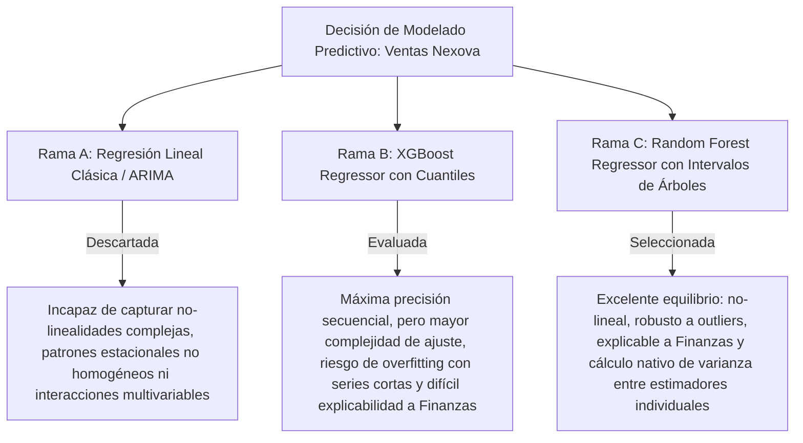

# Implementation Plan: Modelo de Predicción de Ventas con Regresión (Ticket Finanzas)

> **Documento de Planificación y Arquitectura de Machine Learning**  
> **Basado en:** `.github/STRATEGY.md`, `CONTEXT-company.md` / `CONTEXT.md` (Nexova Solutions), `pyproject.toml`  
> **Marco Metodológico:** Code Refinement Suite (Nivel 3 — Módulo Crítico de Machine Learning & Evaluación Estadística)  
> **Modalidad:** Modo Tutor / Aprendizaje guiado (el mentor acompaña y entrega el código por chat; el usuario lo revisa, ejecuta y pega paso a paso)  

---

## 📌 Contexto y Objetivos del Hito

El área de Finanzas y la Dirección Ejecutiva de **Nexova Solutions** (liderada por Laura Mendoza) han solicitado formalmente un estudio de viabilidad predictiva: quieren saber si, con el histórico de ventas disponible, es viable anticipar el comportamiento futuro de las ventas con un margen de error aceptable antes de aprobar la construcción de un dashboard ejecutivo dedicado.

El Tech Lead ha formalizado los criterios técnicos no negociables:
1. **División temporal honesta (Split 8/2):** Usar los primeros 8 años de histórico para entrenamiento y los 2 años más recientes como conjunto de prueba estricto (comprobación ciega, sin *data leakage* temporal).
2. **Modelo y Algoritmo Justificado:** Elegir fundamentadamente entre **Random Forest** y **XGBoost** (explicabilidad vs. precisión secuencial), documentando explícitamente el criterio de decisión.
3. **Métricas de Evaluación Exigentes:** Calcular y reportar sobre el conjunto de test: **MSE**, **PSI** (Population Stability Index), **Gini** y **R2 Score**, justificando pedagógicamente por qué un MSE bajo no basta por sí solo.
4. **Visualización con Rango de Incertidumbre:** Gráfica comparativa de los 2 años de test que muestre la predicción junto a su intervalo/área de variabilidad (no una simple estimación puntual optimista).
5. **Prueba Unitaria de Fuga Temporal:** Test automatizado en `tests/pipelines/` que certifique que el split 8 años / 2 años no mezcla datos ni produce fuga de información.
6. **Reproducibilidad:** Fijar `random_state` / `seed` en todas las operaciones estocásticas.

---

## 🏛️ PACK 1: ARCHITECT — Evaluación de Alternativas Técnicas y Veredicto (ToT)

Se evaluaron tres arquitecturas de modelado mediante **Tree of Thoughts (ToT)** bajo la supervisión de 3 perfiles expertos:

### Análisis de los 3 Expertos:
1. **Experto en Stakeholder / Finanzas (UX & Negocio):**  
   *Finanzas exige claridad.* Random Forest permite explicar intuitivamente que "100 analistas independientes (árboles) proyectan escenarios y se calcula el consenso y su dispersión". XGBoost es más percibido como caja negra de optimización por gradiente.
2. **Experto en Machine Learning & Dev Lead:**  
   Ambos modelos son viables con `scikit-learn` / `xgboost`. Sin embargo, Random Forest permite extraer de forma directa la predicción de cada uno de sus árboles (`estimators_`) para construir el área de variabilidad (desviación típica o percentiles) sin requerir re-entrenar múltiples modelos por cuantiles (loss `quantile` en XGBoost).
3. **Experto en Seguridad & Gobernanza de Datos:**  
   El principal riesgo no es el algoritmo, sino el *Data Leakage*. Cualquier escalado o imputación debe ajustarse únicamente sobre el set de entrenamiento (8 años) y transformarse sobre el set de prueba (2 años).

### 🏆 Veredicto Arquitectónico:
* **Algoritmo Principal:** **Random Forest Regressor** (con justificación documentada en código y reporte comparativo frente a XGBoost).
* **Cálculo de Incertidumbre:** Varianza empírica calculada sobre las predicciones individuales de los estimadores (`estimators_`) del ensamble para trazar el intervalo de confianza al 95% ($\mu \pm 1.96 \cdot \sigma$).

---

## 🗺️ Mapa de Trabajo por Fases (Roadmap)

### 🌿 Fase 0: Preparación de Entorno y Control de Versiones
- [x] **Paso 0.1:** Crear y cambiar a la rama de trabajo `feature/sales-forecast-model` desde `main`.
- [x] **Paso 0.2:** Verificar instalación de `uv` y sincronizar dependencias (`uv sync`).
- [x] **Paso 0.3:** Instalar dependencias de Machine Learning mediante `uv add scikit-learn xgboost matplotlib scipy` (respetando la prohibición de usar `pip`).

---

### 📂 Fase 1: Adquisición, Exploración y Contrato de Datos
- [x] **Paso 1.1:** Localizar y validar el dataset histórico de ventas `data/raw/nexova_sales.csv` contrastando su esquema con `CONTEXT-company.md` / `CONTEXT.md`.
- [x] **Paso 1.2:** Crear script exploratorio para auditar columnas, rango de fechas total (debe cubrir al menos 10 años), tipos de datos y valores nulos.
- [x] **Paso 1.3:** Documentar el patrón de estacionalidad detectado en el histórico de Nexova.

---

### ⚙️ Fase 2: Pipeline de Preprocesamiento y Split Temporal Estricto
- [x] **Paso 2.1:** Diseñar la función de división temporal estricta: ordenar cronológicamente, destinar los primeros 8 años exactos a `Train` y los últimos 2 años a `Test`.
- [x] **Paso 2.2:** Tratamiento de valores nulos o faltantes (imputación con estadísticas calculadas únicamente en `Train`).
- [x] **Paso 2.3:** Ingeniería de características temporales (mes, trimestre, año, variables cíclicas o lags si aplica).
- [x] **Paso 2.4:** Escalado/Normalización de variables con ajuste exclusivo en `Train` (`scaler.fit_transform(X_train)`, `scaler.transform(X_test)`).

---

### 🧠 Fase 3: Entrenamiento y Justificación del Modelo
- [x] **Paso 3.1:** Crear el módulo de entrenamiento `services/ml/sales_forecaster.py` con `RandomForestRegressor` (y baseline opcional `XGBRegressor`).
- [x] **Paso 3.2:** Fijar la semilla aleatoria (`random_state=42`) para garantizar reproducibilidad 100%.
- [x] **Paso 3.3:** Incluir en el encabezado del módulo la justificación técnica documentada de la elección del algoritmo.

---

### 📊 Fase 4: Evaluación Multimétrica y Documentación Pedagógica
- [x] **Paso 4.1:** Implementar el cálculo de las 4 métricas obligatorias exclusivamente sobre el conjunto de test:
  - **MSE (Mean Squared Error)**: Magnitud cuadrática del error de predicción.
  - **PSI (Population Stability Index)**: Evaluación de drift en las distribuciones entre Train y Test.
  - **Gini / Coeficiente de Gini**: Capacidad de ordenamiento discriminativo sobre los residuos o valores relativos.
  - **R2 Score**: Coeficiente de determinación ($1 - SS_{res} / SS_{tot}$).
- [x] **Paso 4.2:** Redactar el análisis pedagógico explicando por qué un MSE bajo no es suficiente por sí solo (vulnerabilidad a escala, drift o sesgos sistemáticos).

---

### 📈 Fase 5: Visualización de Predicción con Banda de Incertidumbre
- [x] **Paso 5.1:** Desarrollar el generador de gráficos en `matplotlib` que trace:
  - Curva de ventas reales (los 2 años de prueba).
  - Curva de predicción del modelo.
  - Área sombreada de variabilidad/incertidumbre ($\pm 1.96 \cdot \sigma$ entre estimadores de los árboles).
- [x] **Paso 5.2:** Guardar la figura generada en alta resolución en `reports/figures/sales_forecast_uncertainty.png`.

---

### 🧪 Fase 6: Pruebas Unitarias de Fuga Temporal (Anti-Leakage)
- [x] **Paso 6.1:** Crear el archivo de test `tests/pipelines/test_sales_split.py`.
- [x] **Paso 6.2:** Programar test que verifique que `max(train_date) < min(test_date)` sin superposición de fechas.
- [x] **Paso 6.3:** Programar test que valide la proporción de 8 años para Train y 2 años para Test.
- [x] **Paso 6.4:** Ejecutar la suite con `uv run pytest tests/pipelines/test_sales_split.py -v`.

---

### 🛡️ Fase 7: PACK 4 AUDITOR & Protocolo de Entrega
- [x] **Paso 7.1:** Auditoría de calidad de código y tipado.
- [x] **Paso 7.2:** Redacción de la sección de resultados en el `README.md` o reporte final.
- [ ] **Paso 7.3 (Regla Inviolable de Git):** Detenerse y solicitar autorización explícita al usuario antes de hacer `git push`.
- [ ] **Paso 7.4:** Apertura de Pull Request hacia `main` describiendo modelo, justificación y métricas sobre el test set.

---

## ⚙️ Métodos Aplicados (Code Refinement Suite)

1. **Tree of Thoughts (ToT):** Se utilizó en el PACK 1 para ramificar y contrastar tres caminos técnicos (Regresión simple, XGBoost y Random Forest), evaluando ventajas operativas y requerimientos de negocio de Finanzas.
2. **Chain of Verification (CoVe):** Durante la Fase 2 y Fase 6, se verificará fácticamente que no exista *Data Leakage*: toda transformación se ajusta solo en entrenamiento y las fechas de corte se auditan mediante aserciones matemáticas y tests automáticos.
3. **Step-Back Prompting:** En la Fase 4, se eleva la interpretación de las métricas más allá del número bruto (MSE), incorporando el índice de estabilidad poblacional (PSI) y Gini para evaluar robustez ante cambios en el patrón de ventas de Nexova.
4. **Red Teaming (Anti-Fragilidad):** En las pruebas unitarias se inyectarán desórdenes cronológicos para garantizar que el pipeline ordene siempre por fecha antes de segmentar, impidiendo que una mezcla de registros contamine el modelo.
5. **Human-in-the-Loop & Hands-Off Tutoring:** El mentor no edita el código fuente de forma autónoma; entrega cada archivo por chat en bloques Markdown con explicaciones didácticas para que el usuario aprenda, copie, pruebe y valide paso a paso.

