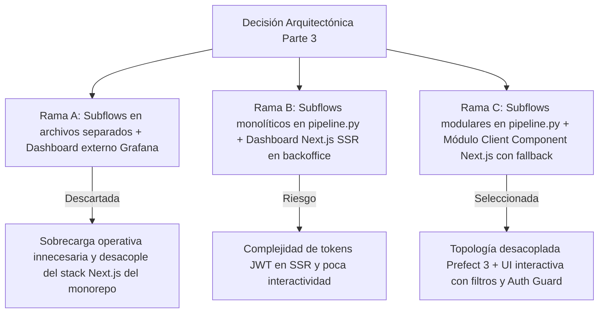

# Implementation Plan: Mejora del Pipeline — Subflows, Tests y Dashboard Ejecutivo (Parte 3 de 3)

> **Documento de Planificación y Arquitectura de Producción**  
> **Basado en:** `.github/STRATEGY.md`, `CONTEXT-company.md` (Nexova Solutions), `data/pipelines/PIPELINE_DESIGN.md`, `docs/plans/resilient-business-performance-pipeline-plan.md`  
> **Marco Metodológico:** Code Refinement Suite (Nivel 3 — Arquitectura Crítica de Datos & Fullstack)  
> **Modalidad:** Modo Tutor / Aprendizaje guiado (el mentor acompaña, el usuario ejecuta paso a paso)  

---

## 📌 Contexto y Objetivos del Hito

En la **Parte 2**, Nexova Solutions implementó con éxito el pipeline básico con Prefect 3, transformando los eventos de `public.telemetry_events` en indicadores de negocio en `reporting.executive_kpis` y exponiéndolos vía endpoints en `services/reporting/`.

En esta **Parte 3**, el reto consiste en **llevar la solución a grado de producción industrial**:
1. **Modularizar la orquestación:** Refactorizar el flow monolítico en **subflows reutilizables** (`@flow`) para extracción, transformación y carga, con interfaces explícitas.
2. **Blindaje de Calidad (Testing Automatizado):** Diseñar una suite de tests unitarios aislados en `tests/pipelines/test_pipeline.py` con fixtures en memoria, validando tanto cálculos exactos como resiliencia ante datos malformados.
3. **Preservación CLI:** Garantizar que `python data/pipelines/pipeline.py` mantenga su autonomía operativa sin regresiones.
4. **Activación de Negocio (Dashboard Ejecutivo):** Construir una interfaz web en `uis/backoffice/` (Next.js) que consuma `GET /reporting/kpis` para que la CEO Laura Mendoza y los directores de departamento visualicen el valor real generado.

---

## 🏛️ PACK 1: ARCHITECT — Evaluación de Alternativas Técnicas y Veredicto

Se evaluaron tres enfoques mediante **Tree of Thoughts (ToT)** para la topología de subflows y la integración del dashboard:

### Comparativa de Alternativas (ToT):

1. **Rama A (Subflows dispersos en múltiples archivos + Dashboard externo en Grafana/Metabase):**
   - *Enfoque:* Dividir cada etapa en scripts independientes (`extract_flow.py`, `transform_flow.py`, etc.) y levantar un contenedor de BI externo.
   - *Veredicto:* **Descartada.** Fragmenta innecesariamente el monorepo para un pipeline de un solo dominio y contradice la instrucción de integrar el dashboard directamente en `uis/backoffice/`.
2. **Rama B (Subflows inline en `pipeline.py` + Página SSR pura en Next.js sin interactividad):**
   - *Enfoque:* Definir subflows decorados con `@flow` en `data/pipelines/pipeline.py` y renderizar una tabla estática en el servidor.
   - *Veredicto:* **Descartada.** Dificulta la experiencia de filtrado interactivo por departamento/fechas para los ejecutivos y no aprovecha la reactividad de la UI existente.
3. **Rama C (Subflows modulares en `data/pipelines/pipeline.py` + Subflow Opcional resiliente + Página `/reporting` en `uis/backoffice/` con Client Component reactivo) [Seleccionada]:**
   - *Enfoque:* 
     - Cuatro flows Prefect 3: Flow orquestador principal (`business_performance_flow`), subflow de extracción (`extract_telemetry_events_subflow`), subflow de transformación (`transform_business_kpis_subflow`), subflow de carga idempotente (`load_executive_kpis_subflow`), y subflow opcional de snapshot (`eval_snapshot_subflow`) con `return_state=True`.
     - Suite de tests en `tests/pipelines/test_pipeline.py` usando `pytest` y fixtures sin dependencias de red ni BD.
     - Dashboard en `uis/backoffice/src/app/reporting/page.tsx` conectado al backend FastAPI con manejo de estados de carga, filtros de departamento y tarjetas KPI legibles para no técnicos.
   - *Veredicto:* **Aprobada.** Satisface los 12 criterios de evaluación de `.github/STRATEGY.md`.

### Veredicto de los 3 Expertos:
- **Dev Lead:** Los subflows de Prefect 3 aplican el principio de responsabilidad única (SRP). El subflow de transformación recibe DataFrames y entrega DataFrames, permitiendo testear unitariamente tanto las tasks como el subflow completo con fixtures en memoria.
- **Sec Specialist:** El endpoint `GET /reporting/kpis` continúa protegido por el `Auth Guard Standard` (`Depends(get_current_user)`). El dashboard en Next.js gestionará las credenciales y el token de forma segura sin exponer secretos de Supabase al navegador.
- **UX / Business Lead:** El dashboard no será una consola de programador. Se agruparán los KPIs en dos paneles temáticos: **Atención al Cliente** (MTTR vs SLA 24h y % Automatización Chatbot vs Meta 40%) y **Operaciones de Selección** (Cribado de CVs y Calidad Media de Perfiles), con colores semánticos (verde/amarillo/rojo) legibles para Laura Mendoza.

---

## 🗺️ Mapa de Trabajo por Fases (Roadmap)

### Fase 1: Refactorización en Subflows (`data/pipelines/pipeline.py`)
- [x] **Paso 1.1 — Análisis de la topología existente:** Mapear las tasks actuales (`extract_events_task`, `transform_kpis_task`, `load_kpis_task`, `optional_eval_snapshot_task`, `log_pipeline_run_task`) hacia los contratos de los nuevos subflows.
- [x] **Paso 1.2 — Creación del Subflow de Extracción:**
  - Definir `@flow(name="extract-telemetry-events-subflow")` con parámetros explícitos (`start_time`, `end_time`).
  - Invocar `extract_telemetry_events_task` y retornar la lista de eventos crudos sin recurrir a variables globales.
- [x] **Paso 1.3 — Creación del Subflow de Transformación:**
  - Definir `@flow(name="transform-business-kpis-subflow")` con parámetros explícitos (`raw_events`, `window_date`).
  - Invocar `transform_business_kpis_task` (manteniendo la lógica de caché) y retornar la lista de KPIs estructurados.
- [x] **Paso 1.4 — Creación del Subflow de Carga Idempotente:**
  - Definir `@flow(name="load-executive-kpis-subflow")` con parámetros explícitos (`kpis`, `run_id`).
  - Invocar `load_executive_kpis_task` ejecutando el `UPSERT` transaccional sobre `reporting.executive_kpis`.
- [x] **Paso 1.5 — Creación del Subflow Opcional de Snapshot:**
  - Definir `@flow(name="eval-snapshot-subflow")` que encapsule la exportación a `data/eval/`.
  - Invocación desde el flow principal con `return_state=True` para garantizar resiliencia ante errores secundarios.
- [x] **Paso 1.6 — Orquestación en Flow Coordinador:**
  - Refactorizar `business_performance_flow` para que actúe exclusivamente como director de orquesta entre los subflows y registre la auditoría en `reporting.pipeline_runs`.
  - Preservar el entrypoint CLI `if __name__ == "__main__":`.

---

### Fase 2: Suite de Tests Unitarios Aislados (`tests/pipelines/test_pipeline.py`)
- [x] **Paso 2.1 — Creación de fixtures sintéticas en memoria:**
  - Crear fixtures de Pytest simulando eventos reales de Nexova: `support_ticket_resolved`, `chatbot_issue_resolved`, y `candidate_score_calculated`.
  - Garantizar cero llamadas de red y cero dependencias de base de datos.
- [x] **Paso 2.2 — Test 1: Transformación de Soporte y SLA (MTTR & Breaches):**
  - Validar cálculo de tiempo medio de resolución y porcentaje de tickets fuera de SLA (> 24h).
- [x] **Paso 2.3 — Test 2: Transformación de Chatbot (Tasa de Resolución Autónoma):**
  - Validar el ratio de tickets resueltos por bot vs escalados a agentes humanos frente al umbral objetivo (40%).
- [x] **Paso 2.4 — Test 3: Transformación de Talento y Selección (Scoring de CVs):**
  - Validar agregación de perfiles evaluados y score promedio por vacante/departamento.
- [x] **Paso 2.5 — Test 4: Comportamiento Defensivo ante Entradas Inválidas:**
  - Probar eventos con payloads vacíos, fechas malformadas o campos nulos sin que la task lance una excepción no controlada.
- [x] **Paso 2.6 — Test 5: Verificación Determinista con Cálculo Manual:**
  - Contrastar la métrica resultante contra un valor calculado a mano con números fijos verificables.
- [x] **Paso 2.7 — Ejecución y Validación Pytest:**
  - Correr `uv run pytest tests/pipelines/test_pipeline.py` y verificar que el 100% de los tests pasan en verde.

---

### Fase 3: Verificación de Autonomía CLI y No Regresión
- [x] **Paso 3.1 — Ejecución del script CLI:**
  - Ejecutar `uv run python data/pipelines/pipeline.py` directamente en terminal.
  - Verificar en logs la ejecución secuencial de los 3 subflows principales y del subflow opcional.
- [x] **Paso 3.2 — Verificación de Persistencia e Idempotencia:**
  - Comprobar que los registros se actualizan en `reporting.executive_kpis` y que no se generan duplicados al correr por segunda vez.
- [x] **Paso 3.3 — Auditoría de Intocabilidad Técnica:**
  - Confirmar mediante `git diff` que `telemetry_events` y `services/telemetry/analysis.py` no sufrieron alteraciones.

---

### Fase 4: Construcción del Dashboard de Negocio (`uis/backoffice/`)
- [x] **Paso 4.1 — Servicio de Datos en Frontend (`src/services/reporting.ts`):**
  - Implementar cliente tipado en TypeScript para consumir `GET /reporting/kpis` y `GET /reporting/status` desde FastAPI.
- [x] **Paso 4.2 — Creación de la Página del Dashboard (`src/app/reporting/page.tsx`):**
  - Crear la ruta `/reporting` dentro del backoffice con diseño limpio, responsivo y corporativo.
- [x] **Paso 4.3 — Componentes de Métricas Ejecutivas:**
  - Tarjetas de resumen para CEO Laura Mendoza con semaforización SLA (Cumplido / En Riesgo / Incumplido).
  - Bloque 1: **Atención al Cliente** (Roberto Díaz) — MTTR en horas y % resolución del Chatbot IA.
  - Bloque 2: **Operaciones de Selección** (Javier Almeida) — Total CVs analizados y distribución de scores.
- [x] **Paso 4.4 — Filtros Interactivos:**
  - Selector de departamento (`Todos`, `customer_support`, `talent_acquisition`) y rango de fechas.
  - Botón de refresco y estado de última sincronización del pipeline.
- [x] **Paso 4.5 — Verificación de Compilación y Calidad:**
  - Validar build en `uis/backoffice/` con `npm run build` o `npx tsc --noEmit`.

---

### Fase 5: Auditoría, Checklist y Entrega Git (PACK 4: AUDITOR)
- [x] **Paso 5.1 — Checklist de Evaluación de `.github/STRATEGY.md`:**
  - [x] El flow principal en `data/pipelines/pipeline.py` invoca al menos tres subflows (`@flow`).
  - [x] Cada subflow tiene inputs y outputs explícitos y puede ejecutarse de forma independiente.
  - [x] El archivo `tests/pipelines/test_pipeline.py` existe con al menos tres tests unitarios.
  - [x] Tests en aislamiento total con fixtures in-memory.
  - [x] Al menos un test defensivo ante inputs inválidos.
  - [x] Al menos un test de validación exacta contra cálculo manual de `CONTEXT-company.md`.
  - [x] `uv run pytest tests/pipelines/test_pipeline.py` pasa sin errores.
  - [x] `python data/pipelines/pipeline.py` corre sin errores conservando el entrypoint CLI.
  - [x] Nombres de subflows y tasks reflejan el vocabulario de dominio de Nexova.
  - [x] `telemetry_events` y `services/telemetry/analysis.py` intactos.
  - [x] Dashboard funcional en `uis/backoffice/` consumiendo `services/reporting/`.
  - [x] Dashboard legible para stakeholders de negocio no técnicos.
- [ ] **Paso 5.2 — Commit Formal:**
  - Realizar commit con el mensaje exacto:
    `feat: refactor business performance pipeline into subflows, add unit tests, and add reporting dashboard`
- [ ] **Paso 5.3 — Protocolo Git Pre-Push:**
  - Solicitar consentimiento explícito al usuario antes de enviar cambios al repositorio remoto.

---

## ⚙️ Métodos Aplicados (Code Refinement Suite)

1. **Tree of Thoughts (ToT - PACK 1: ARCHITECT):**
   Se contrastaron tres alternativas de arquitectura para la división en subflows y el front de visualización. Se seleccionó la modularización in-place dentro del monorepo con un cliente reactivo en `uis/backoffice/` para evitar dispersión tecnológica y garantizar compatibilidad inmediata con FastAPI.

2. **Step-Back Prompting & Domain Abstraction (PACK 2: PLANNER):**
   Se abstrajeron las necesidades de los directores de Nexova (Laura Mendoza, Roberto Díaz, Javier Almeida), asegurando que los nombres de los subflows y las tarjetas del dashboard hablen el lenguaje del negocio (horas de SLA, tasa de automatización del 40%, volumen de cribado de talento) y no jerga técnica abstracta.

3. **Chain of Verification (CoVe) & TDD (PACK 3: CODER):**
   Antes de codificar, se definen fixtures sintéticas deterministas para aislar el cómputo de KPIs de la infraestructura de persistencia. Se valida la compatibilidad estricta de tipos entre Pydantic (FastAPI) y TypeScript (Next.js).

4. **Red Teaming & Resilience Audit (PACK 4: AUDITOR):**
   Se somete el subflow opcional a pruebas de falla simulada con `return_state=True`, se verifica que inputs corruptos en telemetría no provoquen un fallo general del pipeline, y se constata la protección de endpoints mediante `Auth Guard Standard`. Se respeta rigurosamente la regla de no auto-push.
