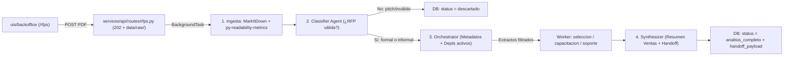

# Implementation Plan: Flujo Agéntico de RFPs — Recepción y Enrutamiento (Hito 9 · Parte 1 de 3)

**Documento:** `.github/implementation-plan.md`  
**Copia de Respaldo:** `docs/plans/rfp-intake-part1-plan.md`  
**Rama de Trabajo:** `feature/rfp-intake`  
**Nivel de Complejidad (Code Refinement Suite):** 🔹 **Nivel 4 — Sistema Cognitivo / Agéntico y Estado Persistente (Muy Alta Complejidad)**  
**Referencias:** `.github/STRATEGY.md`, `docs/nexova-rfp-BRIEFING.md`

---

## 📐 PACK 1: ARCHITECT (Ideación, ToT, Threat Modeling IA & FMEA)

### 1.1 Tree of Thoughts (ToT) — Arquitectura de Ingesta, Persistencia y Orquestación

| Decisión | Opción Elegida | Alternativas Descartadas | Justificación |
| :--- | :--- | :--- | :--- |
| **Grafo / Pipeline** | Grafo LangGraph dedicado `rfp_intake` bajo `data/pipelines/rfp_intake/` | Enganchar nodos al grafo CX (`services/agent/`) | Aislamiento total de dominio (Ventas/RFP vs Soporte CX); cumple la regla no negociable de `.github/STRATEGY.md`. |
| **Conversión & Métricas** | `MarkItDown` (PDF → Markdown) + `py-readability-metrics` antes de cualquier LLM | Pasar PDF binario o texto crudo al LLM | Reduce ruido y consumo de tokens; calcula Flesch-Kincaid y Gunning Fog para anticipar complejidad/coste. |
| **Persistencia** | **PostgreSQL (Supabase) vía SQLModel** (`services/api/models.py`) | TinyDB o archivos JSON en disco | Requisito obligatorio del BRIEFING §2.3 y `.github/STRATEGY.md`; soporta relaciones Ticket ↔ DepartmentSection y evolución a Partes 2–3. |
| **Ejecución Async** | FastAPI `BackgroundTasks` desde `POST /api/rfps/upload` (`202 Accepted`) + polling `GET /api/rfps/{ticket_id}` | Procesamiento síncrono en el POST o segundo servicio HTTP | Evita timeouts HTTP; mantiene un único backend API en `services/` sin levantar otro servidor HTTP. |
| **Patrón Multi-Agente** | `Triage/Classifier` → `Orchestrator` → `Workers` por departamento (aislados) → `Synthesizer` | Un único agente monolítico o activar los 3 departamentos por defecto | Cada worker recibe solo metadatos + extractos relevantes a su departamento y evita inventar cifras o activar áreas innecesarias. |

---

### 1.2 Departamentos Oficiales de Nexova (`docs/nexova-rfp-BRIEFING.md` §2.1)

| `department_id` | Departamento | Responsable | Qué extrae en `key_aspects` |
| :--- | :--- | :--- | :--- |
| `seleccion` | Talent Selection Operations | **Javier Almeida** | Roles a cubrir, tiempo estimado de cierre, horas de consultoría necesarias |
| `capacitacion` | Corporate Training | **Elena Vargas** | Programas de formación aplicables, duración, modalidad |
| `soporte` | Customer Support (outsourcing) | **Roberto Díaz** | Dotación de agentes, turnos, SLA de respuesta comprometido |

---

### 1.3 Análisis de los 3 Expertos (UX/UI, Dev Lead, Sec Specialist)

- **UX / UI Lead (Marcos Ibáñez — Ventas & `uis/backoffice`):**
  - Subida simple en modo ticket dentro de `uis/backoffice` con feedback inmediato (`analizando`) y *polling* automático hasta `analisis_completo` o `descartado`.
  - Vista ejecutiva clara para Ventas: muestra sede/moneda (`EUR`/`USD`), métricas de legibilidad, responsable por departamento activo, `key_aspects` y `open_questions` sin obligar a leer el PDF original.
- **Dev Lead (`data/pipelines/rfp_intake/` & `services/`):**
  - Respeta estrictamente el layout del monorepo: routers HTTP en `services/api/routes/` solo validan, guardan en `data/raw/`, persisten en PostgreSQL (SQLModel) y disparan `BackgroundTasks` (`202`), mientras el grafo dedicado `rfp_intake` vive aislado en `data/pipelines/rfp_intake/`.
  - Prepara `handoff_payload` estructurado (`ticket_id` + `key_aspects` + metadatos) para que la Parte 2 arranque sin re-parsear el PDF.
- **Security & Data Specialist:**
  - Endpoints protegidos con `Depends(get_current_user)` y validación estricta de PDF en recepción.
  - Aislamiento de contexto por worker (solo metadatos + extractos de su departamento), prevención de alucinación de cifras (`open_questions`) y manejo de errores en async para no dejar tickets colgados en `analizando`.

---

### 1.4 Threat Modeling IA & FMEA (Nivel 4)

| Modo de Falla / Riesgo | Causa / Vector | Impacto | Mitigación Obligatoria (Invariante) |
| :--- | :--- | :--- | :--- |
| **Activación por defecto de los 3 departamentos** | Orquestador marca siempre `seleccion`, `capacitacion` y `soporte`. | Carga trabajo innecesario a áreas que no aplican (violación §2.1). | Orquestador evalúa evidencia explícita por servicio y solo activa los departamentos solicitados. |
| **Alucinación de volúmenes / cifras** | Worker inventa número de agentes, roles o plazas cuando la RFP no los indica. | Propuesta económica errónea para Marcos Ibáñez. | Regla explícita en prompt + esquema `open_questions`: si falta una cifra requerida, se registra como pregunta abierta y **nunca** se inventa. |
| **Falso negativo / No-RFP mal clasificada** | Pitch de proveedor (ej. `nexova-request-3.pdf`) pasa como RFP, o RFP informal (`nexova-request-2.pdf`) se descarta. | Pérdida de oportunidades o desperdicio de tokens. | Clasificador evalúa tanto RFPs formales como correos informales de clientes buscando intención de compra/propuesta de servicios Nexova, y rechaza pitches entrantes (`descartado`). |
| **Fallo a mitad de job async** | Excepción en `MarkItDown`, LLM o DB dentro del `BackgroundTask`. | Ticket queda atascado para siempre en `analizando`. | Bloque `try/except` en el runner async: si falla, actualiza `status = "error"` (o `descartado` con motivo en `error_detail`) en PostgreSQL sin tumbar otros tickets. |
| **PDF corrupto o archivo no PDF** | Subida de `.txt`, `.exe` o PDF vacío. | Error 500 o crash del conversor. | Validación estricta de extensión/MIME y tamaño en `POST /api/rfps/upload` antes de guardar en `data/raw/`. |

---

## 📝 PACK 2: PLANNER (Step-Back, Flujo, Contratos & Respuestas de Diseño)

### 2.1 Diagrama de Flujo `rfp_intake` (`flowchart LR`)

### 2.2 Respuestas a las Preguntas de Diseño (`.github/STRATEGY.md`)
1. **Departamento no existente en el BRIEFING:** El orquestador solo permite `department_id` dentro de `{"seleccion", "capacitacion", "soporte"}`; cualquier mención externa (ej. "Legal" o "Hardware") se registra en `notes` / `open_questions` para Marcos Ibáñez sin crear un worker inventado.
2. **Qué recibe cada worker:** Únicamente `rfp_metadata` + los extractos/secciones filtrados relevantes a su departamento (reduciendo ruido y tokens); si falta una cifra requerida, la reporta en `open_questions` sin inventarla.
3. **Decisión de "no es una RFP" y falsos negativos:** Se clasifica como RFP válida toda solicitud (formal o correo informal) de un cliente pidiendo servicios de Nexova; los pitches de proveedores (`nexova-request-3.pdf`) o documentos sin solicitud de propuesta se marcan `descartado` con `classification_reason` visible en UI para permitir revisión manual ante un eventual falso negativo.
4. **Contradicciones entre workers:** El `synthesizer` detecta discrepancias (ej. plazos o volúmenes distintos entre secciones) y las señala explícitamente en `conflicts_or_warnings` dentro del resumen para Ventas en lugar de silenciarlas.
5. **Ejecución async y resiliencia:** Corre en FastAPI `BackgroundTasks` usando sesiones SQLModel independientes; si ocurre una excepción inesperada, el `except` persiste el error en el ticket para que la UI no quede bloqueada en `analizando`.

---

## 🗺️ Mapa de Trabajo por Fases (Roadmap)

- [ ] **Fase 1 — Dependencias y Modelos PostgreSQL/SQLModel (`pyproject.toml`, `services/api/models.py`):**
  - [ ] Instalar `markitdown[pdf]` (o `markitdown` + `pypdf`) y `py-readability-metrics` con `uv add`.
  - [ ] Definir modelos SQLModel `RFPTicket` y `RFPDepartmentSection` en `services/api/models.py` (incluyendo `client_hq`, moneda derivada `EUR`/`USD`, métricas de legibilidad, `key_aspects`, `open_questions`, `handoff_payload` y campos reservados para Partes 2–3).
- [ ] **Fase 2 — Pipeline LangGraph dedicado (`data/pipelines/rfp_intake/`):**
  - [ ] `ingest.py`: conversión PDF → Markdown (`MarkItDown` con fallback `pypdf` documentado) + métricas (`py-readability-metrics`: Flesch-Kincaid, Gunning Fog, palabras, tokens estimados).
  - [ ] `state.py` y `schemas.py`: estado `RFPIntakeState` y contratos Pydantic estrictos para clasificador, orquestador, workers y synthesizer.
  - [ ] `nodes.py` y `graph.py`: grafo dedicado `rfp_intake` (`classifier` → `orchestrator` → `workers` aislados por departamento → `synthesizer`), con soporte LLM + fallback determinista para tests en CI.
- [ ] **Fase 3 — Endpoints HTTP en Backend Existente (`services/api/routes/rfps.py`, `services/api/main.py`):**
  - [ ] `POST /api/rfps/upload` (protegido con `Depends(get_current_user)`): valida PDF, guarda en `data/raw/`, crea `RFPTicket(status="analizando")`, lanza pipeline en `BackgroundTasks` y responde `202`.
  - [ ] `GET /api/rfps` y `GET /api/rfps/{ticket_id}` (protegidos): consultan estado, métricas, `key_aspects` por departamento, resumen para Ventas y `handoff_payload`.
- [ ] **Fase 4 — Interfaz Modo Ticket en `uis/backoffice` (`uis/backoffice/src/app/rfps/`):**
  - [ ] Crear servicio `uis/backoffice/src/services/rfps.ts` y página `uis/backoffice/src/app/rfps/page.tsx` con subida de PDF, listado de tickets, polling automático mientras haya tickets en `analizando` y vista de detalle por departamento (`key_aspects`, responsable y preguntas abiertas).
- [ ] **Fase 5 — Tests Unitarios & Validación End-to-End (`tests/pipelines/test_rfp_intake.py`):**
  - [ ] Tests deterministas del clasificador (formal aceptar, informal aceptar, pitch proveedor rechazar) y de al menos un worker (sin inventar cifras, extrayendo `key_aspects`).
  - [ ] Test del flujo HTTP async (`POST` -> `202` + `GET` estado + persistencia SQLModel) y verificación de **Wiring & Mock-Args Check** + **Cross-Feature/Failure Check**.
  - [ ] Smoke test subiendo los 3 PDFs de muestra (`nexova-request-1.pdf`, `nexova-request-2.pdf`, `nexova-request-3.pdf`) por la UI de `uis/backoffice`.

---

## 🛡️ PACK 4: AUDITOR & Protocolo Git

- **Verificación pre-push:** `uv run pytest tests/pipelines/test_rfp_intake.py -v` + `cd uis/backoffice && npx tsc --noEmit` sin errores.
- **Regla Inviolable de Git:** Nunca ejecutar `git push` de forma automática sin consentimiento explícito del usuario.

---

## ⚙️ Métodos Aplicados (Code Refinement Suite)

1. **Tree of Thoughts (ToT) + 3 Expertos:** Se eligió un grafo LangGraph dedicado bajo `data/pipelines/rfp_intake/`, persistencia SQLModel en PostgreSQL y `BackgroundTasks` en el mismo API `services/`, descartando TinyDB, un segundo servidor HTTP o acoplar nodos RFP al grafo CX.
2. **Threat Modeling IA & FMEA (Nivel 4):** Se mitigó la activación por defecto de los 3 departamentos, la alucinación de volúmenes faltantes (`open_questions`), los falsos positivos/negativos en triage y los tickets colgados en `analizando` ante fallos async.
3. **Step-Back Prompting & Contratos Pydantic (Nivel 4):** Se diseñó el flujo completo `ingest -> classifier -> orchestrator -> workers -> synthesizer -> handoff_payload` garantizando que la Parte 2 arranque sin re-parsear el PDF.
4. **Chain of Verification (CoVe), Topology & Wiring Check (Nivel 4):** Se verifica que los routers en `services/` solo disparen/consulten sin poseer el grafo, que las dependencias se instalen con `uv add`, y que los nombres de departamentos y estados coincidan literalmente con `docs/nexova-rfp-BRIEFING.md`.
5. **EDD & Stateful Adversarial Check (Nivel 4):** Se planifican tests unitarios deterministas para clasificador, worker, fallos async y validación con los 3 PDFs reales del briefing.
