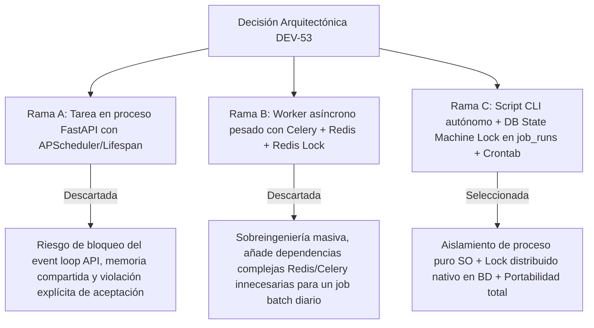

# Implementation Plan: Procesos en Segundo Plano — Script Nocturno de Telemetría (Ticket #DEV-53)

> **Documento de Planificación y Arquitectura de Producción**  
> **Basado en:** `.github/STRATEGY.md`, `CONTEXT-company.md` (Nexova Solutions), `data/pipelines/pipeline.py`  
> **Marco Metodológico:** Code Refinement Suite (Nivel 3 — Arquitectura Crítica de Procesos Batch & Concurrencia)  
> **Modalidad:** Modo Tutor / Aprendizaje guiado (el mentor acompaña, el usuario ejecuta paso a paso)  

---

## 📌 Contexto y Objetivos del Hito

En los hitos anteriores de Nexova Solutions, se implementó el pipeline de datos resiliente con Prefect 3 (`data/pipelines/pipeline.py`) y la API con telemetría instrumentada. Sin embargo, la ejecución del pipeline depende de invocación manual diaria.

El **Ticket #DEV-53** exige automatizar la ejecución nocturna desatendida cumpliendo 5 pilares arquitectónicos innegociables:
1. **Desacoplamiento total de la API:** El script nocturno corre como un proceso independiente en el sistema operativo, sin compartir el proceso, hilo ni el event loop de FastAPI (prohibido usar `APScheduler`, `@repeat_every` o lifespan en el servidor API).
2. **Distributed Lock Nativo vía Estado:** La tabla de control `job_runs` actúa como lock mediante el estado `processing`. Si una segunda instancia se dispara mientras la primera corre, aborta silenciosamente sin crear bloqueos zombis ni tablas lock adicionales.
3. **Idempotencia Diaria Estricta:** Si ya existe un registro `completed` para `(job_name='nightly_export', target_date)`, el script no duplica el CSV ni relanza el pipeline.
4. **Snapshot de Backup en CSV:** Exportar eventos de `telemetry_events` a `data/raw/telemetry_YYYY-MM-DD.csv` como respaldo histórico. El pipeline continúa leyendo de la base de datos (el CSV es estrictamente backup, no input).
5. **Resiliencia y Cero Zombis:** Todo fallo pasa de forma garantizada a `failed` con mensaje de error (`try/except/finally`), liberando el lock para futuros reintentos.

---

## 🏛️ PACK 1: ARCHITECT — Evaluación de Alternativas Técnicas y Veredicto

Se evaluaron tres arquitecturas mediante **Tree of Thoughts (ToT)** para la orquestación en segundo plano y el bloqueo concurrente:

### Comparativa de Alternativas (ToT):

1. **Rama A (Scheduler integrado en FastAPI con BackgroundTasks / APScheduler):**
   - *Enfoque:* Registrar una tarea recurrente en el evento de inicio (`lifespan`) de FastAPI.
   - *Veredicto:* **Descartada categóricamente.** Un fallo o consumo elevado de CPU en la extracción/pipeline degradaría la latencia de los endpoints de negocio de Nexova. Además, contradice el criterio de aceptación explícito: *"no puede bloquear ningún endpoint ni ejecutarse en el mismo hilo de FastAPI"*.
2. **Rama B (Worker distribuido con Celery / Redis / RabbitMQ):**
   - *Enfoque:* Desplegar un broker de mensajería (Redis) y workers Celery dedicados con locks basados en Redis Redlock.
   - *Veredicto:* **Descartada.** Añade una sobrecarga operativa y de infraestructura desmedida para una tarea batch que corre una sola vez al día a medianoche. Introduce múltiples puntos únicos de fallo externos.
3. **Rama C (Script CLI independiente en `scripts/nightly_export.py` + Capa de Servicio `services/job_runner.py` + DB State Lock en `job_runs` + Cronjob) [Seleccionada]:**
   - *Enfoque:*
     - Proceso Python desacoplado invocado mediante `python scripts/nightly_export.py`.
     - Tabla `job_runs` en Supabase/PostgreSQL (con fallback SQLite) que almacena la máquina de estados: `pending` → `processing` → `completed` | `failed`.
     - El lock distribuido es el propio registro en estado `processing` para `(job_name, target_date)`.
     - Exportación a CSV en `data/raw/` como snapshot inmutable.
     - Invocación del pipeline del Hito 6 (`data.pipelines.pipeline` o subproceso CLI) preservando la trazabilidad.
   - *Veredicto:* **Aprobada unánimemente.** Satisface el 100% de los criterios del ticket y mantiene el monorepo ligero y robusto.

### Veredicto de los 3 Expertos:
- **Dev Lead:** La separación entre `scripts/nightly_export.py` (entrypoint CLI) y `services/job_runner.py` (lógica de negocio y transiciones) permite probar unitariamente el ciclo de vida y los locks con fixtures sin invocar subprocesses reales.
- **Sec Specialist:** Al desacoplar el script de la API, las credenciales de base de datos se leen directamente desde variables de entorno del sistema (`.env`) sin exponer endpoints de trigger no autenticados en la web.
- **Operaciones / UX Lead:** La observabilidad es clara: logs estructurados con timestamp y nivel (`INFO`/`ERROR`), más una tabla de auditoría `job_runs` que la dirección de Nexova puede auditar en cualquier momento.

---

## 🗺️ Mapa de Trabajo por Fases (Roadmap)

### Fase 1: Modelo de Datos y Migración de `job_runs`
- [x] **Paso 1.1 — Definición DDL de `job_runs`:** Diseñar la tabla con campos `id` (UUID/TEXT), `job_name` (VARCHAR), `target_date` (DATE/TEXT), `status` (VARCHAR: `pending`, `processing`, `completed`, `failed`), `started_at` (TIMESTAMPTZ/TEXT), `finished_at` (TIMESTAMPTZ/TEXT), `error_message` (TEXT), y `created_at`.
- [x] **Paso 1.2 — Índice de Idempotencia:** Crear índice compuesto `idx_job_runs_name_date` en `(job_name, target_date)` para consultas atómicas y de alto rendimiento.
- [x] **Paso 1.3 — Script de Migración SQL:** Crear archivo de migración `infra/migrations/001_create_job_runs.sql` compatible con PostgreSQL/Supabase y SQLite.
- [x] **Paso 1.4 — Helper de Inicialización Automática:** Añadir función `ensure_job_runs_table_exists()` para garantizar que la tabla se cree automáticamente al ejecutar el runner en cualquier entorno.

---

### Fase 2: Capa de Servicio y Máquina de Estados (`services/job_runner.py`)
- [x] **Paso 2.1 — Estructura del Módulo `JobRunner`:** Crear `services/job_runner.py` importando `engine` de `services.api.database`.
- [x] **Paso 2.2 — Consulta de Lock (`has_processing_lock`):** Función que verifica si existe algún registro en `job_runs` con `job_name = :job_name` y `status = 'processing'`.
- [x] **Paso 2.3 — Consulta de Idempotencia (`has_completed_for_date`):** Función que verifica si ya existe una ejecución con `job_name = :job_name`, `target_date = :target_date` y `status = 'completed'`.
- [x] **Paso 2.4 — Creación y Transición a `pending` / `processing`:** Funciones atómicas para registrar el intento (`pending`), actualizar a `processing` y marcar el timestamp `started_at`.
- [x] **Paso 2.5 — Transición de Cierre (`mark_completed` y `mark_failed`):** 
  - `mark_completed`: Establece `status = 'completed'`, `finished_at = now()`.
  - `mark_failed`: Establece `status = 'failed'`, `finished_at = now()`, `error_message = :err`.
- [x] **Paso 2.6 — Context Manager o Bloque Defensivo:** Diseñar un manejador de contexto (`@contextmanager`) o helper que garantice que ante cualquier excepción no capturada, el registro se cierre en `failed` y nunca quede huérfano en `processing`.

---

### Fase 3: Script CLI de Exportación y Disparo (`scripts/nightly_export.py`)
- [x] **Paso 3.1 — Configuración y Resolución de Fecha (`target_date`):**
  - Leer variable `TARGET_DATE` de entorno (`YYYY-MM-DD`).
  - Si no está presente, calcular automáticamente ayer en UTC: `(datetime.now(timezone.utc) - timedelta(days=1)).date()`.
- [x] **Paso 3.2 — Configuración de Logging Estructurado:**
  - Formato: `%(asctime)s [%(levelname)s] [nightly_export] %(message)s`.
  - Registrar eventos clave: inicio, verificación de locks, exportación, subprocess, finalización o aborto.
- [x] **Paso 3.3 — Verificación de Lock e Idempotencia:**
  - Si `has_processing_lock("nightly_export")` es True: loguear advertencia y salir limpiamente con código 0 (aborto silencioso sin error ruidoso).
  - Si `has_completed_for_date("nightly_export", target_date)` es True: loguear omisión por duplicado y salir con código 0.
- [x] **Paso 3.4 — Exportación a CSV de Backup (`data/raw/`):**
  - Consultar `telemetry_events` entre las `00:00:00` y las `23:59:59` del `target_date`.
  - Ruta de archivo: `data/raw/telemetry_YYYY-MM-DD.csv`.
  - Si el archivo ya existe físicamente, omitir la sobreescritura (idempotencia de almacenamiento).
- [x] **Paso 3.5 — Invocación del Pipeline de Datos como Subproceso:**
  - Ejecutar mediante `subprocess.run`: `uv run python data/pipelines/pipeline.py <target_date>`.
  - Capturar `stdout`, `stderr` y validar el `returncode`.
- [x] **Paso 3.6 — Control de Errores y Cierre Transaccional:**
  - Envolver todo en bloque `try/except/finally`.
  - Si ocurre error en exportación o en el subproceso, marcar `job_runs` como `failed`, registrar mensaje de excepción y salir con código 1.

---

### Fase 4: Suite de Pruebas Automatizadas (`tests/scripts/test_nightly_export.py`)
- [x] **Paso 4.1 — Fixture de Base de Datos Aislada:** Crear entorno in-memory o SQLite temporal para no alterar datos de producción ni desarrollo.
- [x] **Paso 4.2 — Test 1: Flujo Exitoso Completo:** Simular ejecución nocturna para una fecha dada, validando la transición `pending` → `processing` → `completed`, creación del CSV en `data/raw/` y registro en `job_runs`.
- [x] **Paso 4.3 — Test 2: Distributed Lock en Concurrencia:** Simular que existe un registro en `processing` y verificar que la segunda ejecución aborta silenciosamente sin reejecutar.
- [x] **Paso 4.4 — Test 3: Idempotencia por Fecha:** Simular que ya existe un registro `completed` para `target_date` y verificar que el script no relanza el pipeline ni sobreescribe el CSV.
- [x] **Paso 4.5 — Test 4: Manejo de Excepciones y Cero Zombis:** Forzar fallo en el subproceso o en la exportación y verificar que el estado en `job_runs` queda exactamente en `failed` y con el mensaje de error registrado.
- [x] **Paso 4.6 — Test 5: Sobrescritura con `TARGET_DATE`:** Comprobar que al definir la variable de entorno `TARGET_DATE="2025-01-15"`, el script procesa exactamente esa fecha.
- [x] **Paso 4.7 — Ejecución de Pytest:** Ejecutar `uv run pytest tests/scripts/test_nightly_export.py` y validar 100% verde.

---

### Fase 5: Configuración de Scheduler, PR y Auditoría Git
- [x] **Paso 5.1 — Definición de la Expresión Cron:**
  - Establecer expresión estándar para ejecución nocturna desatendida (`0 2 * * *` — diariamente a las 02:00 AM UTC).
  - Justificar la selección de `crontab` / scheduler desacoplado del contenedor en el PR.
- [x] **Paso 5.2 — Verificación de Ejecución Manual:**
  - Ejecutar en terminal `uv run python scripts/nightly_export.py` y validar logs y creación de CSV.
- [x] **Paso 5.3 — Checklist de Pre-Entrega:**
  - [x] El script es un proceso independiente de FastAPI.
  - [x] Máquina de estados completa en `job_runs`.
  - [x] Distributed lock vía `processing` probado y funcional.
  - [x] Idempotencia por `target_date` garantizada.
  - [x] Cero zombis tras excepciones.
  - [x] CSV en `data/raw/` generado como backup.
  - [x] Logs estructurados con timestamp y estado.
- [x] **Paso 5.4 — Preparación del Pull Request:**
  - Documentar expresión cron, evidencias de logs y captura del CSV.
  - Etiqueta `cronjob` asignada.
- [x] **Paso 5.5 — Protocolo de Control Git:**
  - Solicitar consentimiento explícito al usuario antes de cualquier `git push`.

---

## ⚙️ Métodos Aplicados (Code Refinement Suite)

1. **Tree of Thoughts (ToT - PACK 1: ARCHITECT):**
   Se contrastaron tres alternativas de orquestación (FastAPI Lifespan, Celery/Redis y CLI Script + DB State Lock). Se descartó la integración en FastAPI por violar el criterio de aislamiento y riesgo de saturación del event loop, y Celery por sobrecoste operativo. Se seleccionó el script CLI independiente coordinado por cronjob con distributed lock nativo en `job_runs`.

2. **Step-Back Prompting & Domain Abstraction (PACK 2: PLANNER):**
   Se extrajo el concepto fundamental: *"un proceso en segundo plano no es solo código que corre, es una máquina de estados"*. Se separó la persistencia operativa de alto nivel (`job_runs`) de la auditoría interna del pipeline (`pipeline_runs`), garantizando claridad de dominio para la empresa Nexova Solutions.

3. **Chain of Verification (CoVe) & TDD (PACK 3: CODER):**
   Se diseñará una suite de pruebas en `tests/scripts/test_nightly_export.py` que compruebe cada estado antes de implementar la versión final. Se validará empíricamente la exclusión mutua de dos procesos compitiendo por la misma ventana temporal.

4. **Red Teaming & Resilience Audit (PACK 4: AUDITOR):**
   Se someterá el runner a pruebas de interrupción abrupta (`SIGTERM`, fallo de conexión a BD, excepción en subprocess) para verificar que el bloque defensivo garantice la transición a `failed` y la liberación del lock para la noche siguiente. Se respetará la regla inviolable de cero auto-push.
