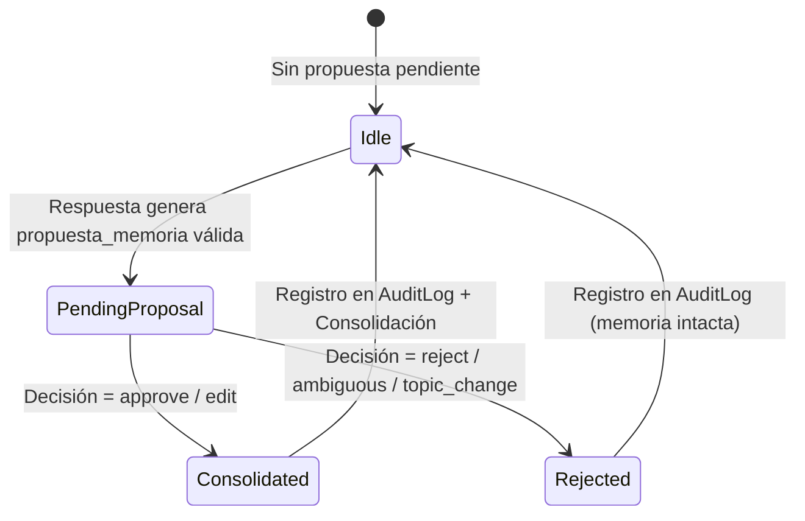
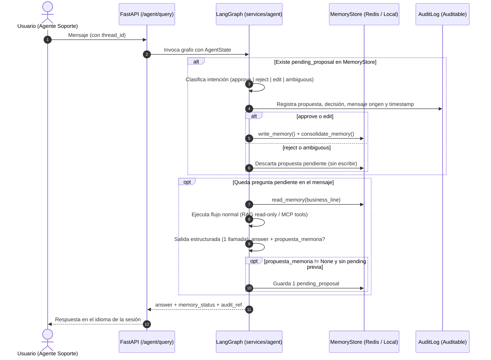

# Implementation Plan: Memoria Persistente y Auto-mejora del Agente (Hito 8 · Parte 1 de 2)

**Documento:** `.github/implementation-plan.md`  
**Copia de Respaldo:** `docs/plans/agent-memory-part1-plan.md`  
**Rama de Trabajo:** `feature/agent-memory`  
**Nivel de Complejidad (Code Refinement Suite):** 🔹 **Nivel 4 — Sistema Cognitivo / Agéntico y Estado Persistente (Muy Alta Complejidad)**  
**Referencias:** `.github/STRATEGY.md`, `docs/nexova-memory-BRIEFING.md` (Ticket `#MEM-092`)

---

## 📐 PACK 1: ARCHITECT (Ideación, ToT, Threat Modeling IA & FMEA)

### 1.1 Tree of Thoughts (ToT) — Selección de Arquitectura de Memoria

| Alternativa | Ventajas | Riesgos / Costes | Decisión |
| :--- | :--- | :--- | :--- |
| **Opción A: Redis KV con Namespaces por `business_line` + Fallback JSON/SQLite local** | Lectura/escritura sub-milisegundo; separación total de `*_knowledge` (Qdrant); soporte nativo de TTL/expiración; `redis` ya existe en `docker-compose.yml`; determinista en `pytest` con fallback local. | No realiza búsqueda semántica por coseno sobre miles de documentos (no necesaria aquí, pues los hechos operativos de soporte son concisos y estructurados). | ✅ **ELEGIDA** |
| **Opción B: Qdrant colección aparte (`nexova_agent_memory`)** | Búsqueda semántica por embeddings. | Mayor latencia y coste por embedding en cada turno; sobreingeniería para reglas cortas de SLA/escalación y preferencias B2B; riesgo de solapamiento conceptual con RAG si no se cuida el filtrado. | ❌ Descartada como store primario |
| **Opción C: Fine-tuning / Inyección total en System Prompt** | Sin dependencias externas. | Fine-tuning es lento, costoso y no permite olvidar selectivamente; volcar todo en el system prompt rompe el límite de contexto y degrada la atención del LLM. | ❌ Descartada (prohibido por `.github/STRATEGY.md`) |

**Justificación por líneas de negocio de Nexova:**  
Se separa la memoria por `business_line` (`outsourcing`, `headhunting`, `training`, `general`) porque las reglas operativas de Roberto Díaz (Customer Support Lead y sus 30 agentes) pertenecen a *outsourcing* de soporte y no deben contaminar *headhunting* ni *formación*.

---

### 1.2 Análisis de los 3 Expertos

- **UX / CX Lead (Roberto Díaz & Soporte):**
  - El agente debe proponer el recuerdo de forma natural al final de su respuesta, en el idioma de la conversación (español o inglés, operación España–Miami).
  - Si el usuario responde a la propuesta *y además* hace una pregunta nueva en el mismo mensaje, el agente no debe obligar a repetir la pregunta: resuelve la propuesta y responde la nueva consulta en el mismo turno.
- **Dev Lead (`services/agent/`):**
  - Extender el grafo existente en `services/agent/graph.py` sin crear un segundo agente ni arquitectura multi-agente.
  - Utilizar **salida estructurada en una sola llamada** (`answer` + `propuesta_memoria`) para mantener baja latencia y un clasificador estructurado para evaluar respuestas sobre propuestas pendientes.
- **Security Specialist (Privacidad y Anti-Poisoning):**
  - Enforced *Allowlist/Blocklist* alineada con `docs/nexova-memory-BRIEFING.md`: **cero** datos personales de candidatos (ATS/CVs/notas de entrevista), **cero** salarios/negociaciones de headhunting, **cero** correcciones puntuales de un solo ticket.
  - Prohibido escribir en `*_knowledge` (Qdrant RAG permanece estrictamente de solo lectura).

---

### 1.3 Threat Modeling IA (OWASP LLM Top 10) & FMEA

| Amenaza / Modo de Falla | Vector / Causa | Impacto | Mitigación Obligatoria (Invariante) |
| :--- | :--- | :--- | :--- |
| **LLM01 / Memory Poisoning** | Usuario malicioso presenta un dato falso o regla peligrosa como "corrección legítima". | Corrupción persistente de respuestas futuras para los 30 agentes. | Filtro de validación previo + confirmación humana explícita (`pending_proposal`) + registro auditable de quién originó y aprobó la entrada. |
| **Fuga de PII / Datos Prohibidos (ATS)** | El modelo intenta memorizar datos de un candidato, calificaciones o salario de headhunting. | Violación crítica de privacidad y del `company-BRIEFING.md`. | Guardrail determinista (`validate_memory_candidate`) que bloquea patrones de candidatos/salarios/tickets puntuales antes de proponer y antes de consolidar. |
| **Ambigüedad / Silencio interpretado como "Sí"** | El usuario ignora la pregunta de memoria y cambia de tema. | Escritura no autorizada en memoria persistente. | Política **default-deny**: cualquier intención `ambiguous` o `topic_change` descarta la propuesta y la registra como `rejected_by_default`. |
| **Doble Propuesta Pendiente** | El agente lanza una segunda propuesta antes de cerrar la primera. | Estado inconsistente y pérdida de trazabilidad. | Invariante de estado: **máximo 1 propuesta pendiente por `thread_id`**. Mientras exista una pendiente, no se emite otra. |
| **Caída de Redis en local/CI** | Redis no está levantado al correr `pytest` o desarrollo local. | Falla el flujo del agente. | Fallback automático a almacén local persistente (`data/agent_memory.json` o memoria temporal en tests) con la misma interfaz explícita. |

---

## 📝 PACK 2: PLANNER (Step-Back, Máquina de Estados e Invariantes)

### 2.1 Arquitectura y Máquina de Estados (`stateDiagram-v2` & `sequenceDiagram`)

---

### 2.2 Contratos Pydantic Estrictos e Invariantes

1. **`MemoryProposal`:** `proposal_id`, `business_line` (`outsourcing | headhunting | training | general`), `fact`, `reason`, `category` (`escalation | client_preference | incident_pattern`), `created_at`, `source_message`.
2. **`StructuredAgentResponse` (1 sola llamada LLM):**
   - `answer: str`
   - `should_propose_memory: bool`
   - `proposed_fact: Optional[str]`
   - `proposed_business_line: Optional[str]`
   - `proposed_category: Optional[str]`
   - `proposal_reason: Optional[str]`
3. **`ProposalClassification`:**
   - `decision: Literal["approve", "reject", "edit", "ambiguous_or_unrelated"]`
   - `edited_fact: Optional[str]`
   - `remaining_question: Optional[str]` (captura si el usuario respondió y además preguntó otra cosa en el mismo turno).
4. **`MemoryAuditEntry`:** `audit_id`, `thread_id`, `proposal_id`, `proposed_fact`, `final_fact`, `decision`, `source_message`, `timestamp`.

---

### 2.3 Matriz de Criterios de Auto-Evaluación (Nexova)

| Tipo | Ejemplo Real del Briefing de Nexova | Resultado Esperado |
| :--- | :--- | :--- |
| **Memorable (SLA)** | *"Los tickets de nómina para clientes de retail ahora se resuelven en 24h, no en 48h."* | Genera propuesta en `outsourcing` (`escalation`). |
| **Memorable (Preferencia B2B)** | *"Ese cliente de finanzas siempre pide confirmación por email antes de cerrar un ticket."* | Genera propuesta en `outsourcing` (`client_preference`). |
| **Memorable (Patrón Helpdesk)** | *"Los tickets urgentes de contrato premium deben ir directo a un agente senior."* | Genera propuesta en `outsourcing` (`incident_pattern`). |
| **NO Memorable (Consulta puntual)** | *"¿Cuántos tickets abiertos hay ahora mismo?"* | `propuesta_memoria = None`. |
| **NO Memorable (Cierre)** | *"Perfecto, gracias por la explicación."* | `propuesta_memoria = None`. |
| **NO Memorable (Tarea one-shot)** | *"Resume este ticket en dos líneas para el reporte de Laura."* | `propuesta_memoria = None`. |
| **Prohibido (Bloqueado)** | Datos personales/CV/entrevista de candidatos o salarios de headhunting, o corrección única de 1 ticket. | Rechazado por guardrail; nunca se propone ni consolida. |

---

### 2.4 Política de Consolidación y Limpieza

- **Separación por `business_line`:** evita contaminación cruzada entre *outsourcing*, *headhunting* y *training*.
- **Deduplicación / Reemplazo por tema:** al consolidar un hecho nuevo que actualiza uno existente (ej. cambio de SLA de 48h → 24h), reemplaza el hecho anterior en lugar de acumular contradicciones.
- **Límite y TTL:** tope máximo configurable por línea de negocio (ej. `MAX_MEMORIES_PER_LINE = 25`) + TTL (`MEMORY_TTL_SECONDS`, ej. 30 días en Redis) purgando las entradas más antiguas/menos usadas.

---

### 2.5 Ciclos de Auto-Refinamiento (Self-Refinement Loop — 3 Ciclos)

- **Ciclo 1 (Un solo grafo, 1 sola llamada):** Confirmamos que `generate_answer_node` y `format_tool_answer_node` reutilizan el mismo flujo en `services/agent/nodes.py` devolviendo respuesta + propuesta sin añadir un segundo agente.
- **Ciclo 2 (Mensaje mixto: decisión + nueva pregunta):** Si el usuario dice *"Sí, recuérdalo. Por cierto, ¿cuál es el estado del ticket INC-101?"*, el clasificador extrae `decision="approve"` y `remaining_question="¿cuál es el estado del ticket INC-101?"` para resolver la memoria y continuar el grafo en el mismo turno.
- **Ciclo 3 (Bilingüe ES/EN):** La pregunta de confirmación y los mensajes de estado respetan el idioma detectado en el turno (español / inglés) para soportar la operación España–Miami.

---

## 🗺️ Mapa de Trabajo por Fases (Roadmap)

- [ ] **Fase 1 — Almacén de Memoria, Guardrails y Auditoría (`services/agent/memory.py`):**
  - [ ] Implementar interfaz explícita (`read_memory`, `save_pending_proposal`, `get_pending_proposal`, `resolve_proposal`, `consolidate_memory`, `get_audit_log`) con Redis + fallback JSON local.
  - [ ] Implementar filtro de privacidad de Nexova (bloqueo de PII de candidatos, salarios de headhunting y correcciones no repetibles).
  - [ ] Implementar política de consolidación (deduplicación/reemplazo, límite máximo por `business_line` y expiración TTL).
- [ ] **Fase 2 — Extensión del Estado y Nodos LangGraph (`services/agent/state.py`, `services/agent/nodes.py`, `services/agent/graph.py`):**
  - [ ] Añadir a `AgentState` los campos de `thread_id`, `pending_proposal`, `memory_proposal`, `memory_decision`, `memory_context` y `remaining_question`.
  - [ ] Añadir nodo `resolve_pending_memory_node` al inicio del grafo (clasificación explícita, *default-deny*, registro en `AuditLog` y soporte de pregunta encadenada).
  - [ ] Integrar lectura explícita de memoria (`read_memory`) antes de responder y salida estructurada en 1 sola llamada (`answer` + `propuesta_memoria`) sin escribir nunca en `*_knowledge`.
- [ ] **Fase 3 — Integración API (`services/api/routes/agent.py`):**
  - [ ] Propagar `thread_id` al grafo y exponer metadatos opcionales de memoria/auditoría en `AgentQueryResponse` manteniendo `Depends(get_current_user)`.
- [ ] **Fase 4 — Eval-Driven Development (EDD) & Red Teaming (`tests/pipelines/test_agent_memory.py`):**
  - [ ] Testear los 3 ejemplos positivos y 3 negativos del briefing de Nexova.
  - [ ] Testear bloqueo de datos prohibidos (PII candidatos, salarios) y prohibición de escritura en Qdrant `*_knowledge`.
  - [ ] Testear invariantes: máximo 1 propuesta pendiente, ambigüedad/cambio de tema = rechazo por defecto, mensaje mixto (confirmación + nueva pregunta), consolidación/deduplicación.
  - [ ] Ejecutar y documentar 2 ciclos completos de evidencia (1 aprobado reflejado en interacción futura, 1 rechazado con memoria intacta).
- [ ] **Fase 5 — Documentación de Decisiones de Diseño & PR (`docs/` y PR `feature/agent-memory`):**
  - [ ] Completar checklist de `.github/STRATEGY.md` y documentar respuestas a las 5 Decisiones de Diseño en la descripción del PR.

---

## 🛡️ PACK 4: AUDITOR & Protocolo Git

- **Verificación pre-push:** `uv run pytest tests/pipelines/test_agent_memory.py tests/pipelines/test_agent_evals.py -v` sin regresiones.
- **Regla Inviolable de Git:** Nunca ejecutar `git push` de forma automática sin consentimiento explícito del usuario.

---

## ⚙️ Métodos Aplicados (Code Refinement Suite)

1. **Tree of Thoughts (ToT) + 3 Expertos:** Se evaluaron Redis KV con namespaces, Qdrant secundario y system prompt plano frente a los requisitos de UX (Roberto Díaz), desarrollo (LangGraph en 1 llamada) y seguridad (privacidad ATS/headhunting).
2. **Threat Modeling IA (OWASP LLM Top 10) & FMEA (Nivel 4):** Se definieron invariantes formales contra *memory poisoning*, fuga de PII de candidatos, ambigüedad del usuario (*default-deny*), doble propuesta simultánea y caída de Redis.
3. **Step-Back Prompting & Máquina de Estados (Nivel 4):** Se diseñó la transición de estados `Idle <-> PendingProposal -> Consolidated/Rejected` y los contratos Pydantic estrictos para el clasificador y la salida estructurada.
4. **Self-Refinement Loop (3 Ciclos):** Refinado para mantener 1 solo grafo/llamada, resolver mensajes mixtos (decisión + nueva pregunta) y respetar operación bilingüe España–Miami.
5. **Chain of Verification (CoVe), EDD & Adversarial Red Teaming:** Los contratos y rutas se verificaron contra `services/agent/state.py`, `services/agent/graph.py` y `services/api/routes/agent.py`, planificando replay multi-turno determinista y pruebas adversarias antes del PR.
