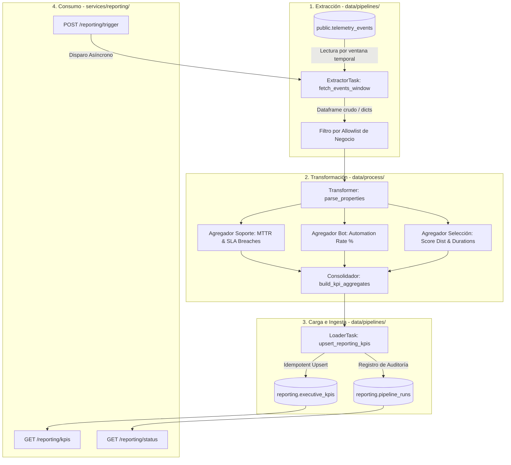

# Documento de Diseño: Pipeline de Desempeño de Negocio

> **Empresa:** Nexova Solutions (Talent Consulting, Support Outsourcing & Corporate Training)  
> **Autor:** AI Engineering Team  
> **Estado:** Fase de Diseño de Arquitectura  
> **Documento base:** `.github/STRATEGY.md`, `CONTEXT-company.md`, `docs/telemetry/telemetry-plan.md`  

---

## 1. Estado Actual y Brecha de Negocio

### 1.1 Estado Actual de la Telemetría Técnica
En la fase previa de instrumentación, Nexova Solutions implementó la captura de telemetría centrada en la observabilidad técnica de la infraestructura:
- **Almacenamiento fuente:** Todos los eventos brutos emitidos por el frontend (panel SPA en `nexova-departamentos-panel.html`) y servicios backend se persisten en la tabla relacional `public.telemetry_events`.
- **Estructura del dato:** Cada registro implementa un *Event Envelope* canónico con campos comunes (`eventId`, `timestamp`, `sessionId`, `userId`, `event_type`, `schemaVersion`, `requestId`) y un payload semiestructurado `properties` (JSONB) protegido por esquemas cerrados (allowlists).
- **Reporte técnico existente:** El módulo `services/telemetry/analysis.py` expone el endpoint `GET /telemetry/report`, el cual calcula métricas agregadas de salud de infraestructura:
  - Tasa global de errores HTTP (4xx / 5xx).
  - Percentiles de latencia de red (`p95` y `p99`).
  - Volumen bruto de eventos recibidos por ventana de tiempo.

> [!IMPORTANT]
> **Restricción de Arquitectura:** `services/telemetry/analysis.py` y `GET /telemetry/report` pertenecen exclusivamente al equipo de SRE / DevOps. Este pipeline existente permanecerá intacto y `telemetry_events` operará estrictamente como fuente de lectura, nunca como destino.

---

### 1.2 Identificación de la Brecha de Negocio (Business Gap)
A pesar de contar con visibilidad sobre la estabilidad de los servidores, la dirección ejecutiva y los líderes operativos de Nexova operan a ciegas respecto al desempeño comercial y contractual:

1. **Atención al Cliente Externalizada (Roberto Díaz):**
   - *Brecha:* El compromiso contractual (SLA) con clientes de retail y fintech exige resolver incidencias en menos de **24 horas**, pero la media real ronda las **48 horas**. El reporte técnico muestra si la API responde rápido, pero no indica si los tickets se están cerrando a tiempo ni qué porcentaje de casos resuelve autónomamente el chatbot con IA (meta contractual: 40%).
2. **Operaciones de Selección y Reclutamiento (Javier Almeida):**
   - *Brecha:* Los 40 consultores criban manualmente entre 30 y 80 CVs por proceso. La telemetría técnica no reporta la distribución de calidad de los candidatos evaluados por el modelo de scoring (`candidate_score_calculated`), ni el ahorro de tiempo operativo real que aporta la IA.
3. **Dirección Ejecutiva (Laura Mendoza):**
   - *Brecha:* La CEO toma decisiones con informes semanales en PDF elaborados manualmente durante 4 a 8 horas por cada manager, con datos desfasados por días. Se carece de una consolidación automática y auditable de KPIs de negocio que alimente dashboards ejecutivos en tiempo real.

**Conclusión:** Se requiere un pipeline desacoplado, periódico e idempotente que lea de `telemetry_events`, extraiga las dimensiones de negocio del payload `properties`, aplique agregaciones por ventanas temporales y cargue los indicadores en un esquema dedicado `reporting`.

---

## 2. Propósito y Arquitectura del Flujo de Datos

### 2.1 Declaración del Propósito del Pipeline
> **Propósito:** Consolidar periódicamente los eventos operativos de Nexova para alimentar el dashboard ejecutivo de Laura Mendoza (CEO) y los directores de área mediante el cálculo auditable del Tiempo Medio de Resolución de soporte (MTTR vs SLA 24h), la tasa de automatización del chatbot (meta 40%) y la eficiencia del scoring de talento, persistiendo los agregados en el esquema dedicado `reporting`.

---

### 2.2 Especificación de Extracción
- **Fuente primaria:** Tabla relacional `public.telemetry_events` en Supabase/PostgreSQL.
- **Cadencia de extracción y ciclo de reporting:** Ejecución por micro-lotes programados (Batch) cada 1 hora para métricas intra-día, más un flow de consolidación diario nocturno (02:00 AM UTC). Cron recomendado: `0 2 * * *`.
- **Comando de ejecución directa (CLI):**
  ```bash
  uv run python data/pipelines/pipeline.py [YYYY-MM-DD]
  # Si se omite la fecha, procesa la ventana del día actual UTC
  ```
- **Formato del dato origen:** 
  - Registros inmutables con envoltura canónica JSONB.
  - Campos clave extraídos: `event_type`, `timestamp`, `requestId` y el objeto `properties`.
- **Filtro de extracción:** Consultas acotadas por ventana temporal determinista basada en el `timestamp` del evento (`WHERE timestamp >= :window_start AND timestamp < :window_end`), garantizando que solo se procesen eventos pertenecientes a los tipos de negocio requeridos (`support_ticket_resolved`, `chatbot_issue_resolved`, `candidate_score_calculated`, etc.).

---

### 2.3 Flujo de Datos de Extracción, Transformación y Carga (ETL)

El siguiente diagrama detalla las tres etapas desacopladas del pipeline:



---

### 2.4 Estrategia para Actualizaciones y Mutaciones de Estado
Aunque la tabla `telemetry_events` es de solo inserción (*append-only* e inmutable), los procesos de negocio en Nexova experimentan transiciones de estado a lo largo del tiempo (ej. un ticket de soporte nace abierto, se escala y horas después se resuelve).

Para evitar agregaciones incorrectas o duplicación de conteos:
1. **Deduplicación en Ingesta por Entidad de Negocio:**
   - Para entidades con ciclo de vida (como tickets o sesiones), el pipeline utiliza la clave de negocio dentro de `properties` (`ticket_id`, `conversation_id`, `candidate_id_hash`).
   - Si se procesa una ventana donde coinciden eventos de ciclo de vida para la misma entidad, la transformación realiza un *deduplication pass* ordenado por `timestamp DESC`, conservando el estado final del registro (`support_ticket_resolved` prevalece sobre estados transitorios).
2. **Estrategia Snapshot vs. Delta:**
   - La tabla de destino `reporting.executive_kpis` no almacena eventos individuales, sino agregaciones consolidadas por ventana de granularidad (ej. `window_date`, `department`, `metric_name`).
   - Los registros de destino se manejan vía **Upsert** (actualizar si existe la misma clave de ventana y dimensión, o insertar si es nueva), permitiendo que re-ejecuciones por eventos tardíos recalculen limpiamente la métrica sin inflar los totales.

---

### 2.5 Esquema de Destino y Módulos de Consumo
- **Esquema de Destino:** `reporting` (completamente aislado de `public` y de `telemetry_events`).
- **Tabla Maestra de KPIs:** `reporting.executive_kpis`
  - Contiene: `kpi_id` (UUID), `window_date` (DATE), `window_granularity` (daily/hourly), `department` (VARCHAR), `metric_name` (VARCHAR), `metric_value` (NUMERIC), `target_value` (NUMERIC), `sla_status` (VARCHAR: ON_TRACK, AT_RISK, BREACHED), `calculated_at` (TIMESTAMPTZ), `run_id` (UUID FK a `pipeline_runs`).
- **Endpoints dedicados (`services/reporting/`):**
  - Los endpoints de consulta y orquestación residirán en `services/reporting/`, aislados de `services/telemetry/`, y consumirán directamente desde `reporting.executive_kpis` y `reporting.pipeline_runs`.

---

## 3. Resiliencia, Idempotencia y Auditoría de Corridas

### 3.1 Estrategia de Idempotencia y Reintentos
La idempotencia es la garantía de que ejecutar el pipeline múltiples veces sobre el mismo rango de datos produce idéntico estado en el destino, sin duplicados ni corrupción.

1. **Clave Única Compuesta en Destino:**
   - La tabla `reporting.executive_kpis` implementa una restricción de unicidad:
     `CONSTRAINT uq_kpi_window UNIQUE (window_date, window_granularity, department, metric_name)`.
2. **Operación Atómica Upsert (`ON CONFLICT DO UPDATE`):**
   - Si una corrida de las 02:00 AM procesa 800 de 1,500 registros y se interrumpe por una caída de conexión, la siguiente ejecución no genera filas duplicadas.
   - La sentencia de carga aplica:
     ```sql
     INSERT INTO reporting.executive_kpis (window_date, window_granularity, department, metric_name, metric_value, target_value, sla_status, calculated_at, run_id)
     VALUES (...)
     ON CONFLICT (window_date, window_granularity, department, metric_name)
     DO UPDATE SET
         metric_value = EXCLUDED.metric_value,
         sla_status = EXCLUDED.sla_status,
         calculated_at = EXCLUDED.calculated_at,
         run_id = EXCLUDED.run_id;
     ```
3. **Transaccionalidad Atómica por Lote:**
   - Las tareas de carga se ejecutan bajo una transacción de base de datos (`BEGIN ... COMMIT`). Si ocurre un fallo a mitad de camino, se ejecuta un `ROLLBACK` y se registra el fallo en la tabla de auditoría, impidiendo estados parcialmente corruptos.

---

### 3.2 Diseño del Log de Ejecución (`reporting.pipeline_runs`)
Cada ejecución del pipeline —sea programada o manual— persiste un registro auditable e inmutable en `reporting.pipeline_runs`.

| Campo | Tipo SQL | Nullable | Justificación Técnica para Auditoría en Producción |
| :--- | :--- | :--- | :--- |
| `run_id` | `UUID` | No (PK) | Identificador único de la corrida para trazabilidad cruzada con Prefect y logs de la aplicación. |
| `flow_name` | `VARCHAR(100)` | No | Identifica el pipeline ejecutado (ej. `daily_business_kpis_flow` vs `hourly_sla_monitor_flow`). |
| `started_at` | `TIMESTAMPTZ` | No | Marca temporal exacta de inicio para cálculo de latencia de ejecución y detección de procesos colgados. |
| `finished_at` | `TIMESTAMPTZ` | Sí | Marca temporal de finalización. Si permanece en `NULL` tras el timeout esperado, delata una caída abrupta del worker. |
| `status` | `VARCHAR(20)` | No | Estado de la ejecución: `RUNNING`, `COMPLETED`, `FAILED`, `CANCELLED`. Permite filtrar corridas degradadas. |
| `records_extracted` | `INTEGER` | No | Total de eventos recuperados desde `telemetry_events`. Audita el volumen de ingesta. |
| `records_loaded` | `INTEGER` | No | Total de registros insertados/actualizados en `reporting.executive_kpis`. Detecta desajustes entre extracción y carga. |
| `window_start` | `TIMESTAMPTZ` | No | Límite inferior de la ventana temporal de datos evaluada. Esencial para reproducibilidad de backfills. |
| `window_end` | `TIMESTAMPTZ` | No | Límite superior de la ventana temporal de datos evaluada. |
| `error_message` | `TEXT` | Sí | Mensaje de excepción y traza sanitizada en caso de fallo, permitiendo depurar sin entrar a logs de servidor. |

---

### 3.3 Solución a los Casos Límite de Operación (Preguntas STRATEGY.md)

#### A. Idempotencia y Duplicados en el Origen
- **Escenario:** Un operador confirma una acción dos veces en 300 ms (ej. doble clic en resolver ticket o dos eventos `candidate_score_calculated` con el mismo `eventId`).
- **Mecanismo:** La tabla `telemetry_events` ya cuenta con clave primaria en `eventId`. En caso de reintentos de ingesta desde el cliente con el mismo `eventId`, se aplica deduplicación en la capa API con HTTP 200 idempotente. Si por desfase de timestamp llegan eventos duplicados de la misma entidad de negocio (`ticket_id`), la tarea de transformación agrupa por clave de negocio y toma el registro más reciente (`ORDER BY timestamp DESC LIMIT 1`).

#### B. Eventos Tardíos (*Late-Arriving Data*)
- **Escenario:** A las 23:50 entra un evento `support_ticket_resolved` cuyo ticket se cerró a las 14:00 (por ejemplo, porque el operador estuvo sin conexión). El reporte del día ya se había calculado parcialmente.
- **Mecanismo:** El pipeline de consolidación diaria (02:00 AM) procesa la ventana completa del día anterior con un margen de solapamiento (*lookback window*) de 2 horas. Además, si llega un evento muy desfasado, el endpoint `POST /reporting/trigger` permite disparar un recálculo retroactivo para la fecha afectada (`window_date`), el cual ejecuta el `UPSERT` en `reporting.executive_kpis` recalculando la métrica histórica de forma limpia sin crear duplicados.

#### C. Detección de Silencio Técnico vs. Inactividad de Negocio
- **Escenario:** Entre las 14:00 y las 16:00 no hay eventos registrados en `telemetry_events`. ¿El sistema está caído o es la hora del almuerzo de los consultores?
- **Mecanismo:** Se implementa un **Heartbeat sintético** emitido periódicamente por el backend y los clientes web (`system_heartbeat`) independiente de las acciones del usuario. Si hay `system_heartbeat` pero no hay eventos de negocio, se constata inactividad operacional normal. Si no hay ni heartbeats ni eventos, el monitor de observabilidad detecta un *silencio técnico* y alerta al equipo.

#### D. Búfer Offline en el Frontend
- **Escenario:** El navegador del operador pierde conexión por 20 minutos, almacena 40 eventos en `localStorage` / `IndexedDB` y los remite en un solo lote al reconectar.
- **Mecanismo:** El cliente preserva el `timestamp` original de la acción y el `eventId` original. Cuando el lote llega al backend, se procesa en bloque; la base de datos ignora duplicados por `eventId` y la tarea de transformación utiliza el `timestamp` del evento (no el de recepción en el servidor) para ubicar el dato en su ventana horaria correspondiente.

#### E. Prevención de Condiciones de Carrera (Corridas Concurrentes)
- **Escenario:** El cron nocturno de las 02:00 AM está corriendo y un usuario presiona "Disparar recálculo" en el panel de administración a las 02:02 AM.
- **Mecanismo:** Se implementa un mecanismo de **Lock a nivel de ventana** utilizando la tabla `reporting.pipeline_runs`. Antes de iniciar, el flow comprueba:
  `SELECT count(*) FROM reporting.pipeline_runs WHERE status = 'RUNNING' AND window_start = :start AND window_end = :end`.
  Si existe una corrida en ejecución para esa misma ventana temporal, el segundo proceso aborta con un mensaje informativo (`State: CANCELLED`, motivo: `Concurrent run in progress`), evitando carreras de escritura sobre `reporting.executive_kpis`.

---

## 4. Mapeo Conceptual a Prefect

### 4.1 Definición de Flows y Subflows
El pipeline se orquesta mediante **Prefect** como framework estándar de ingeniería de datos:

- **Flow Principal (`@flow`):** `business_performance_flow`
  - Función coordinadora que recibe los parámetros de ejecución (`window_start`, `window_end`, `is_backfill=False`).
  - Responsable de inicializar el registro en `reporting.pipeline_runs`, orquestar las tareas en orden de dependencia, manejar excepciones globales y actualizar el estado final (`Completed` o `Failed`).

### 4.2 Desglose de Tasks Atómicas (`@task`)
Cada etapa del pipeline se aísla en una tarea atómica con políticas específicas de reintento:

1. **`extract_telemetry_events_task` (`data/pipelines/`):**
   - Extrae eventos crudos de `public.telemetry_events` dentro de la ventana temporal especificada.
   - Retries: `retries=3, retry_delay_seconds=30`.
   - Estado devuelto: Lista de tuplas o DataFrame estructurado.
2. **`transform_business_kpis_task` (`data/process/`):**
   - Parsea los payloads JSONB `properties`, aplica deduplicación por entidad, calcula KPIs agregados (MTTR, ratio de automatización del bot, distribución de score) y evalúa el cumplimiento de SLAs.
   - Tarea puramente computacional determinista y sin efectos secundarios (*stateless*).
3. **`load_executive_kpis_task` (`data/pipelines/`):**
   - Ejecuta la transacción de `UPSERT` en `reporting.executive_kpis` y registra métricas de volumen (`records_loaded`).
   - Retries: `retries=3, retry_delay_seconds=15`.
4. **`audit_pipeline_run_task` (`data/pipelines/`):**
   - Actualiza `reporting.pipeline_runs` con el estado final, duración y errores en caso de fallo.

### 4.3 Manejo de Estados y Prefect Blocks
- **Prefect States:**
  - `Pending`: Tarea encolada.
  - `Running`: Ejecución activa con tracking de inicio en `pipeline_runs`.
  - `Completed`: Finalización exitosa con persistencia en `executive_kpis`.
  - `Failed`: Dispara captura de traza en `pipeline_runs.error_message` y notificación preventiva.
  - `Cancelled`: Disparado si el *window lock* detecta una corrida concurrente activa.
- **Prefect Blocks (Gestión Segura de Secretos):**
  - `SqlAlchemyConnector / SecretBlock`: Almacena de forma encriptada el connection string de Supabase/PostgreSQL (`SUPABASE_DB_URL`).
  - `SlackWebhook / WebhookBlock`: Permite despachar alertas automáticas a canales de Slack/Teams en caso de estado `Failed` o detección de silencio prolongado.

---

## 5. Integración con la Aplicación (`services/reporting/`)

### 5.1 Endpoints HTTP Planificados
Para desacoplar el consumo de la interfaz y permitir interacción operativa, se definen tres endpoints bajo el nuevo router `services/reporting/routes.py`:

```
GET  /reporting/status   --> Consulta de estado de la última corrida
POST /reporting/trigger  --> Disparo manual / bajo demanda del pipeline
GET  /reporting/kpis     --> Feed analítico para el dashboard ejecutivo
```

### 5.2 Contrato de Endpoints y Mapeo a Pipeline

#### 1. `GET /reporting/status`
- **Propósito:** Devuelve la salud operativa del pipeline y el detalle de la última ejecución.
- **Función interna:** Invoca `get_latest_pipeline_status()` en `data/pipelines/`.
- **Respuesta 200 OK:**
  ```json
  {
    "last_run_id": "f47ac10b-58cc-4372-a567-0e02b2c3d479",
    "flow_name": "business_performance_flow",
    "status": "COMPLETED",
    "started_at": "2026-10-14T02:00:00Z",
    "finished_at": "2026-10-14T02:03:12Z",
    "duration_seconds": 192,
    "records_processed": 1420,
    "is_stale": false
  }
  ```

#### 2. `POST /reporting/trigger`
- **Propósito:** Permite a administradores forzar un recálculo manual o histórico (backfill).
- **Parámetros (Body):** `{"window_date": "2026-10-13", "force": false}`
- **Función interna:** Dispara de forma asíncrona (vía BackgroundTasks o cliente de Prefect) el flow `trigger_business_performance_flow()` definido en `data/pipelines/`.
- **Respuesta 202 Accepted:**
  ```json
  {
    "message": "Pipeline run triggered successfully",
    "run_id": "8a32b614-72cd-4861-9c3f-58b29f796c90",
    "status": "RUNNING",
    "window_date": "2026-10-13"
  }
  ```

#### 3. `GET /reporting/kpis`
- **Propósito:** Suministra los KPIs ejecutivos consolidados para el dashboard de Laura Mendoza.
- **Parámetros (Query):** `department` (opcional), `start_date`, `end_date`.
- **Función interna:** Lee directamente de `reporting.executive_kpis` mediante `fetch_executive_kpis()` en `data/pipelines/`.
- **Respuesta 200 OK:**
  ```json
  {
    "period": {"start": "2026-10-07", "end": "2026-10-14"},
    "kpis": [
      {
        "department": "customer_support",
        "metric_name": "mttr_hours",
        "current_value": 21.4,
        "target_value": 24.0,
        "sla_status": "ON_TRACK"
      },
      {
        "department": "customer_support",
        "metric_name": "chatbot_automation_rate",
        "current_value": 42.1,
        "target_value": 40.0,
        "sla_status": "ON_TRACK"
      },
      {
        "department": "talent_acquisition",
        "metric_name": "cvs_ai_scored_count",
        "current_value": 312,
        "target_value": 250,
        "sla_status": "ON_TRACK"
      }
    ]
  }
  ```

---

### 5.3 Seguridad y Reglas de Arquitectura
1. **Cumplimiento Estricto de Auth Guard Standard (`AGENTS.md`):**
   Todos los endpoints de `services/reporting/` están protegidos obligatoriamente mediante autenticación JWT:
   ```python
   from fastapi import APIRouter, Depends
   from services.api.routes.auth import get_current_user

   router = APIRouter(prefix="/reporting", tags=["Reporting & Business KPIs"])

   @router.get("/kpis")
   def get_business_kpis(
       department: str | None = None,
       current_user: dict = Depends(get_current_user)
   ):
       # Solo usuarios autenticados con rol de liderazgo pueden acceder
       ...
   ```
2. **Dirección Unidireccional de Importaciones:**
   - `services/reporting/` **importa desde** `data/pipelines/` (o consultas de solo lectura a `reporting`).
   - Ningún módulo de `data/pipelines/` o `data/process/` importará jamás desde `services/`.
   - `services/telemetry/` y `GET /telemetry/report` permanecen completamente inmutables.