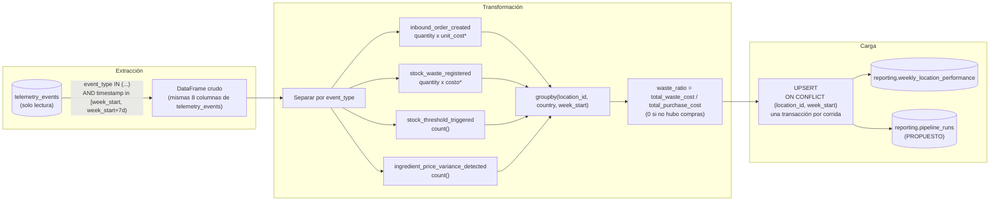

# PIPELINE_DESIGN — Reporte Semanal de Costo y Merma por Local

> Fase 1 (estado actual) y Fase 2 (diseño del pipeline de desempeño de negocio). Este documento es de **análisis y diseño únicamente** — no implementa el pipeline, no crea tablas en Supabase y no cambia el comportamiento de la aplicación. Todas las tablas, endpoints y nombres marcados como **PROPUESTO** no tienen aprobación de negocio y no deben tratarse como contrato final.

Fuentes usadas: `docs/company-briefing.md` (briefing de negocio), `docs/telemetry_plan.md` (briefing de telemetría), `docs/mandatory_metrics.md`, `docs/event-envelope.md`, `docs/event-schemas.json` / `services/api/app/models/events.py` (catálogo aprobado), `supabase/migrations/*.sql`, `services/api/app/models/telemetry_storage.py`, `services/api/app/routers/telemetry.py`, `services/api/app/services/telemetry_analysis.py`, `services/api/app/models/{inbound,outbound,menu_item}.py`, y los puntos de instrumentación en `uis/backoffice/components/{InboundOrderForm,OutboundOrderForm}`.

---

## 1. Estado actual

### 1.1 Eventos capturados, disparadores y propiedades disponibles

Catálogo aprobado (`app/models/events.py`, generado desde `docs/event-schemas.json`). Los 5 eventos obligatorios de inventario (`docs/telemetry_plan.md` sección 3) son los relevantes para este pipeline:

| `event_type` | Se dispara cuando... (implementado) | Propiedades disponibles hoy (`tags`) |
| --- | --- | --- |
| `inbound_order_created` | Se envía el formulario de entrada de mercancía (`InboundOrderForm.tsx:84-94`), tras un `POST /inventory/orders/inbound` exitoso | `location_id`, `country`, `product_id`, `product_category`, `quantity`, `unit`, `currency`, `order_id`, `supplier_id`. **No incluye costo.** |
| `outbound_order_created` | Salida de consumo normal (no merma) (`OutboundOrderForm.tsx:113`) | `location_id`, `country`, `product_id`, `product_category`, `quantity`, `unit`, `currency`, `order_id`, `reason` |
| `stock_waste_registered` | Salida con `reason` ∈ {`expired`, `kitchen_error`, `theft_suspected`} (`OutboundOrderForm.tsx:110`) | Igual que arriba. **No incluye costo.** |
| `stock_threshold_triggered` | Transición de stock de ≥ `minimum_stock` a < `minimum_stock` en una orden de salida (`OutboundOrderForm.tsx:121`, calculado en `inventory.py`) | `location_id`, `country`, `product_id`, `product_category`, `quantity`, `unit`, `currency`, `minimum_stock` |
| `ingredient_price_variance_detected` | El `unit_cost` de una entrada varía más del umbral configurado respecto al promedio histórico (calculado server-side en `inventory.py`, emitido en `InboundOrderForm.tsx:100-110`) | ...`unit_cost_actual`, `unit_cost_historical`, `variance_pct`, `variance_threshold_pct` — **el único evento de inventario que ya carga un costo.** |

`location_id` es un identificador sintético `"COUNTRY-CITY"` (p. ej. `CO-MEDELLIN`) construido en el frontend a partir del país/ciudad del producto — **no existe una tabla `locations`** en el dominio; el local vive únicamente dentro de `tags` de cada evento (`docs/event-envelope.md` sección 6).

### 1.2 Almacenamiento y mapeo API → `telemetry_events`

- `POST /telemetry/events` (`app/routers/telemetry.py`) valida cada evento contra `TelemetryEvent` y hace un único `INSERT` por lote en `telemetry_events` vía `app/models/telemetry_storage.py`.
- Mapeo 1:1, con el único cambio de nombre `properties` → `tags`: `eventId→event_id`, `timestamp→timestamp`, `sessionId→session_id`, `userId→user_id`, `event_type→event_type`, `schemaVersion→schema_version`, `requestId→request_id`, `properties→tags` (jsonb).
- Esquema real, tras dos migraciones (`supabase/migrations/20261030220000_create_telemetry_events.sql` + `20261102000000_drop_telemetry_events_received_at.sql`): **8 columnas**, sin `received_at` (se eliminó para cumplir el contrato exacto de 8 campos). Índices: `ix_telemetry_events_timestamp` (btree), `ix_telemetry_events_event_type` (btree), `ix_telemetry_events_tags` (GIN). Triggers `telemetry_events_no_update`/`no_delete`/`no_truncate` rechazan incondicionalmente cualquier `UPDATE`/`DELETE`/`TRUNCATE` — la tabla es **append-only e inmutable**.
- `event_id` es la PK: un reintento de un evento ya almacenado falla el `INSERT` completo (no hay `ON CONFLICT`), por diseño existente — no es un problema de este pipeline, pero sí una propiedad a respetar al leer la fuente.

### 1.3 Reporte técnico existente — qué pregunta responde y cuál no

`GET /telemetry/report` (`app/routers/telemetry.py` + `app/services/telemetry_analysis.py`) calcula, sobre un rango `[start_date, end_date)` arbitrario pedido por query param, cacheado 60s:

- `events_per_day` — volumen diario de **todos** los `event_type`.
- `api_latency_by_operation` — `mean/p50/p95/max` de `duration_ms` por (endpoint, método), desde `api_latency_recorded`.
- `error_rate_by_operation` — tasa de `status_code >= 400` por operación.
- `frontend_error_counts_by_type` — conteo de `frontend_error_detected` por `error_name`.

Estas 4 métricas responden preguntas **de ingeniería**: ¿cuánto tráfico recibe el sistema?, ¿qué tan rápido responde?, ¿qué tasa de error tiene cada endpoint?, ¿qué errores de frontend ocurren? Ninguna es monetaria, ninguna agrega por local/país, ninguna persiste un histórico — es un cálculo *on-the-fly* sobre el rango pedido, sin tabla de destino propia.

**Pregunta de negocio sin respuesta (identificada en `docs/company-briefing.md` sección 1-2):** *"¿Cuánto costó la compra y la merma de cada local esta semana, y qué locales tuvieron quiebres de stock o alertas de precio?"* Audiencia: **Mariana (CEO)** y **Felipe (Director de Operaciones)** — stakeholders no técnicos que necesitan un consolidado semanal por local/país para decidir dónde auditar merma y con quién renegociar precio, no eventos crudos ni percentiles de latencia. `GET /telemetry/report` no puede responderla porque (a) no tiene ningún campo de costo, (b) no agrega por `location_id`, y (c) no persiste snapshots semanales — cada llamada recalcula el rango pedido, sin histórico consultable.

### 1.4 Limitaciones conocidas

- **Instrumentación incompleta para costo** (el bloqueador real de este pipeline — ver sección 2): `inbound_order_created` no envía `unit_cost` aunque el dato ya existe en `InboundStock.unit_cost` en el momento del `track()` (`InboundOrderForm.tsx:84-94` tiene `order.unit_cost` disponible pero no lo incluye). `stock_waste_registered` no tiene ningún campo de costo, y el modelo de dominio `StockExit` (`app/models/outbound.py`) **no tiene columna de costo en absoluto**.
- **Calidad de dato**: no existe reconciliación ni backfill — los eventos solo existen desde que esta instrumentación se desplegó; no hay histórico previo que migrar.
- **Cobertura histórica**: verificado manualmente contra la base real con ~36 filas de prueba (fases anteriores); no se ha validado el comportamiento a volumen de producción.
- **Verificación**: `GET /telemetry/report` se verificó manualmente (Playwright + curl) y con 291 tests automatizados; no existe verificación de carga ni de concurrencia real.
- **Sin infraestructura de scheduling**: `workflows/` e `infra/` son carpetas vacías (solo README de andamiaje) — no hay cron, n8n ni ningún disparador periódico configurado en el repo hoy. Cualquier cadencia semanal automática depende de infraestructura que todavía no existe.
- **`services/telemetry_analysis.py` y `GET /telemetry/report` quedan explícitamente fuera de alcance** (`docs/company-briefing.md` sección 7) — este diseño no los toca ni los reutiliza como fuente de datos (lee `telemetry_events` directamente, igual que ellos, pero de forma independiente).

---

## 2. Propósito concreto del pipeline

> El pipeline de desempeño de negocio produce, con cadencia **semanal** (fresco cada lunes en la mañana), el **"Reporte Semanal de Costo y Merma por Local"** para **Mariana (CEO) y Felipe (Director de Operaciones)**, calculando los KPIs **costo de compra por local, costo de merma por local, ratio de merma, frecuencia de quiebre de stock y frecuencia de alertas de precio**, soportados por los eventos obligatorios de telemetría `inbound_order_created`, `stock_waste_registered`, `stock_threshold_triggered` e `ingredient_price_variance_detected`.

### Tabla de trazabilidad

| Pregunta de negocio | KPI | Evento(s) fuente | Campos requeridos | Cálculo | Grano | Campo destino |
| --- | --- | --- | --- | --- | --- | --- |
| ¿Cuánto gastó cada local comprando esta semana? | Costo de compra por local | `inbound_order_created` | `location_id`, `country`, `quantity`, `currency`, **`unit_cost` (falta — ver abajo)** | `sum(quantity × unit_cost)` | `location_id` × semana ISO | `total_purchase_cost` |
| ¿Cuánto perdió cada local en merma esta semana? | Costo de merma por local | `stock_waste_registered` | `location_id`, `country`, `quantity`, `currency`, **costo unitario o total (falta — ver abajo)** | `sum(quantity × unit_cost)` | `location_id` × semana ISO | `total_waste_cost` |
| ¿Qué tan eficiente es la merma frente a la compra? | Ratio de merma | derivado de las dos filas anteriores | `total_waste_cost`, `total_purchase_cost` | `total_waste_cost / total_purchase_cost` (0 si no hubo compras) | `location_id` × semana ISO | `waste_ratio` |
| ¿Con qué frecuencia un local se queda sin un insumo clave? | Frecuencia de quiebre de stock | `stock_threshold_triggered` | `location_id`, `country`, `timestamp` | `count(*)` | `location_id` × semana ISO | `stockout_events_count` |
| ¿Con qué frecuencia el costo de un insumo sube de forma anómala? | Frecuencia de alertas de precio | `ingredient_price_variance_detected` | `location_id`, `country`, `timestamp` | `count(*)` | `location_id` × semana ISO | `price_alert_events_count` |

`outbound_order_created` no alimenta ningún KPI de este reporte — es contexto operativo (`docs/company-briefing.md` sección 3), no se usa en v1.

### Insumos faltantes identificados (no inventados — bloqueadores reales)

1. **Costo de compra**: `inbound_order_created.properties` no incluye `unit_cost`. El dato **sí existe** en el dominio (`InboundStock.unit_cost`, `app/models/inbound.py`) y el frontend ya lo tiene disponible en el momento de emitir el evento (`order.unit_cost` en `InboundOrderForm.tsx`) — es una extensión de instrumentación de una línea, no un dato inexistente. Requiere (a) agregar `unit_cost` al esquema de `inbound_order_created` en `docs/event-schemas.json`/`events.py` y (b) incluirlo en el `track()` del frontend. **No se implementa en este documento.**
2. **Costo de merma**: no existe ningún campo de costo, ni en `stock_waste_registered.properties` ni en `StockExit` (`app/models/outbound.py` no tiene columna de costo). A diferencia del punto 1, este no es solo un gap de instrumentación: **requiere una decisión de negocio** sobre cómo valorar la merma — ejemplos no excluyentes entre sí que no se deciden aquí: (a) agregar una columna `unit_cost` a `stock_exits`, capturada al registrar la merma, o (b) derivar el costo uniendo contra el `unit_cost` más reciente de `InboundStock` para el mismo `ingredient_id`/local. Ninguna opción se asume como aprobada.

Mientras estos dos insumos no se resuelvan, `total_purchase_cost`, `total_waste_cost` y `waste_ratio` **no se pueden calcular con datos reales** — el pipeline puede diseñarse y hasta implementarse con un valor `NULL`/pendiente explícito para esas tres columnas, pero no con datos inventados.

---

## 3. Diseño de extracción

- **Fuente principal**: `telemetry_events`, filtrado a `event_type IN ('inbound_order_created', 'stock_waste_registered', 'stock_threshold_triggered', 'ingredient_price_variance_detected')` y `timestamp` dentro de la semana ISO a procesar. `outbound_order_created` no se extrae (no alimenta ningún KPI de este reporte).
- **Tablas de dominio adicionales**: ninguna es estrictamente necesaria para los 5 KPIs tal como están definidos — `location_id`/`country` ya viven dentro de `tags` de cada evento, y no existe una tabla `locations` que unir. Si el gap de costo de merma (sección 2, punto 2) se resuelve con la opción de "costo derivado", se necesitaría un `JOIN` de solo lectura contra `inbound_stock` por `ingredient_id` — marcado aquí solo como alternativa posible, no como diseño aprobado.
- **Formato de entrada a la transformación**: igual patrón que `fetch_telemetry_events_dataframe` (`app/models/telemetry_storage.py`) — lectura vía cursor del lado del servidor (`stream_results=True`) en chunks, ensamblada en un `DataFrame` de Pandas con las mismas 8 columnas de `telemetry_events` (incluyendo `tags` como `dict`). Se reutiliza el *patrón*, no el módulo — este pipeline vive en un módulo nuevo y separado (sección 6).
- **Frecuencia de la fuente vs. cadencia del pipeline**: `telemetry_events` se escribe en tiempo casi real, evento por evento, a medida que el personal usa los formularios (append-only). El pipeline corre **semanalmente**, en la madrugada del lunes, sobre la semana ISO recién cerrada — más una vía de ejecución manual (`POST /reporting/pipeline-runs`, sección 6). No existe hoy ningún disparador automático (sección 1.4); la cadencia semanal depende de infraestructura (cron/n8n) que queda fuera de alcance de este diseño.
- **Claves de unión y cardinalidad**: no hay `JOIN` obligatorio para v1. La relación es N eventos → 1 fila agregada por (`location_id`, `week_start`) — una relación de agregación, no una relación 1:1 ni 1:N entre tablas.
- **Significado de los timestamps**: `timestamp` en `telemetry_events` es el momento de captura reportado por el cliente (`AwareDatetime`, con zona explícita — mismo contrato que `TelemetryEvent.timestamp`), normalizado a UTC por el pipeline al leerlo. **No existe ningún campo de tiempo de ingestión separado** desde que `received_at` se eliminó (migración `20261102000000`) — ver el punto de extracción incremental abajo. No existe tampoco un "tiempo de actualización de registro": la tabla es append-only, sin `updated_at`.
- **Límites del periodo de reporte**: semana ISO, `[week_start 00:00:00 UTC del lunes, week_start + 7 días)` — mismo patrón *start-inclusive / end-exclusive* que ya usa `GET /telemetry/report`.
- **Paginación y estrategia de extracción incremental**: dado que no hay un timestamp de ingestión separado del timestamp de captura, **no se puede distinguir confiablemente** "evento insertado después de la última corrida" de "evento con `timestamp` tardío pero insertado a tiempo". Esto limita la extracción incremental por cursor de inserción. La estrategia viable aquí es **recomputar completo el alcance de la semana** (`location_id` × `week_start`) en cada corrida que la toque, en lugar de un delta incremental por fila — ver sección 5 para cómo esto se mantiene idempotente vía `UPSERT`. La lectura en sí sigue usando cursor/paginación (chunks) para no truncar un rango grande, pero el *alcance* del filtro es por rango de semana, no por cursor incremental de filas nuevas.
- **Datos faltantes, inválidos, duplicados y tardíos**:
  - *Duplicados*: `event_id` es PK en origen — un duplicado de ingestión ya fue rechazado antes de llegar a `telemetry_events`; el pipeline no necesita deduplicar de nuevo por `event_id`.
  - *Faltantes* (p. ej. `inbound_order_created` sin `unit_cost` hoy): la fila se excluye del cálculo de ese KPI específico sin asumir `0` ni descartar el evento completo, y se registra cuántos eventos del rango no pudieron valorarse — mismo principio de "no fabricar un cero" ya aplicado en `telemetry_analysis.py`.
  - *Tardíos* (evento con `timestamp` dentro de la semana N, insertado después de que el pipeline ya corrió para N): al ser *full recompute* por semana (no incremental), una corrida posterior de esa misma semana (manual o por reconciliación programada, sección 5) recalcula desde cero y el `UPSERT` reemplaza la fila existente — ningún evento tardío se pierde, solo queda reflejado hasta la siguiente corrida de esa semana.
  - *Inválidos*: no deberían existir en `telemetry_events` (ya pasaron validación Pydantic en la ingesta), pero por defensividad un `tags` incompleto/malformado se trata igual que "faltante" arriba — nunca debe hacer fallar la corrida completa por una sola fila.

---

## 4. Extracción, transformación y carga (ETL)


*(* = pendiente del insumo de costo faltante, sección 2)*

### Transformaciones por KPI

- **Filtro base**: `event_type` ∈ los 4 eventos relevantes, `timestamp` dentro del rango semanal.
- **Costo de compra**: de `inbound_order_created`, `line_cost = quantity × unit_cost` (cuando `unit_cost` exista); `sum(line_cost)` agrupado por (`location_id`, `week_start`). Unidad: moneda local del evento (`COP`/`USD`) — nunca se convierte entre monedas en este pipeline (restricción explícita del briefing).
- **Costo de merma**: mismo patrón sobre `stock_waste_registered`, pendiente del campo de costo.
- **`waste_ratio`**: división vectorizada `total_waste_cost / total_purchase_cost`; `0` cuando no hubo compras esa semana (denominador válido en cero compras, no una medición "no disponible" — el local realmente no compró).
- **`stockout_events_count` / `price_alert_events_count`**: conteo simple agrupado, sin transformación de valor.
- **`currency`**: derivada de `country` (`CO→COP`, `US→USD`), mismo mapeo que ya usa el frontend (`toCurrency()`).
- **Grano final**: una fila por (`location_id`, `week_start`); `country`/`currency` son atributos de esa fila (un local pertenece siempre a un único país).

### Estrategia de carga

- **Transacción**: un único `INSERT ... ON CONFLICT (location_id, week_start) DO UPDATE ...` por fila, pero **todas las filas de una corrida se cargan dentro de una sola transacción** — o se confirman todas las filas de la semana, o ninguna, evitando un estado parcial si la carga falla a la mitad.
- **Rerun idempotente**: recomputar la misma semana y volver a cargarla produce exactamente los mismos valores (recomputación determinística sobre el mismo rango de origen inmutable), sin duplicar filas (lo garantiza el `UNIQUE (location_id, week_start)` del DDL del briefing) y sin doble conteo (se **reemplaza** la fila completa vía `UPSERT`, nunca se suma incrementalmente sobre el valor anterior).
- **Avance de checkpoint**: el checkpoint (la corrida registrada como exitosa) solo avanza después de que el `COMMIT` de la carga de **todas** las filas de esa semana se confirma. Un fallo a mitad de carga no avanza el checkpoint; la corrida queda marcada `failed` y lista para reintentarse sin dejar efectos parciales visibles (gracias a la transacción única).
- **Separación explícita**: este pipeline es un módulo nuevo (`services/reporting/`, sección 6) y no modifica ni reutiliza `app/services/telemetry_analysis.py` ni `GET /telemetry/report` — ambos quedan fuera de alcance, cumpliendo la restricción del briefing.

---

## 5. Fuentes mutables y prevención de duplicados

`telemetry_events` en sí **permanece inmutable** (los triggers de la migración existente lo garantizan) — este pipeline solo lee de ahí, nunca escribe. La "fuente mutable" real en este diseño es la propia tabla de destino `reporting.weekly_location_performance`, que sí se reescribe semana a semana a medida que llegan eventos tardíos de esa semana o se re-ejecuta manualmente.

- **Clave estable y marcador de cambio**: no hay una clave de fila individual relevante para detectar cambios (el pipeline agrega muchos eventos en una fila), así que la unidad que puede "cambiar" es el **alcance** (`location_id`, `week_start`), no una fila fuente individual. No existe un marcador de cambio confiable en `telemetry_events` (no hay `updated_at`/`received_at` desde la migración que lo eliminó) — por lo que no se puede detectar "qué cambió desde la última corrida" con un marcador de tiempo de ingestión.
- **Alternativa viable (sin marcador de cambio)**: **recomputación completa del alcance afectado** en cada corrida que lo toca, en vez de un delta incremental — ver la estrategia de reconciliación programada abajo.
- **Clave de unicidad en destino**: `UNIQUE (location_id, week_start)`, ya especificada en el DDL del briefing — el `UPSERT` se apoya en ella.
- **Registros que cambian de grupo o periodo**: no aplica a eventos de telemetría — son inmutables y su `timestamp` no cambia una vez insertados, así que un evento nunca "se mueve" de semana o de local después de capturado. El único escenario real es un **evento tardío** que llega después de que el pipeline ya corrió para esa semana; se resuelve con reconciliación programada, no con detección de movimiento.
- **Manejo de borrado**: `telemetry_events` no soporta `DELETE` (el trigger lo bloquea) — no hay borrado de origen que propagar. Si se necesitara corregir una fila agregada incorrecta en el destino, sería una operación administrativa explícita sobre `reporting.weekly_location_performance`, nunca automatizada desde el pipeline.
- **Avance de checkpoint**: solo tras carga exitosa (igual que sección 4).
- **Estrategia concreta recomendada**: además de la corrida semanal normal (que cubre la semana recién cerrada), ejecutar una **reconciliación programada** que recompute las últimas *N* semanas en cada corrida, para absorber eventos tardíos sin necesitar un marcador de cambio. El valor de *N* es un parámetro de negocio a confirmar (ver Supuestos, sección 7) — no se fija aquí un número sin aprobación.

---

## 6. Destinos de reporte y endpoints

### `reporting.weekly_location_performance` (del briefing — nombre y DDL aprobados)

```sql
create table reporting.weekly_location_performance (
    id uuid primary key default gen_random_uuid(),
    location_id text not null,
    country text not null,
    week_start date not null,
    total_purchase_cost numeric not null default 0,
    total_waste_cost numeric not null default 0,
    waste_ratio numeric not null default 0,
    stockout_events_count integer not null default 0,
    price_alert_events_count integer not null default 0,
    currency text not null,
    computed_at timestamptz not null default now(),
    unique (location_id, week_start)
);
```

| Columna | Tipo | Significado del KPI |
| --- | --- | --- |
| `location_id` | text | Identificador sintético `"COUNTRY-CITY"`, igual convención que en `tags` de telemetría |
| `country` | text | `CO`/`US` |
| `week_start` | date | Lunes de la semana ISO reportada, UTC |
| `total_purchase_cost` | numeric | Costo de compra por local |
| `total_waste_cost` | numeric | Costo de merma por local |
| `waste_ratio` | numeric | Ratio de merma |
| `stockout_events_count` | integer | Frecuencia de quiebre de stock |
| `price_alert_events_count` | integer | Frecuencia de alertas de precio |
| `currency` | text | `COP`/`USD`, derivada de `country` |
| `computed_at` | timestamptz | Momento en que esta fila se calculó — indicador de frescura para los consumidores |

Grano: una fila por `location_id` × semana. Clave única: `(location_id, week_start)` — también sirve como índice de acceso principal; no se identifica la necesidad de un índice adicional para el alcance de v1.

### `reporting.pipeline_runs` — **PROPUESTO, no especificado en `docs/company-briefing.md`**

El briefing pide los endpoints de estado/disparo manual pero no define una tabla de soporte para ellos. Se propone esta tabla exclusivamente para que esos endpoints tengan algo que consultar — **nombre y esquema no aprobados**, solo una propuesta razonable a validar:

```sql
-- PROPUESTO — pendiente de aprobación de negocio/arquitectura
create table reporting.pipeline_runs (
    id uuid primary key default gen_random_uuid(),
    pipeline_name text not null,              -- p.ej. 'weekly_location_performance'
    status text not null,                      -- 'running' | 'succeeded' | 'failed'
    week_start date,                           -- semana procesada, si aplica
    rows_written integer,
    started_at timestamptz not null default now(),
    finished_at timestamptz,
    error_message text
);
```

### Endpoints — `services/reporting/` (**rutas propuestas**, separado de `services/telemetry/`)

Mismas convenciones que `app/routers/*.py` existentes (FastAPI, `Depends`, `require_staff` para datos operativos no técnicos — mismo gate que `GET /incidents/metrics` y `GET /telemetry/report`; **control de acceso propuesto**, el briefing no especifica roles).

| Método y path | Parámetros | Respuesta | Acceso | Errores |
| --- | --- | --- | --- | --- |
| `GET /reporting/weekly-location-performance` (del briefing) | `week_start` opcional (ISO date; por defecto, la semana calculada más reciente en `reporting.pipeline_runs`) | `{"week_start": "...", "locations": [...]}` (shape del briefing) | `require_staff` (propuesto) | `404` si no hay ninguna fila para esa semana |
| `GET /reporting/pipeline-runs/latest` (del briefing) | ninguno | última fila de `reporting.pipeline_runs` por `pipeline_name` — incluye `status`, `finished_at`, `week_start`, `rows_written` | `require_staff` (propuesto) | `404` si el pipeline nunca ha corrido |
| `POST /reporting/pipeline-runs` (del briefing) | body opcional `{"week_start": "..."}` (por defecto, la semana ISO recién cerrada) | `202` + la fila `running` recién creada | `require_staff` (propuesto) | `409` si ya existe una corrida `status='running'` para el mismo `pipeline_name` — evita corridas simultáneas sobre el mismo alcance |

**Frescura de los datos**: cualquier consumidor puede saber qué tan reciente es el dato combinando `weekly_location_performance.computed_at` (cuándo se calculó esa fila específica) con `GET /reporting/pipeline-runs/latest` (cuándo fue la última corrida exitosa en general, y si la corrida actual sigue `running` o falló).

Estos destinos y endpoints son explícitamente **independientes** de `telemetry_events` y de `GET /telemetry/report` — ninguno de los dos se modifica.

---

## 7. Entregable

### Criterios de aceptación (ligados al briefing)

- [ ] Existe una fila en `reporting.weekly_location_performance` por cada local activo y cada semana ISO procesada, con `unique(location_id, week_start)` respetado.
- [ ] `total_purchase_cost`/`total_waste_cost`/`waste_ratio` se calculan con datos reales (no antes de resolver los insumos faltantes de la sección 2).
- [ ] Ningún local mezcla `COP` y `USD` en una misma fila agregada.
- [ ] `telemetry_events` permanece sin ninguna escritura proveniente de este pipeline.
- [ ] `GET /reporting/weekly-location-performance` devuelve el shape exacto especificado en el briefing.
- [ ] Reejecutar la misma semana no duplica ni hace doble conteo de ninguna fila.
- [ ] `services/telemetry_analysis.py` y `GET /telemetry/report` quedan sin modificar.

### Secuencia de implementación propuesta

1. Resolver el insumo faltante #1 (sección 2): agregar `unit_cost` al esquema y a la emisión de `inbound_order_created`.
2. Decisión de negocio sobre el insumo faltante #2 (costo de merma) — bloqueante para `total_waste_cost`/`waste_ratio`.
3. Migración `reporting.weekly_location_performance` (DDL del briefing) + `reporting.pipeline_runs` (propuesto, sujeto a aprobación).
4. Módulo de extracción (`services/reporting/extract.py` o equivalente) reutilizando el patrón de cursor/chunking ya probado.
5. Módulo de transformación puro (Pandas, sin I/O), análogo en espíritu a `telemetry_analysis.py` pero en su propio archivo.
6. Módulo de carga (`UPSERT` transaccional + registro en `pipeline_runs`).
7. Router `services/reporting/` con los 3 endpoints.
8. Tests (unitarios de transformación, de carga idempotente, de los endpoints) + verificación manual contra la base real.
9. Reconciliación programada (sección 5) — una vez el pipeline base esté verificado.

### Preguntas sin resolver y su impacto

| Pregunta | Impacto si queda sin resolver |
| --- | --- |
| ¿Cómo se valora el costo de la merma (columna nueva en `stock_exits` vs. costo derivado del último `inbound`)? | **Bloqueante** — sin esto, `total_waste_cost` y `waste_ratio` no se pueden calcular con datos reales. |
| ¿Cuántas semanas atrás (`N`) debe cubrir la reconciliación programada? | El pipeline funciona sin esto (solo corre para la semana recién cerrada), pero eventos tardíos de semanas más viejas no se absorberían automáticamente. |
| ¿Qué rol(es) exactos deben tener acceso a estos endpoints? | Se propuso `require_staff` por analogía con `GET /incidents/metrics`; sin confirmación de negocio, el control de acceso real podría ser más estricto (p. ej. solo `admin`) o distinto. |
| ¿`reporting.pipeline_runs` es el nombre/esquema aceptable, o existe ya un patrón de logging de pipelines en otro lugar del monorepo? | Sin esto, los endpoints de estado/disparo manual no tienen una tabla de soporte aprobada. |

### Supuestos que requieren confirmación

- Que la "semana ISO" se define como lunes–domingo en UTC (mismo patrón ya usado en `GET /telemetry/report` para los límites de periodo), y no en la zona horaria local de cada país (`CO`/`US`).
- Que recomputar el alcance completo de una semana (en vez de un delta incremental) es aceptable operacionalmente, dado que no existe un marcador de cambio confiable en `telemetry_events`.
- Que `outbound_order_created` genuinamente no debe entrar en ningún KPI de v1 (confirmado por el briefing, sección 3, pero vale la pena una confirmación explícita antes de implementar).
- Que el control de acceso de los nuevos endpoints puede alinearse con `require_staff` (mismo patrón ya usado para datos operativos no técnicos) hasta que se diga lo contrario.

---

## Resumen (Fases 1 y 2)

- **Ubicación de este documento**: `docs/PIPELINE_DESIGN.md`.
- **Pregunta de negocio seleccionada**: costo de compra y de merma por local, semanal, para Mariana (CEO) y Felipe (Director de Operaciones) — no respondida por `GET /telemetry/report`.
- **KPIs objetivo**: costo de compra por local, costo de merma por local, ratio de merma, frecuencia de quiebre de stock, frecuencia de alertas de precio.
- **Destino aprobado**: `reporting.weekly_location_performance` (DDL del briefing). Destino **propuesto, no aprobado**: `reporting.pipeline_runs`.
- **Bloqueadores**: dos insumos de costo faltantes (sección 2) — uno es una extensión trivial de instrumentación (`unit_cost` en `inbound_order_created`), el otro requiere una decisión de negocio sobre cómo valorar la merma. Ninguno de los dos se resuelve en este documento ni se inventa un valor para avanzar.
- Todo lo marcado **PROPUESTO** en este documento (tabla `pipeline_runs`, rutas exactas de endpoints, control de acceso) es una propuesta de diseño, no una decisión aprobada ni una implementación existente.

---

## 8. Resiliencia e idempotencia (Fase 3)

> Extiende la sección 5 (fuentes mutables) con el mecanismo concreto que hace segura una re-ejecución tras un fallo. No contradice nada de las secciones 1–7; las profundiza.

### Identidad de origen y claves de unicidad en destino, al grano del reporte

- **Grano del reporte** (ya fijado en secciones 2 y 4): una fila por (`location_id`, `week_start`).
- **Clave de unicidad en destino**: `UNIQUE (location_id, week_start)` en `reporting.weekly_location_performance` (DDL del briefing, sección 6) — es la clave sobre la que se apoya todo lo que sigue.
- **"Identidad de origen" a este grano**: no existe una fila única de `telemetry_events` que identifique un resultado agregado — el origen de una fila de destino es, en realidad, un **alcance determinístico**: `(event_type IN {...4 eventos...}, location_id extraído de tags, timestamp en [week_start, week_start+7d))`. Dos ejecuciones con el mismo alcance, sobre el mismo contenido de `telemetry_events`, producen la misma fila — esa determinación (no una clave de fila fuente) es la base de la idempotencia aquí.

### Estrategia de carga: upsert transaccional (no staging + reemplazo atómico)

Se elige **upsert transaccional** (`INSERT ... ON CONFLICT (location_id, week_start) DO UPDATE ...`), no una tabla *staging* con reemplazo atómico, porque:

- El volumen por corrida es pequeño y acotado (≤ 14 filas, una por local activo) — el beneficio de una tabla staging (aislar lectores de una reconstrucción masiva) no aplica a este tamaño.
- El `UNIQUE (location_id, week_start)` ya existente en el DDL del briefing da resolución de conflicto atómica por fila sin infraestructura adicional.
- Es consistente con el patrón ya establecido en el propio repo para cargas a Supabase: un único `INSERT`/`UPSERT` por lote dentro de una transacción (mismo principio que `insert_telemetry_event_rows` en `app/models/telemetry_storage.py`, aunque ese módulo no hace upsert — aquí sí se necesita por ser datos recalculables, no append-only).

**Todas las filas de una corrida (hasta 14) se cargan dentro de una única transacción de base de datos.** Postgres (aislamiento *read committed*, el nivel por defecto) garantiza que los lectores de `reporting.weekly_location_performance` solo ven el estado **anterior completo** o el estado **nuevo completo** tras el `COMMIT` — nunca una mezcla de locales ya actualizados y locales pendientes dentro de la misma corrida.

### Qué se vuelve visible a los consumidores, y cuándo

- Antes del `COMMIT`: los consumidores de `GET /reporting/weekly-location-performance` (sección 11) siguen viendo exactamente los valores de la **última corrida exitosa anterior** para esa semana (o ninguna fila, si es la primera vez que se calcula).
- Después del `COMMIT`: todos los locales de esa semana se actualizan atómicamente a la vez — nunca una vista parcial entre locales de la misma corrida.

### Cuándo avanza el checkpoint

No existe una tabla de checkpoint separada: el **checkpoint es, por definición, la última fila de `reporting.pipeline_runs` con `status='succeeded'` para ese `pipeline_name`** (sección 9) — evita doble contabilidad entre un checkpoint propio y el log de ejecución. El checkpoint avanza **únicamente** después de que:

1. El `COMMIT` de todas las filas de la semana en `reporting.weekly_location_performance` se confirma, **y**
2. La fila de `reporting.pipeline_runs` correspondiente se actualiza a `status='succeeded'` con sus conteos finales.

Si (1) ocurre pero (2) falla, ver "Fallos después del commit" más abajo — los datos ya son correctos, pero el checkpoint (que depende del log) todavía no refleja ese éxito hasta que se reconcilia.

### Reintentos, corridas simultáneas y re-ejecuciones manuales

- **Reintentos** (de una tarea individual, o de la corrida completa): seguros por construcción — repetir el mismo alcance (`location_id`, `week_start`) recalcula y re-upsertea los mismos valores deterministas; el `UNIQUE` evita cualquier fila duplicada.
- **Corridas simultáneas sobre la MISMA semana**: se rechazan explícitamente (ver endpoint `POST /reporting/pipeline-runs`, sección 11) si ya existe una fila `status='running'` para el mismo `pipeline_name` y el mismo `week_start` — no porque el upsert no sea seguro a nivel de base de datos (lo es), sino porque dos extracciones concurrentes podrían leer `telemetry_events` en momentos distintos (p. ej. una ve un evento tardío que la otra no) y producir resultados *distintos* para el mismo alcance según cuál gane la carrera — eso rompe la reproducibilidad de una corrida, aunque no corrompa la base de datos.
- **Corridas simultáneas sobre semanas DISTINTAS**: permitidas — no comparten ninguna fila de destino (`UNIQUE` está particionado por `week_start`), así que no hay riesgo de corrupción ni de resultados ambiguos entre ellas.
- **Re-ejecución manual de una semana ya exitosa**: idéntica a cualquier otra corrida — recomputa completo y reemplaza vía upsert. Es, de hecho, el mecanismo mismo por el que se absorben eventos tardíos (sección 5) y mutaciones de origen (ver siguiente punto).

### Registros mutables de origen y eventos tardíos sobre periodos ya calculados

`telemetry_events` es inmutable — nunca cambia una fila ya insertada (sección 1.2, triggers de la migración existente). El único efecto de "mutabilidad" relevante aquí es un **evento tardío**: un evento cuyo `timestamp` cae dentro de una semana ya procesada, pero que se inserta en `telemetry_events` después de que esa semana ya se calculó y cargó. Como no hay un marcador de cambio confiable (sección 3/5), esto se resuelve exclusivamente por **recomputación completa** del periodo afectado — manual o por la reconciliación programada (sección 5) — nunca por un ajuste incremental sobre la fila ya cargada.

### Fallos antes de cargar, durante la carga, y después del commit

| Momento del fallo | Qué pasa en `reporting.weekly_location_performance` | Qué pasa en el log (`reporting.pipeline_runs`) | Qué hace un rerun |
| --- | --- | --- | --- |
| **Antes de cargar** (durante extracción o transformación — p. ej. la conexión a Supabase falla al leer `telemetry_events`) | Sin cambios — ninguna escritura llegó a intentarse | Se marca `status='failed'`, `failed_stage='extract'` o `'transform'` | Repetir desde cero; no hay ningún efecto secundario que limpiar |
| **Durante la carga** (la transacción de upsert falla a mitad de las ~14 filas — p. ej. se cae la conexión) | Postgres hace `ROLLBACK` automático de **toda** la transacción — el destino queda exactamente como tras la última corrida exitosa previa (ninguna fila parcial visible) | Se marca `status='failed'`, `failed_stage='load'` | Repetir toda la transacción; al ser recomputación determinística, el resultado es idéntico al que se habría obtenido si la carga hubiera funcionado a la primera |
| **Después del `COMMIT` de datos, antes de marcar éxito en el log** (la ventana más delicada: los datos ya son correctos y visibles, pero el proceso se cae antes de escribir `status='succeeded'`) | **Correcto y visible** — no se revierte nada, no se vuelve a tocar | Queda colgado en `status='running'` (o nunca llega a escribirse) | Ver "Reconciliación" abajo — **no** se debe simplemente re-lanzar a ciegas sin chequear primero si los datos ya están correctos |

### Reconciliación de un fallo de log después de un commit exitoso (sin duplicar datos)

Esta es la pregunta explícita de la Fase 3: ¿qué pasa si el commit de datos tuvo éxito pero la escritura del log falla? Dos salidas, ninguna de las cuales duplica ni corrompe datos:

1. **Re-ejecución simple (la opción por defecto, sin lógica adicional)**: un operador (o la siguiente corrida programada) simplemente vuelve a disparar la misma semana. Como la carga es idempotente, esto **recalcula y re-upsertea los mismos valores** — ningún dato se duplica; el único costo es cómputo redundante. Esta vez, si la escritura del log también tiene éxito, el checkpoint queda correctamente actualizado.
2. **Reconciliación dirigida (opcional, para no gastar cómputo de más)**: un proceso de reconciliación puede detectar una fila `status='running'` cuyo `started_at` excede un umbral de tiempo razonable (p. ej. 30 minutos — ver "Supuestos", sección 12) y, si ya existe una fila en `reporting.weekly_location_performance` para ese `week_start` con `computed_at` posterior a ese `started_at`, marcar la corrida retroactivamente como `status='succeeded'` **sin volver a ejecutar nada** — la evidencia de que el commit ya ocurrió está en la propia tabla de destino.

En ambos casos, la propiedad clave es: **la seguridad de la escritura en destino (retry-safe) es independiente de si el log logró registrarlo** — un log perdido es un problema de observabilidad, nunca de integridad de los datos.

### Distinción explícita: escritura segura a reintentos vs. completitud/consistencia de los datos extraídos

Estas son dos garantías **distintas** y no deben confundirse:

- **"Retry-safe" (lo que este diseño garantiza)**: repetir la misma operación de carga nunca duplica ni corrompe filas — propiedad del mecanismo de escritura (upsert + clave única + recomputación determinística).
- **Completitud/consistencia de los datos extraídos (lo que este diseño NO garantiza por sí solo)**: que una corrida "exitosa" haya capturado *todos* los eventos de esa semana. Si un evento tardío llega después de la ventana de reconciliación, una corrida puede ser perfectamente "retry-safe" y "exitosa" según el log, y aun así estar **desactualizada** respecto a la realidad operativa, hasta que algo (reconciliación o rerun manual) vuelva a tocar esa semana. Un consumidor del endpoint de KPIs (sección 11) debe interpretar `computed_at`/`status='succeeded'` como "esta corrida fue correcta y segura", no como "este dato es necesariamente completo para siempre".

---

## 9. Log de ejecución (Fase 3, cont.)

`reporting.pipeline_runs` (introducida como **PROPUESTA** en la sección 6) se extiende aquí con el esquema completo necesario para auditoría de producción. Sigue sin tener aprobación de negocio — es una propuesta de diseño.

```sql
-- PROPUESTO — pendiente de aprobación de negocio/arquitectura
create table reporting.pipeline_runs (
    id uuid primary key default gen_random_uuid(),   -- Run ID propio (independiente del orquestador)
    prefect_flow_run_id uuid,                          -- Run ID de orquestación (Prefect flow run, sección 10)
    pipeline_name text not null,                       -- 'weekly_location_performance'
    pipeline_version text not null,                    -- semver de la lógica de cálculo, p.ej. '1.0.0'
    requested_week_start date not null,                -- periodo solicitado (lo que el llamador pidió)
    scope jsonb not null default '{}'::jsonb,          -- alcance real ejecutado (p.ej. filtros aplicados)
    status text not null,                              -- 'running' | 'succeeded' | 'failed'
    started_at timestamptz not null default now(),
    finished_at timestamptz,
    records_read integer,
    records_rejected integer,
    records_transformed integer,
    records_loaded integer,
    failed_stage text,                                 -- 'extract' | 'transform' | 'load' | 'log'
    error_summary text,                                -- mensaje saneado, nunca el payload crudo
    triggered_by text                                   -- 'schedule' | 'manual:<user_id>'
);
```

### Tabla de campos y justificación

| Campo | Para qué sirve en auditoría de producción |
| --- | --- |
| `id` | Identificador propio de la corrida, independiente de Prefect — permite que los endpoints de negocio (sección 11) referencien una corrida sin acoplarse al orquestador. |
| `prefect_flow_run_id` | Permite cruzar con la UI/logs de Prefect para debug profundo, sin duplicar toda la telemetría de orquestación en esta tabla. |
| `pipeline_name` | Permite que coexistan distintos pipelines de reporting bajo el mismo esquema `reporting.pipeline_runs` (reutilizable para futuros reportes, como ya anticipaba el briefing de telemetría). |
| `pipeline_version` | Permite auditar con qué lógica de cálculo se produjo cada fila histórica — relevante en particular tras resolver los insumos de costo faltantes (sección 2), cuando la lógica de `total_waste_cost` cambie. |
| `requested_week_start` | Distingue "qué se pidió" (p. ej. vía `POST /reporting/pipeline-runs`) de lo realmente ejecutado — necesario si en el futuro se filtra por un subconjunto de locales. |
| `scope` | Detalle del alcance real ejecutado (p. ej. filtros de local), para reproducir exactamente una corrida pasada. |
| `status` | Base de la regla de "rechazar una segunda corrida concurrente sobre la misma semana" (sección 8) y de la distinción "último intento" vs. "última carga exitosa" (abajo). |
| `started_at` / `finished_at` | Duración de la corrida; permite detectar una corrida colgada (`status='running'` con `started_at` muy antiguo) para la reconciliación de la sección 8. |
| `records_read` | Filas crudas de `telemetry_events` leídas en el rango — sin esto, "procesado" es ambiguo entre "visto" y "usado". |
| `records_rejected` | Filas excluidas de un KPI por datos faltantes/inválidos (sección 1.4/3) — necesario para distinguir "0 compras esa semana" de "datos de compra no se pudieron valorar". |
| `records_transformed` | Filas de agregación resultantes antes de cargar (debe ser ≤ número de locales activos) — detecta errores de agregación (p. ej. duplicación accidental de un `location_id`). |
| `records_loaded` | Filas efectivamente upserteadas en destino — debe coincidir con `records_transformed` en una corrida sana; una discrepancia señala un fallo parcial de carga. |
| `failed_stage` | Acota en qué etapa del diagrama ETL (sección 4) ocurrió el fallo, para triage operativo inmediato sin leer logs crudos. |
| `error_summary` | Mensaje saneado para triage — **nunca** el payload crudo de `tags` ni credenciales de conexión, mismo principio ya aplicado en el código existente (`app/routers/telemetry.py` nunca loguea el payload). |
| `triggered_by` | Distingue corridas automáticas de manuales, y qué usuario disparó una corrida manual — auditoría de quién pidió qué. |

### Transiciones de estado

`running → succeeded` (tras commit de datos + conteos finales escritos) o `running → failed` (en cualquiera de las tres ventanas de fallo de la sección 8). No hay transición `succeeded → *` ni `failed → *` — cada fila de `pipeline_runs` es un intento inmutable; un rerun crea una **fila nueva**, nunca sobrescribe el resultado de una corrida pasada (esto es justamente lo que hace auditable el historial de intentos).

### Corridas interrumpidas (proceso caído sin escribir ningún estado final)

Una corrida interrumpida (el proceso muere, Prefect pierde el worker, etc.) queda con `status='running'` indefinidamente a menos que se reconcilie. Se propone un umbral de "corrida colgada" (`now() - started_at > umbral`, p. ej. 30 minutos — a confirmar, ver sección 12) que activa la reconciliación de la sección 8: o bien se confirma éxito retroactivo (si hay evidencia en destino), o se marca `failed` con `failed_stage='interrupted'`.

### Último intento vs. última carga exitosa

El endpoint `GET /reporting/pipeline-runs/latest` (sección 11) debe exponer ambos conceptos, no solo uno:

- **Último intento**: la fila con `max(started_at)` para ese `pipeline_name`, sin filtrar por `status` — puede estar `running` o `failed`.
- **Última carga exitosa**: la fila con `max(started_at)` donde `status='succeeded'` — es la que define qué tan fresco es el dato que ve un consumidor de `GET /reporting/weekly-location-performance`.

Un operador debe poder ver ambos a la vez (p. ej. "el último intento falló hace 10 minutos, pero la última carga exitosa fue hace 6 días") sin tener que inferirlo combinando dos llamadas.

---

## 10. Mapeo a Prefect (Fase 4)

**No existe Prefect instalado en este repo hoy** (`pyproject.toml` de `services/api` no lo incluye; no hay configuración de Prefect en ningún lugar del monorepo — confirmado por búsqueda exhaustiva). Todo lo que sigue es una **propuesta de integración**, no una instalación existente. Se asume **Prefect 3.x** (la generación activamente soportada a la fecha de este diseño, basada en `@flow`/`@task` y *deployments*) por ser la opción por defecto razonable hoy — **la versión exacta debe verificarse y fijarse** en `services/api/pyproject.toml` (o un `pyproject.toml` propio bajo `data/pipelines/`) antes de implementar, incluyendo su compatibilidad con `sqlmodel>=0.0.48`/`psycopg2-binary>=2.9.13` ya fijados ahí.

### Un flow principal

`weekly_location_performance_flow` (**propuesto**, en `data/pipelines/weekly-location-performance/flow.py` — nombre de carpeta en kebab-case siguiendo los ejemplos de `data/pipelines/README.md`: `sales-etl`, `customer-segmentation`).

- **Input**: `week_start: date | None` (si es `None`, se resuelve a la última semana ISO cerrada — mismo patrón de resolución de periodo que `GET /telemetry/report`, sección 1.3); `triggered_by: str` (`'schedule'` o `'manual:<user_id>'`).
- **Output**: el `id` (UUID) de la fila de `reporting.pipeline_runs` creada, y su `status` final.
- **Responsabilidad**: resolver `week_start`, crear la fila `running` en `reporting.pipeline_runs`, invocar las 3 tareas en secuencia, capturar cualquier excepción para marcar `failed` con `failed_stage`, y marcar `succeeded` con los conteos finales tras el commit de carga.

### Tres tareas: extracción, transformación y carga

1. **`extract_weekly_telemetry_events`** (**propuesta**, `data/pipelines/weekly-location-performance/extract.py`)
   - *Input*: `week_start: date`.
   - *Output*: `DataFrame` crudo (mismas 8 columnas de `telemetry_events`) + `records_read: int`.
   - *Responsabilidad*: lectura de solo lectura contra `telemetry_events`, filtrada a los 4 `event_type` relevantes y al rango `[week_start, week_start+7d)`, usando el mismo patrón de cursor del lado del servidor + chunks ya probado en `fetch_telemetry_events_dataframe` (sección 3).
   - *Depende de*: nada (primera tarea del flow).

2. **`transform_weekly_location_performance`** (**propuesta**, `data/pipelines/weekly-location-performance/transform.py`)
   - *Input*: el `DataFrame` crudo de la tarea anterior + `week_start`.
   - *Output*: `DataFrame` agregado (una fila por local) + `records_rejected: int` + `records_transformed: int`.
   - *Responsabilidad*: las transformaciones puras de la sección 4 (filtrado, `groupby`, `waste_ratio`, mapeo de moneda) — sin ningún acceso a base de datos, análoga en espíritu a `app/services/telemetry_analysis.py` pero en su propio módulo, nunca reutilizando ese archivo (fuera de alcance, sección 1.4).
   - *Depende de*: la salida de `extract_weekly_telemetry_events`.

3. **`load_weekly_location_performance`** (**propuesta**, `data/pipelines/weekly-location-performance/load.py`)
   - *Input*: el `DataFrame` agregado de la tarea anterior + `week_start`.
   - *Output*: `records_loaded: int`.
   - *Responsabilidad*: abrir una única transacción, ejecutar el upsert de todas las filas (sección 8), confirmar (`COMMIT`).
   - *Depende de*: la salida de `transform_weekly_location_performance`.

La escritura del log (`reporting.pipeline_runs`) **no es una tarea de Prefect** — vive como código plano dentro del cuerpo del flow (antes/después de las 3 tareas), porque no necesita la semántica de reintentos de Prefect; es la propia bitácora de lo que les pasó a las tareas.

### Mapeo a estados de Prefect

- **`Running`** (flow run): coincide con `reporting.pipeline_runs.status='running'`.
- **`Completed`** (flow run): el flow terminó sin excepción sin resolver — esto es **éxito de orquestación**, no necesariamente frescura o calidad de los datos de negocio. Un flow puede `Completed` con `records_rejected > 0` (datos de costo faltantes, sección 2) o con 0 locales con actividad esa semana (resultado vacío válido) — ambos son orquestación exitosa con una señal de negocio distinta, que solo se lee en los conteos del log, nunca en el estado de Prefect por sí solo.
- **`Failed`** (flow run): una excepción sin capturar se propaga fuera del flow (p. ej. una tarea agotó sus reintentos) → `reporting.pipeline_runs.status='failed'`.
- **`Retrying`** (a nivel de tarea): detalle interno de orquestación — solo se refleja en el log si la tarea agota todos sus reintentos y finalmente falla, propagándose al flow.

**Distinción explícita**: el estado de Prefect responde "¿corrió el código sin errores?"; los conteos de `reporting.pipeline_runs` (sección 9) responden "¿los datos resultantes son completos/confiables?" — un consumidor de los KPIs (sección 11) debe mirar ambos, nunca asumir que `Completed` implica datos frescos o completos (ver también la distinción de la sección 8).

### Reintentos, timeouts y propagación de fallos por tarea

| Tarea | Reintentos (**propuesto**) | Qué SÍ reintenta | Qué NO reintenta (falla inmediato) |
| --- | --- | --- | --- |
| `extract_weekly_telemetry_events` | `retries=3`, `retry_delay_seconds=30` | Caída de conexión a Supabase, timeout transitorio de red | `week_start` inválido o fuera de rango permitido (error de configuración — reintentarlo produce el mismo error 3 veces) |
| `transform_weekly_location_performance` | `retries=1` (margen mínimo por si un recurso transitorio falla, p. ej. memoria) | Fallo transitorio de recursos del worker | `tags` malformado/incompleto por evento — **no** es un fallo de tarea, se maneja inline como `records_rejected` (sección 3), nunca lanza una excepción |
| `load_weekly_location_performance` | `retries=2` | Conflicto de escritura/deadlock transitorio en Postgres, caída de conexión | Credenciales de conexión ausentes/inválidas (error de configuración) |

- **Timeouts**: se propone un `timeout_seconds` por tarea acotado al volumen conocido y pequeño del dominio (14 locales, 1 semana) — un valor exacto (p. ej. 2–5 minutos por tarea) queda como parámetro a confirmar (sección 12), no se fija aquí sin validación contra el ambiente real.
- **Propagación**: el fallo final (post-reintentos) de cualquier tarea se captura en el cuerpo del flow, que escribe `status='failed'` + `failed_stage=<nombre de la tarea>` en el log, y luego re-lanza (o retorna un estado de fallo) para que el propio flow run de Prefect también quede `Failed` — manteniendo el estado de Prefect y el log de ejecución consistentes entre sí.
- **Errores de datos inválidos vs. errores de configuración**: un dato inválido dentro de un evento individual (`tags` incompleto) nunca hace fallar una tarea — se cuenta y se excluye (sección 3/8). Un error de configuración (credenciales ausentes, `week_start` mal formado, el *block* de conexión no resuelto) falla la tarea de inmediato, sin reintentos, porque reintentar no cambia el resultado.

### Configuración y credenciales vía Prefect Blocks (propuesto)

- **Conexión a Supabase/Postgres**: un *block* de Prefect (propuesto: `SqlAlchemyConnector` de la integración `prefect-sqlalchemy`, o alternativamente un `Secret` block plano si la compatibilidad de versión de `prefect-sqlalchemy` con `sqlmodel`/`psycopg2-binary` ya fijados en `services/api/pyproject.toml` no se puede verificar a tiempo) — es el equivalente, en el lado de orquestación, de cómo `services/api/app/core/config.py` ya lee `DATABASE_URL` desde `.env`. **Ninguna integración de Prefect está instalada hoy** — esto es una propuesta a validar, no un hecho.
- **Ningún secreto en parámetros de flow, logs o respuestas de API**: el único parámetro del flow es `week_start` (y `triggered_by`, un string no sensible) — la cadena de conexión se resuelve dentro de cada tarea desde el *block*, nunca se pasa como parámetro del flow ni se imprime en ningún log (mismo principio ya aplicado en `error_summary`, sección 9).

### Segundo flow (opcional) y subflows

Un flow de *backfill* (p. ej. `backfill_weekly_location_performance_flow(start_week, end_week)` que invoca las mismas 3 tareas semana por semana en el rango) es **opcional** y no se detalla aquí más allá de mencionarlo como extensión natural una vez el flow principal esté validado. Las 3 tareas ya están separadas limpiamente por etapa (extracción/transformación/carga, igual que el diagrama de la sección 4), de forma que cada una podría convertirse en su propio *subflow* más adelante sin rediseñar nada — no se requieren subflows en esta fase.

---

## 11. Integración con la aplicación (Fase 5)

Tres endpoints bajo `services/reporting/` (**módulo propuesto**, separado de `services/telemetry/` y de `GET /telemetry/report`, igual que ya establecía la sección 6). La lógica de ETL vive exclusivamente en `data/pipelines/weekly-location-performance/` (sección 10) — estos endpoints solo validan HTTP, autorizan, invocan o leen, y mapean la respuesta.

### 1. `GET /reporting/pipeline-runs/latest` (consulta de estado)

- **Autenticación/autorización**: `require_staff` (**propuesto** — mismo gate que `GET /incidents/metrics` y `GET /telemetry/report`).
- **Parámetros**: `pipeline_name` opcional (por defecto `'weekly_location_performance'`); `run_id` opcional (UUID) — si se da, devuelve ese intento específico en vez de "el más reciente", para que el cliente del disparo manual (endpoint 2) pueda hacer *polling* de su propia corrida sin necesitar un cuarto endpoint.
- **Respuesta**: `{"latest_attempt": {...fila de pipeline_runs...}, "latest_succeeded": {...fila de pipeline_runs o null...}}` — ambos conceptos de la sección 9, no solo uno.
- **Errores**: `404` si `pipeline_name` nunca ha corrido; `404` si se pasa `run_id` y no existe.
- **Invoca**: ninguna función de `data/pipelines/` — lee directamente `reporting.pipeline_runs` (metadata persistida).

### 2. `POST /reporting/pipeline-runs` (disparo manual)

- **Autenticación/autorización**: `require_staff` (**propuesto**).
- **Parámetros** (body): `week_start` opcional, ISO date (por defecto, la última semana ISO cerrada).
- **Respuesta**: `202 Accepted` + `{"run_id": "<uuid>", "status": "running", "week_start": "..."}` — el `run_id` es el mismo `id` de la fila de `reporting.pipeline_runs` creada sincrónicamente antes de retornar (no el `prefect_flow_run_id`, que puede no estar resuelto todavía en ese instante).
- **Seguimiento de la finalización**: el cliente hace *polling* de `GET /reporting/pipeline-runs/latest?run_id=<run_id>` hasta ver `status` en `succeeded`/`failed` — no se requiere un endpoint adicional ni *websockets* para esta fase.
- **Corridas simultáneas**: se rechaza con `409 Conflict` si ya existe una fila `status='running'` para el mismo `pipeline_name` **y** el mismo `week_start` (sección 8) — se permite una corrida concurrente para una semana *distinta*.
- **Errores**: `409` (corrida concurrente sobre la misma semana, arriba); `422` si `week_start` no es una fecha ISO válida.
- **Invoca**: `data/pipelines/weekly-location-performance/flow.py::weekly_location_performance_flow` (sección 10) — disparado como un *deployment run* de Prefect (vía su API REST / cliente, `run_deployment(...)`), **no** ejecutado en el mismo proceso de la petición HTTP del backend — la petición retorna inmediatamente tras crear la fila `running` y encolar el disparo.

### 3. `GET /reporting/weekly-location-performance` (consulta de KPIs para el futuro dashboard)

- **Autenticación/autorización**: `require_staff` (**propuesto** — es el dato que verán Mariana y Felipe, sección 2).
- **Parámetros**: `week_start` opcional, ISO date (por defecto, la semana más reciente con una corrida exitosa — tomada de `reporting.pipeline_runs`, no de "la fecha de hoy"); `location_id` opcional (identificador real de dominio, `"COUNTRY-CITY"`); `country` opcional (`CO`/`US`).
- **Respuesta**: shape del briefing, extendido con información de frescura:
  ```json
  {
    "week_start": "2026-07-13",
    "computed_at": "2026-07-14T05:03:00Z",
    "locations": [
      {
        "location_id": "medellin-centro",
        "country": "CO",
        "total_purchase_cost": 8420000,
        "total_waste_cost": 610000,
        "waste_ratio": 0.072,
        "stockout_events_count": 2,
        "price_alert_events_count": 1,
        "currency": "COP"
      }
    ]
  }
  ```
- **Errores**: `404` si no hay ninguna fila para el `week_start` pedido (o si nunca ha corrido el pipeline).
- **Invoca**: ninguna función de `data/pipelines/` — lee directamente `reporting.weekly_location_performance` (resultados ya persistidos). **Nunca vuelve a ejecutar el ETL** — es, explícitamente, el requisito de la Fase 5.

---

## 12. Consistencia y entregable (Fases 3–5)

### Verificación de consistencia con las secciones 1–7

- El grano (`location_id` × `week_start`) y la clave única del DDL del briefing (secciones 2, 4, 6) son los mismos usados aquí para la idempotencia (sección 8) — sin cambios.
- Los 5 KPIs y sus fuentes (sección 2) no cambian; las 3 tareas de Prefect (sección 10) implementan exactamente las transformaciones ya descritas en la sección 4.
- Los dos insumos de costo faltantes (sección 2) siguen bloqueando `total_purchase_cost`/`total_waste_cost`/`waste_ratio` — ninguna fase nueva los resuelve ni los rodea.
- `telemetry_events` permanece de solo lectura en todo momento (secciones 1, 5, 8) — ninguna tarea de Prefect escribe ahí.
- `services/telemetry_analysis.py` y `GET /telemetry/report` siguen fuera de alcance (secciones 1.4, 6) — los 3 endpoints nuevos (sección 11) y el flow de Prefect (sección 10) son completamente independientes de ellos.

### Tabla de fallos y recuperación

(Repetida de la sección 8 para referencia directa como entregable.)

| Momento del fallo | Estado del destino | Estado del log | Acción de rerun |
| --- | --- | --- | --- |
| Antes de cargar (extract/transform) | Sin cambios | `failed`, `failed_stage` = etapa correspondiente | Repetir desde cero, sin limpieza necesaria |
| Durante la carga | `ROLLBACK` automático — destino sin cambios | `failed`, `failed_stage='load'` | Repetir toda la transacción — resultado idéntico al de una carga exitosa a la primera |
| Después del commit, antes de marcar éxito | Correcto y visible, sin tocar | `running` colgado o ausente | Re-ejecutar (idempotente) o reconciliar retroactivamente si hay evidencia de commit en destino |

### Tabla de campos del log de ejecución (con justificación)

Ver la tabla completa en la sección 9 — se referencia aquí como entregable formal de esta fase, sin duplicarla.

### Tabla de mapeo flow/tarea

| Elemento Prefect | Nombre propuesto | Input | Output | Depende de | Reintentos propuestos |
| --- | --- | --- | --- | --- | --- |
| Flow | `weekly_location_performance_flow` | `week_start`, `triggered_by` | `run_id`, `status` final | — | N/A (orquesta las 3 tareas) |
| Task (extracción) | `extract_weekly_telemetry_events` | `week_start` | `DataFrame` crudo, `records_read` | — | 3, solo fallos transitorios |
| Task (transformación) | `transform_weekly_location_performance` | `DataFrame` crudo, `week_start` | `DataFrame` agregado, `records_rejected`, `records_transformed` | extracción | 1 |
| Task (carga) | `load_weekly_location_performance` | `DataFrame` agregado, `week_start` | `records_loaded` | transformación | 2, solo fallos transitorios |

### Tabla de mapeo endpoint → función

| Endpoint | Invoca | Lee / escribe |
| --- | --- | --- |
| `GET /reporting/pipeline-runs/latest` | Ninguna función de pipeline | Lee `reporting.pipeline_runs` |
| `POST /reporting/pipeline-runs` | `weekly_location_performance_flow` (vía *deployment run* de Prefect) | Escribe la fila `running` inicial; dispara ejecución asíncrona |
| `GET /reporting/weekly-location-performance` | Ninguna función de pipeline | Lee `reporting.weekly_location_performance` |

### Criterios de aceptación — reruns seguros e integración con la aplicación

- [ ] Repetir la carga de la misma semana (tras un fallo o manualmente) nunca produce más de una fila por (`location_id`, `week_start`) en destino.
- [ ] Un fallo durante la carga deja el destino exactamente como estaba antes de esa corrida (verificable vía `ROLLBACK`).
- [ ] El checkpoint (última corrida `succeeded`) solo avanza después del `COMMIT` de datos.
- [ ] Un log colgado en `running` tras un commit exitoso no provoca un recálculo duplicado visible para los consumidores — un rerun recalcula los mismos valores.
- [ ] Dos corridas disparadas para la misma semana al mismo tiempo: una se rechaza con `409`.
- [ ] `GET /reporting/weekly-location-performance` nunca ejecuta el ETL — solo lee resultados persistidos.
- [ ] `POST /reporting/pipeline-runs` retorna un `run_id` que `GET /reporting/pipeline-runs/latest?run_id=...` puede consultar hasta ver un estado final.
- [ ] Ningún secreto (cadena de conexión, credenciales) aparece en parámetros de flow, logs o respuestas de los 3 endpoints.

### Preguntas sin resolver (Fases 3–5) y su impacto

| Pregunta | Impacto si queda sin resolver |
| --- | --- |
| Versión exacta de Prefect y de `prefect-sqlalchemy` (u otra integración de conexión) a fijar | Bloqueante para implementar — sin esto no se puede instalar ni validar compatibilidad con `sqlmodel`/`psycopg2-binary` ya fijados |
| Umbral exacto de "corrida colgada" (propuesto 30 min) y de `timeout_seconds` por tarea | El pipeline funciona sin un valor exacto, pero la reconciliación automática (sección 8) no puede activarse sin uno |
| ¿Se requiere un endpoint o mecanismo adicional para cancelar una corrida `running` colgada manualmente? | Sin esto, una corrida colgada solo se resuelve por el umbral de tiempo automático — puede ser insuficiente operacionalmente |
| ¿Dónde se alojará Prefect (Prefect Cloud vs. self-hosted) y quién administra los *blocks* de credenciales? | Afecta directamente cómo se configura el *block* de conexión a Supabase — no es una decisión de este documento |

### Supuestos que requieren confirmación (Fases 3–5)

- Que permitir corridas concurrentes para semanas *distintas* (rechazando solo el solapamiento sobre la misma semana) es aceptable, en vez de un bloqueo global de un solo vuelo por `pipeline_name`.
- Que 30 minutos es un umbral razonable para considerar una corrida `running` como "colgada" antes de reconciliar.
- Que Prefect 3.x (y no una versión anterior, p. ej. Prefect 2.x con sintaxis distinta) es la generación correcta a adoptar — no se ha verificado contra ninguna preferencia de infraestructura ya decidida en otro lugar del monorepo.
- Que el seguimiento de una corrida manual vía `run_id` como query param sobre el endpoint de estado (en vez de un cuarto endpoint dedicado) es suficiente para el caso de uso del dashboard futuro.

---

## Resumen final (Fases 1–5)

- **Documento actualizado**: `docs/PIPELINE_DESIGN.md` — las Fases 1–2 (estado actual y diseño base) no cambiaron; se añadieron las secciones 8–12 (Fases 3–5) de forma consistente con ellas.
- **Estrategia de idempotencia elegida**: upsert transaccional por lote (todas las filas de una semana en una sola transacción), apoyado en el `UNIQUE (location_id, week_start)` ya existente en el DDL del briefing — no se usa *staging* + reemplazo atómico, por ser innecesario al volumen de datos de este reporte. El checkpoint es, por definición, la última fila `succeeded` del log de ejecución — nunca una tabla de checkpoint separada.
- **Mapeo a Prefect**: un flow (`weekly_location_performance_flow`) y tres tareas (`extract_weekly_telemetry_events`, `transform_weekly_location_performance`, `load_weekly_location_performance`), con reintentos solo para fallos transitorios (nunca para datos inválidos o errores de configuración) y credenciales resueltas vía un *block* propuesto, nunca en parámetros/logs. **Prefect no está instalado en el repo hoy** — todo esto es una propuesta a validar e instalar, con la versión exacta pendiente de fijar.
- **Diseño de endpoints**: 3 endpoints bajo `services/reporting/` (estado, disparo manual, consulta de KPIs), todos **propuestos**, que delegan el ETL por completo a `data/pipelines/` y nunca ejecutan transformación dentro de la petición HTTP.
- **Decisiones pendientes**: los dos insumos de costo faltantes (sección 2, sin cambios desde las Fases 1–2) siguen siendo el bloqueador principal para calcular 3 de los 5 KPIs con datos reales; además, la versión exacta de Prefect/integración de conexión, los umbrales de timeout/corrida colgada, y el control de acceso exacto de los endpoints quedan como confirmaciones pendientes (sección 12).
- Todo lo marcado **PROPUESTO** en las secciones 8–12 (tabla `pipeline_runs` extendida, flow/tareas de Prefect, los 3 endpoints, nombres de módulos en `data/pipelines/`/`services/reporting/`) es diseño, no implementación existente — no se creó ningún archivo de código, migración ni despliegue como parte de esta tarea.
