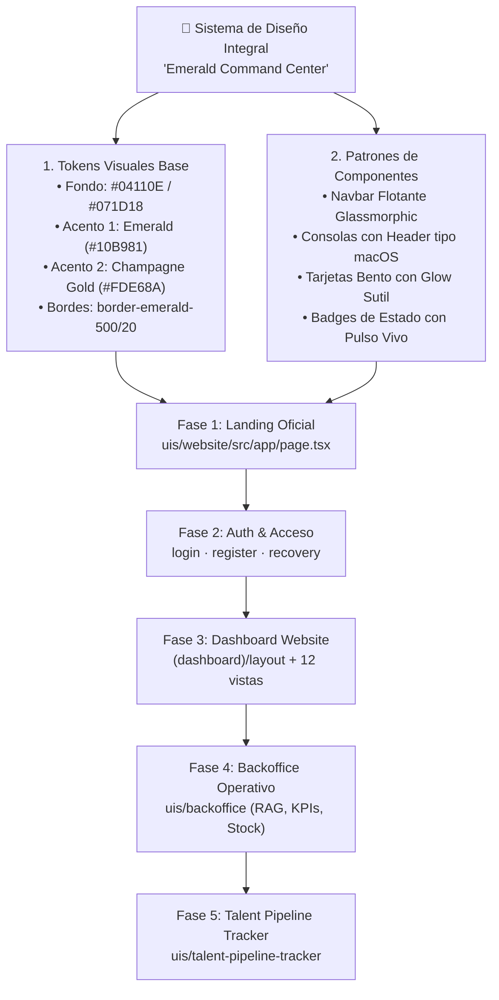

# Implementation Plan: Arquitectura de Diseño Integral "Emerald Command Center" (Multi-UI)

> **Clasificación según Code Refinement Suite:** **Nivel 3 — Arquitectura / Módulo Crítico (Alta Complejidad)**  
> **Alcance:** Sistema de Diseño Unificado transversal a todas las UIs del monorepo (`uis/website`, `uis/backoffice`, `uis/talent-pipeline-tracker`), iniciando por la ruta principal de la Web Oficial (`/`).  
> **Dirección Visual Seleccionada:** *Opción 3 — Emerald FinTech & Command Center* (inspirada en *Ramp*, *Palantir Foundry* y *Brex*).

---

## 🏛️ PACK 1: ARCHITECT (Ideación y Decisión Técnica)

### 1.1 Evaluación de Alternativas con *Tree of Thoughts (ToT)*

| Rama Arquitectónica | Ventajas | Riesgos / Desventajas | Veredicto |
| :--- | :--- | :--- | :--- |
| **Rama A: Rediseño aislado vista por vista sin tokens compartidos** | Rápido en la primera pantalla. | Genera inconsistencia cromática entre `website` y `backoffice`, duplicación de clases y deuda técnica difícil de mantener. | ❌ **Descartada** |
| **Rama B: Instalar una librería UI externa pesada (MUI / Ant Design / Chakra)** | Componentes prefabricados. | Rompe la identidad a medida *Emerald Command Center*, penaliza el bundle size (WPO), entra en conflicto con Tailwind CSS v4 y exige refactorizar la lógica existente. | ❌ **Descartada** |
| **Rama C: Arquitectura de Tokens CSS en Tailwind v4 + Despliegue en 5 Fases Progresivas (Seleccionada)** | Cero dependencias externas, rendimiento óptimo (100% Tailwind + SVG nativo), identidad visual única en todo el monorepo y migración segura pantalla por pantalla sin romper la lógica de negocio. | Requiere disciplina en el orden de migración (de la Landing Pública hacia los Dashboards internos). | ✅ **Seleccionada** |

---

### 1.2 Comité de los 3 Expertos

* **🎨 UX/UI Lead:**
  - *Aprobado.* El sistema cromático **Forest-Slate (`#04110E` / `#071D18`)** combinado con acentos **Emerald (`#10B981` / `emerald-400`)** y **Champagne Gold (`#FDE68A` / `amber-200`)** dota a Nexova Solutions de una personalidad ejecutiva inconfundible.
  - Se garantiza un ratio de contraste superior a `7:1` en titulares y `4.5:1` en textos secundarios (cumplimiento **WCAG 2.1 AA**), además de estados `:focus-visible` con anillo esmeralda (`outline-emerald-400`) para navegación por teclado.
* **👨‍💻 Dev Lead:**
  - *Aprobado.* Se estandarizan variables CSS semánticas en `globals.css` (`--nx-bg-base`, `--nx-surface-glass`, `--nx-border-emerald`, `--nx-accent-gold`) compatibles con Tailwind v4. Todas las vistas conservarán intactos sus hooks (`useAuth`, llamadas Axios/Fetch, estados de carga y rutas).
* **🔐 Sec Specialist:**
  - *Aprobado.* El rediseño es estrictamente de capa de presentación. No se alteran los flujos de autenticación JWT, los interceptores de `axios.ts`, las reglas de proxy en `next.config.ts` ni los controles de rol en las rutas protegidas `(dashboard)`.

---

## 📝 PACK 2: PLANNER (Abstracción y Refinamiento en 3 Ciclos)

### 2.1 Abstracción del Sistema de Diseño (*Step-Back Prompting*)

Para que las **3 aplicaciones frontend** del monorepo se sientan como **una única plataforma empresarial cohesiva**, definimos los siguientes pilares de diseño:

#### Especificación de Tokens Visuales
| Token Semántico | Valor / Clase Tailwind | Uso Principal |
| :--- | :--- | :--- |
| **Canvas Principal** | `bg-[#04110E]` | Fondo base de las páginas y layouts. |
| **Superficie Elevada (Glass)** | `bg-[#071D18]/80 backdrop-blur-xl` | Navbars, consolas, sidebars y tarjetas principales. |
| **Superficie de Módulo Interno** | `bg-[#09221C]/90` | Sub-paneles dentro del *Unified Command Center*, tablas y formularios. |
| **Borde Arquitectónico** | `border border-emerald-500/20` | Delimitación sutil de contenedores y tarjetas. |
| **Acento Primario (Acción/IA)** | `bg-emerald-400 text-[#04110E]` / `text-emerald-400` | CTAs principales, nodos activos de LangGraph, métricas positivas. |
| **Acento Ejecutivo (Valor)** | `from-amber-200 via-amber-100 to-amber-300` | Palabras clave en titulares, distinciones estratégicas y alertas suaves. |

---

### 2.2 Ciclo de Auto-Refinamiento (*Self-Refinement Loop — 3 Ciclos*)

1. **Ciclo 1 (Estructura Inicial):** Se planteó aplicar el tema oscuro únicamente al Hero de la página principal. *Crítica:* Si el usuario navega de la Home al `/login` o al `/admin/panel` y se encuentra con pantallas blancas/azules básicas, se rompe la ilusión de plataforma empresarial integrada.
2. **Ciclo 2 (Homogeneización Multi-UI):** Se estructuró el plan en 5 fases secuenciales que cubren las 28 rutas identificadas en `uis/website`, `uis/backoffice` y `uis/talent-pipeline-tracker`, reutilizando los mismos tokens de superficie, cabeceras y tablas.
3. **Ciclo 3 (Optimización WPO & Interactividad Real):** En la Fase 1 (`uis/website/src/app/page.tsx`), el **Unified Command Center** no será una imagen estática: se maquetará en código nativo interactivo mostrando los 3 motores reales del monorepo (**AI Candidate Scoring 98/100**, **Live LangGraph Support Agent 30ms** con selector de ruta Tool/RAG, y **Telemetría en Tiempo Real**).

---

## 🗺️ Mapa de Trabajo por Fases (Roadmap)

### Fase 1: Fundación Visual y Ruta Principal de la Web Oficial (`uis/website`)
- [x] **Paso 1.1 (`uis/website/src/app/globals.css` y `layout.tsx`):** Definir variables CSS del tema *Emerald Command Center* sobre base metalizada oscura (`#0a0d12`) con malla espacial animada y escala tipográfica `+2px`, configurar la fuente `Geist` como predeterminada y actualizar el `metadata` oficial (*"Nexova Solutions | Plataforma B2B de Talento, Soporte IA y Operaciones"*).
- [x] **Paso 1.2 (`uis/website/src/app/page.tsx`):** Implementar la nueva Landing Page con:
  - Navbar flotante *glassmorphic* y detección de sesión activa (`useAuth`).
  - Hero centrado con badge luminoso, titular con acentos *Champagne Gold* & *Emerald* y doble CTA.
  - **Unified Command Center** interactivo de 3 paneles (Scoring IA 98/100, Consola LangGraph en vivo y Gráfica de Telemetría).
  - Sección de las 3 Líneas de Negocio en formato Bento Grid ejecutivo + Footer corporativo.
- [x] **Paso 1.3 (Verificación Fase 1):** Comprobar compilación limpia y renderizado en `http://localhost:3000`.

### Fase 2: Flujo de Autenticación de la Web Oficial (`uis/website`)
- [x] **Paso 2.1 (`uis/website/src/app/login/page.tsx`):** Rediseñar la tarjeta de inicio de sesión con estética *Emerald Glass*, inputs oscuros con foco esmeralda y alertas de error estilizadas.
- [x] **Paso 2.2 (`uis/website/src/app/register/page.tsx`):** Alinear el formulario de registro corporativo con el nuevo sistema visual.
- [x] **Paso 2.3 (`forgot-password/page.tsx` y `reset-password/page.tsx`):** Unificar las pantallas de recuperación de credenciales.

### Fase 3: Dashboard Corporativo y Módulos Internos (`uis/website/src/app/(dashboard)`)
- [x] **Paso 3.1 (`(dashboard)/layout.tsx`):** Transformar el Sidebar y Topbar del portal interno en una consola ejecutiva *Emerald Command Center* con fondo metalizado oscuro y malla espacial animada.
- [x] **Paso 3.2 (`admin/panel/page.tsx`, `admin/page.tsx`, `admin/tickets/page.tsx`):** Rediseñar las tarjetas de KPIs departamentales y listado de tickets.
- [x] **Paso 3.3 (`scoring/page.tsx` y sub-rutas `candidates/*` + componentes `CandidateCard`, `CandidateFilters`, `CandidateForm`):** Aplicar el estilo del módulo *AI Candidate Scoring* a las tarjetas y formularios de candidatos.
- [x] **Paso 3.4 (`incidents/page.tsx`, `incidents/new/page.tsx`, `suppliers/page.tsx`, `support/page.tsx`, `account/*`):** Completar la migración visual de las tablas operativas y perfil de usuario.

### Fase 4: Unificación del Backoffice Operativo (`uis/backoffice`)
- [x] **Paso 4.1 (`uis/backoffice/src/app/layout.tsx` y `login/page.tsx`):** Aplicar los tokens *Emerald Command Center* al shell del Backoffice (puerto 3001).
- [x] **Paso 4.2 (`uis/backoffice/src/app/knowledge/page.tsx`):** Estilizar la consola de consultas a la Base de Conocimiento (RAG) y trazas del Agente.
- [x] **Paso 4.3 (`uis/backoffice/src/app/reporting/page.tsx`):** Rediseñar los paneles de telemetría y métricas de negocio.
- [x] **Paso 4.4 (`uis/backoffice/src/app/inventory/*`):** Alinear las vistas de activos, stock y órdenes de entrada/salida.

### Fase 5: Unificación de `talent-pipeline-tracker` y Auditoría Final (PACK 4)
- [x] **Paso 5.1 (`uis/talent-pipeline-tracker/app/*`):** Aplicar la identidad visual al tracker standalone.
- [x] **Paso 5.2 (Auditoría WPO, Accesibilidad WCAG 2.1 AA y Build Global):** Ejecutar verificación de tipos (`tsc --noEmit`) en las UIs y validar contraste, responsividad móvil y cero regresiones funcionales.

---

## ⚙️ Métodos Aplicados (Code Refinement Suite)

1. **Tree of Thoughts (ToT):** Se contrastaron tres caminos arquitectónicos antes de escribir código, eligiendo un sistema de tokens ligeros sobre Tailwind CSS v4 y componentes nativos en lugar de librerías pesadas de terceros o parches aislados.
2. **Step-Back Prompting (Abstracción):** Antes de abordar `page.tsx`, se abstrajeron los tokens cromáticos (`#04110E`, `#071D18`, `#10B981`, `#FDE68A`) y los patrones de superficie para garantizar que la Landing Page, el Dashboard interno y el Backoffice compartan el mismo ADN visual.
3. **Self-Refinement Loop (3 Ciclos):** El plan evolucionó desde un cambio cosmético en la portada hasta una hoja de ruta integral en 5 fases que abarca las 28 vistas del ecosistema frontend.
4. **Chain of Verification (CoVe):** Se inventariaron todas las rutas reales existentes en `uis/website`, `uis/backoffice` y `uis/talent-pipeline-tracker` para asegurar que ningún módulo quede huérfano ni se rompan importaciones como `useAuth` o `trackerApi`.
5. **Red Teaming & WCAG/WPO Guardrails:** Se diseñaron los paneles complejos (*Unified Command Center*) usando SVG vectorial ligero y CSS nativo en lugar de imágenes rasterizadas pesadas, manteniendo tiempos de carga instantáneos (LCP óptimo) y contraste accesible.

