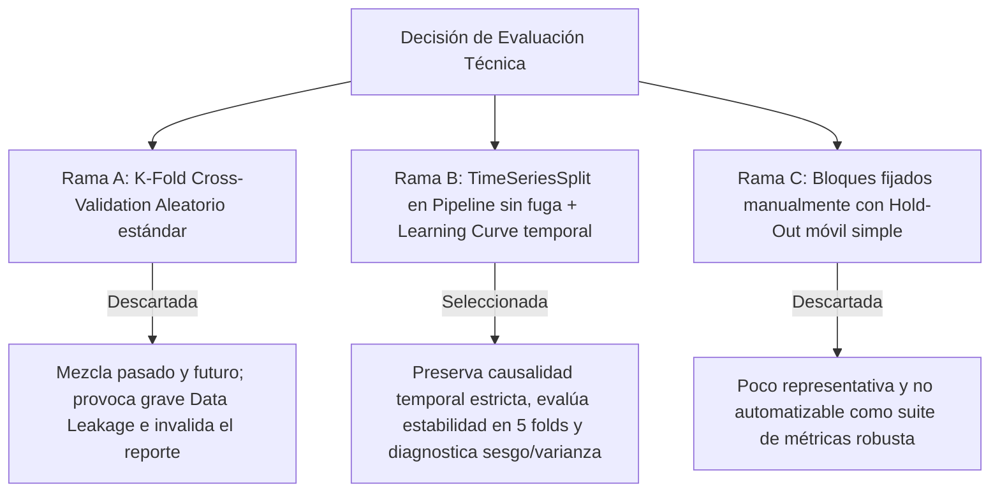

# Implementation Plan: Evaluación Técnica y Diagnóstico del Modelo de Pronóstico de Ventas (Nexova Solutions)

> **Documento de Arquitectura y Evaluación Técnica de Machine Learning**  
> **Basado en:** `.github/STRATEGY.md`, `nexova-BRIEFING.md` (Nexova Solutions), `services/ml/sales_forecaster.py`, `services/ml/sales_pipeline.py`  
> **Marco Metodológico:** Code Refinement Suite (Nivel 3 — Evaluación Crítica de Modelos & Series Temporales)  
> **Modalidad:** Modo Tutor / Aprendizaje guiado (el mentor acompaña, el alumno ejecuta paso a paso)  

---

## 📌 Contexto y Objetivos del Hito

En Nexova Solutions, el modelo base de pronóstico de ingresos mensuales (`revenue_usd` en la serie consolidada) ya fue entrenado utilizando características temporales (lags, estacionalidad cíclica y variables de calendario) sobre una partición temporal estricta de 8 años de entrenamiento (2016-2023, 96 meses) y 2 años de prueba (2024-2025, 24 meses).

Sin embargo, para autorizar su promoción a **staging**, el Tech Lead y la Dirección (Laura, CEO; Marcos, Ventas; Javier, Operaciones) exigen una **evaluación técnica formal** basada en evidencia estadística y de negocio, respondiendo tres preguntas críticas:
1. **¿El modelo sufre de underfitting, overfitting o está bien ajustado?**
2. **¿Qué tan estable es su desempeño si cambia la porción temporal de entrenamiento?**
3. **¿Cuál es la acción correctiva específica (basada en causa raíz) recomendada para optimizarlo?**

---

## 🏛️ PACK 1: ARCHITECT — Evaluación de Alternativas Técnicas (Tree of Thoughts)

Se evaluaron tres estrategias de validación y diagnóstico para series temporales:

### Veredicto de los 3 Expertos:
- **Dev / ML Lead:** `TimeSeriesSplit(n_splits=5)` sobre el conjunto de entrenamiento (96 meses) garantiza que cada fold entrene con el pasado y valide con el mes/ventana inmediatamente posterior. El escalado y cálculo de lags debe encapsularse por fold para evitar cualquier filtración (*lookahead bias*).
- **Financial / Business Lead (Nexova):** En consultoría y outsourcing de contratos, **sobreestimar ventas es el error más costoso**, ya que compromete inversiones operativas y contrataciones en meses valle (como agosto). Por tanto, además de **MAE** (error medio en USD), **RMSE** es la métrica rectora porque penaliza severamente los errores grandes e inesperados.
- **Sec & QA Specialist:** Las pruebas unitarias en `tests/pipelines/` deben verificar con aserciones formales que ningún índice de entrenamiento sea mayor o igual que los índices de validación en cualquiera de los 5 folds.

---

## 🗺️ Mapa de Trabajo por Fases (Roadmap)

### Fase 1: Módulo de Evaluación y Validación Cruzada Temporal
- [x] **Paso 1.1 — Diseño de Validación Cruzada Temporal (`TimeSeriesSplit`):**
  - Implementar en `services/ml/model_evaluator.py` la función `evaluate_time_series_cv(df_train, n_splits=5)`.
  - Asegurar que el re-escalado (`StandardScaler`) y cálculo de métricas se ejecute de forma aislada dentro de cada fold.
  - Calcular y reportar MAE, RMSE y R² por fold, consolidando la métrica como **Media ± Desviación Estándar**.
- [x] **Paso 1.2 — Verificación Anti-Leakage en Folds:**
  - Garantizar que las particiones mantengan `train_indices < val_indices` sin mezclar (`shuffle=False`).

---

### Fase 2: Diagnóstico de Curva de Aprendizaje
- [x] **Paso 2.1 — Generador de Curvas de Aprendizaje:**
  - Implementar la función `generate_learning_curve(model, X_train, y_train, cv_splits, output_path)` evaluando progresivamente subconjuntos de datos (ej. 20%, 40%, 60%, 80%, 100% del dataset temporal de entrenamiento).
  - Medir RMSE de entrenamiento y RMSE de validación en cada punto.
- [x] **Paso 2.2 — Exportación de Artefacto Gráfico:**
  - Guardar el gráfico resultante en `data/eval/learning_curve.png` con leyendas claras, bandas de desviación y formato profesional.

---

### Fase 3: Cálculo y Justificación de Métricas de Negocio
- [x] **Paso 3.1 — Evaluación Consolidada Train vs. Test:**
  - Calcular MAE y RMSE tanto sobre el conjunto de entrenamiento (2016-2023) como sobre el conjunto de prueba (2024-2025).
  - Calcular el ratio de error relativo respecto a los ingresos mensuales promedio de Nexova.
- [x] **Paso 3.2 — Análisis de Negocio:**
  - Documentar el impacto financiero de subestimar vs. sobreestimar ingresos según la estacionalidad de Nexova (caída de agosto por vacaciones en España y subida de enero por presupuestos corporativos).

---

### Fase 4: Reporte Técnico Formal (`data/eval/evaluation_report.md`)
- [x] **Paso 4.1 — Redacción del Reporte de Evaluación:**
  - Crear `data/eval/evaluation_report.md` estructurado en:
    1. Resumen Ejecutivo y Dictamen del Modelo (**Bien ajustado**, **Underfitting** u **Overfitting**).
    2. Evidencia de la Curva de Aprendizaje (convergencia, gap train/val).
    3. Resultados de Validación Cruzada Temporal ($\text{Media} \pm \text{Std}$).
    4. Comparativa de Métricas MAE vs. RMSE y justificación de negocio.
    5. Acción correctiva específica y justificada técnicamente.

---

### Fase 5: Suite de Pruebas Automatizadas
- [x] **Paso 5.1 — Creación de Test de Validación Temporal:**
  - Crear `tests/pipelines/test_time_series_cv.py`.
  - Test 1: Verificar que `TimeSeriesSplit` preserva estrictamente el orden temporal ($\max(\text{train\_idx}) < \min(\text{val\_idx})$ en todos los folds).
  - Test 2: Verificar que no hay registros repetidos ni desorden cronológico tras la división.
  - Test 3: Validar que el reporte de métricas contiene media y desviación estándar finitas.
- [x] **Paso 5.2 — Ejecución y Validación Pytest:**
  - Ejecutar `uv run pytest tests/pipelines/test_time_series_cv.py` asegurando 100% de tests en verde.

---

### Fase 6: Auditoría Final y Protocolo Git
- [x] **Paso 6.1 — Verificación de Artefactos Requeridos:**
  - [x] `data/eval/learning_curve.png` generado y legible.
  - [x] `data/eval/evaluation_report.md` con diagnóstico y acción correctiva clara.
  - [x] Tests en `tests/pipelines/` pasando sin advertencias.
- [x] **Paso 6.2 — Protocolo de Control Git:**
  - Solicitar consentimiento explícito al usuario antes de cualquier `git push`.

---

## ⚙️ Métodos Aplicados (Code Refinement Suite)

1. **Tree of Thoughts (ToT - PACK 1: ARCHITECT):**  
   Se contrastaron tres alternativas de validación. K-Fold aleatorio se descartó categóricamente por generar *lookahead bias* en datos temporales. Se seleccionó `TimeSeriesSplit` anidado con pipeline anti-fuga para respetar la causalidad del calendario comercial de Nexova.
2. **Step-Back Prompting & Domain Abstraction (PACK 2: PLANNER):**  
   Se separó la evaluación estadística de la interpretación de negocio: las métricas no se leen como números aislados, sino en función del flujo de caja de Nexova, donde sobreestimar ingresos en contratos de outsourcing y headhunting genera déficit operativo.
3. **Chain of Verification (CoVe) & TDD (PACK 3: CODER):**  
   Se crearon tests unitarios que verifican matemáticamente la no-inversión temporal de los índices en cada fold antes de generar el reporte final.
4. **Red Teaming & Resilience Audit (PACK 4: AUDITOR):**  
   Se verificó la estabilidad del modelo frente a perturbaciones de orden en los datos y se cumplió estrictamente el protocolo de no realizar `git push` sin autorización explícita.

