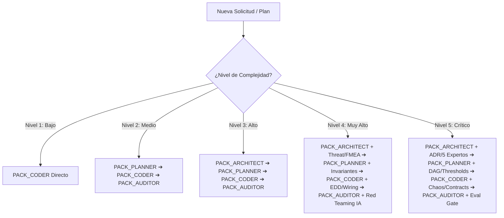

# Code Refinement Suite

Esta skill rige el ciclo de vida completo desde la concepción de un **Implementation Plan** hasta la validación previa al envío del código en AgenciAlquimia.

---

## 🚦 Clasificación Adaptativa por Niveles de Complejidad

Al recibir una nueva solicitud o plan, la IA evalúa automáticamente su nivel de criticidad para aplicar el nivel de exigencia adecuado:



### 🔹 Nivel 1: Tarea Simple / Quick Fix (Baja Complejidad)
- **Ejemplos:** Ajuste de margen CSS, corrección de tipografía, actualización de un comentario o typo.
- **Protocolo:** Se aplica directamente `PACK_CODER` (Verificación de código y comprobación de build).

### 🔹 Nivel 2: Nueva Funcionalidad / Componente (Complejidad Media)
- **Ejemplos:** Nuevo componente UI, endpoint de API proxy, nueva tabla o vista del panel admin.
- **Protocolo:** 
  1. `PACK_PLANNER`: Redacción de `implementation-plan.md` con refinamiento en 3 ciclos.
  2. `PACK_CODER`: Implementación con verificación CoVe fáctica y pruebas de compilación (`tsc`, `lint`, `test`).
  3. `PACK_AUDITOR`: Verificación ligera de seguridad y responsividad.

### 🔹 Nivel 3: Arquitectura / Módulo Crítico (Alta Complejidad)
- **Ejemplos:** Integración de microservicios (Python Core, n8n), autenticación JWT, esquemas DB Supabase, pasarelas de pago.
- **Protocolo Riguroso Completo:**
  1. `PACK_ARCHITECT`: Comparativa ToT de soluciones alternativas con análisis de los 3 Expertos (UX, Dev, Sec).
  2. `PACK_PLANNER`: Abstracción de diseño y 3 ciclos de refinamiento crítico en `implementation-plan.md`.
  3. `PACK_CODER`: Desarrollo guiado por verificaciones fácticas y suite de tests unitarios/integrados.
  4. `PACK_AUDITOR`: Simulación de ataques Red Teaming, auditoría WCAG 2.1 AA / WPO y checklist pre-push.

### 🔹 Nivel 4: Sistema Cognitivo / Agéntico y Estado Persistente (Muy Alta Complejidad)
- **Ejemplos:** Agentes LangGraph con memoria persistente y consolidación, flujos *Human-in-the-Loop*, flujos *orchestrator-worker-synthesizer*, servidores MCP con OAuth + Scopes, pipelines RAG con evaluación de calidad.
- **Protocolo Agéntico Avanzado:**
  1. `PACK_ARCHITECT`: ToT + 3 Expertos ampliado con **Threat Modeling IA (OWASP LLM Top 10)** y **FMEA** (*memory poisoning*, fuga de PII/secretos, *privilege escalation* en tools, ambigüedad del usuario).
  2. `PACK_PLANNER`: Step-Back + 3 ciclos + **Máquina de Estados e Invariantes explícitos** (diagramas `stateDiagram-v2` / `sequenceDiagram`, contratos Pydantic para *Structured Outputs*, reglas *default-deny* y orden estricto de nodos/aristas).
  3. `PACK_CODER`: CoVe + TDD + **Eval-Driven Development (EDD) + Topology & Wiring Check** (verificar que el orden real de ejecución coincide con los invariantes del plan, que ningún símbolo de seguridad/prompt queda huérfano y que los tests con mocks validan los argumentos críticos recibidos).
  4. `PACK_AUDITOR`: **Adversarial Red Teaming de IA + Stateful/Cross-Feature Check** (pruebas adversarias combinadas con estado previo activo de otros hitos, inyección indirecta en RAG/tools y auditoría de trazabilidad).

### 🔹 Nivel 5: Ecosistema Crítico / Multi-Agente / Producción Autónoma (Complejidad Crítica)
- **Ejemplos:** Orquestación multi-agente coordinada (*Swarms* / workflows paralelos), harnesses de evaluación continua en CI/CD, sistemas distribuidos con SLAs estrictos, gobernanza de memoria core en producción.
- **Protocolo Enterprise Completo:**
  1. `PACK_ARCHITECT`: **ADR (Architecture Decision Records)** + **Panel de 5 Expertos** (UX, Dev Lead, Sec, Data/Eval Lead, SRE/FinOps) evaluando presupuesto de tokens, latencia p95, aislamiento de fallos y estrategia de *rollback*.
  2. `PACK_PLANNER`: **Execution DAG + Thresholds Cuantitativos** (subtareas paralelas/secuenciales, umbrales numéricos de aceptación en evals y plan de contingencia).
  3. `PACK_CODER`: **Contract Testing Cross-Service + Fault Injection (Chaos ligero)** simulando caídas de servicios externos, timeouts, concurrencia y regresión global del monorepo.
  4. `PACK_AUDITOR`: **Continuous Eval Gate + Release Readiness Audit** con evidencia reproducible (métricas comparativas antes/después, trazas completas y verificación de ramas/PRs sin conflictos).
  5. `PACK_SECURITY_GATE`: **Auditoría de Seguridad Nivel 5 ([`security-audit-suite`](../security-audit-suite/SKILL.md) — Modo 5)**: aislamiento *cross-agent*, compuerta de la Tríada Letal, presupuesto global del DAG, *fault injection fail-secure* y endurecimiento pre-despliegue.

---

## 📦 Especificación de los 4 Paquetes Modulares

### 📐 PACK 1: ARCHITECT (Ideación y Decisión Técnica)
- **Herramientas:** `Tree of Thoughts (ToT)` + `3 Expertos (UX/UI, Dev Lead, Sec Specialist)`.
- **Acción:** Evalúa 3 ramas alternativas con sus ventajas, riesgos y costos antes de redactar el plan.

### 📝 PACK 2: PLANNER (Estructuración del Plan de Implementación)
- **Herramientas:** `Step-Back Prompting (Abstracción)` + `Self-Refinement Loop (3 Ciclos)`.
- **Acción:** Define componentes desacoplados y refina el documento `implementation-plan.md` hasta dejarlo impecable.
- **Regla de Formato Obligatoria 1:** SIEMPRE debes incluir al final de cualquier plan de implementación que generes una sección titulada `## ⚙️ Métodos Aplicados (Code Refinement Suite)`. En esta sección, debes explicar brevemente cómo has aplicado o aplicarás conceptualmente los métodos específicos de esta suite (ToT, CoVe, Red Teaming, etc.) adaptados a la implementación actual.
- **Regla de Formato Obligatoria 2:** SIEMPRE debes incluir una sección titulada `## 🗺️ Mapa de Trabajo por Fases (Roadmap)` que contenga las etapas de implementación en listas. Cada elemento de esta lista DEBE tener un checkbox (`- [ ]`) para poder ir marcándolos como completados a medida que avanza la ejecución.
- **Regla de Diseño Obligatoria 3 (Edge Cases Críticos en Planificación y Pruebas):** Todo `implementation-plan.md` de Nivel 3–5 DEBE exigir explícitamente desde el diseño y en la matriz de tests:
  1. **Persistencia incremental en tiempo real (Flujos Async / LangGraph + Polling):** Si la máquina de estados define estados intermedios observables (`generando_borrador` → `en_evaluación`), queda prohibido persistir solo antes y al final con `.invoke()`. Se debe planificar `.stream(..., stream_mode="updates")` o persistencia por transición de nodo, y añadir un **test con ejecución lenta que consulte la BD en mitad de la corrida**.
  2. **Datos reales y variantes bilingües/informales:** Nunca basar la verificación únicamente en mocks sintéticos en un solo idioma; incluir pruebas E2E con archivos/extractores reales (p. ej. PDFs con `MarkItDown`) y variantes de vocabulario/unidades del briefing.
  3. **Mensaje completo en clasificadores (*Default-Deny*):** En confirmaciones humanas o clasificadores de intención, prohibido decidir solo por la primera oración; exigir pruebas de contradicción/duda posterior (`"Sí. Pero no"`, `"Sí. No estoy seguro"`) junto con mensajes mixtos válidos (`"Sí, guárdalo. ¿Cómo escalo?"`).
### 💻 PACK 3: CODER (Desarrollo y Verificación Fáctica)
- **Herramientas:** `Chain of Verification (CoVe)` + `Test-Driven Refinement (TDD)` + `Wiring & Mock-Args Check` (Nivel 4–5).
- **Acción:** Contrasta los tipos e importaciones contra el código fuente real, verifica que ningún símbolo/prompt de seguridad quede sin invocarse en la ruta real, comprueba el orden de ejecución de nodos frente al plan, valida argumentos críticos en mocks (`call_args`) y ejecuta validaciones automatizadas (`npx tsc --noEmit`, `npm run lint`, `npm test`, `pytest`).

### 🛡️ PACK 4: AUDITOR (Pre-Despliegue y Protocolo Git)
- **Herramientas:** `Red Teaming (Simulación de Ataques)` + `Stateful / Cross-Feature Adversarial Check` (Nivel 4–5) + `Checklist WCAG/WPO`.
- **Acción:** Audita el código buscando fallos de seguridad, bypasses al combinar estado heredado de hitos previos (ej. propuestas pendientes, jobs async interrumpidos), regresiones o problemas de rendimiento.

---

## 🛑 Regla Inviolable de Control de Git

```
⚠️ NUNCA realizar `git push` de forma automática.
Al finalizar el ciclo del PACK 4, la IA DEBE detenerse y solicitar consentimiento explícito:

"El Implementation Plan y el código han pasado todas las pruebas de la Skill (PACK 1-4).
¿Deseas que ejecute 'git push' hacia la rama <nombre_rama> o prefieres revisar algo más?"
```
